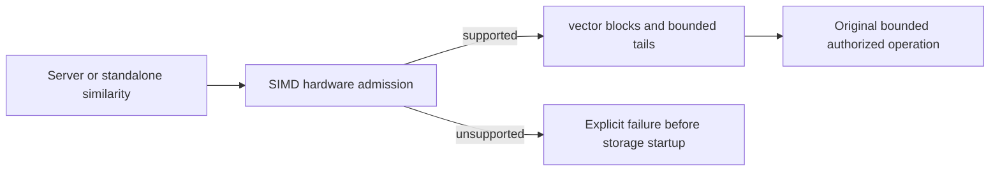
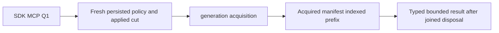

# Search

Search covers authorized text, vector, graph and hybrid retrieval over committed ZoneTree data. The delivery contracts of its children are [FilteredRetrieval](Search/FilteredRetrieval.md), [GraphRetrieval](Search/GraphRetrieval.md), [EventProjectionLineage](Search/EventProjectionLineage.md), [FullTextProjection](Search/FullTextProjection.md), [ManagedAnn](Search/ManagedAnn.md) and [OnlineGenerationLifetime](Search/OnlineGenerationLifetime.md). Index generations are disposable node-local storage state derived from canonical committed records; they are never an authority for acknowledged writes, authorization or replication. Distributed search is performed by Orleans grains that query the partitions through ordinary Orleans calls and merge the results; cluster concept: [ADR-136](../ADR/ADR-136-orleans-partition-ownership.md).

ZoneTree.FullTextSearch is the selected full-text provider under [ADR-071](../ADR/ADR-071-canonical-zonetree-providers.md) and the projection/freshness boundaries of [ADR-009](../ADR/ADR-009-search-provider-boundaries.md). Canonical-commit/index-generation freshness, tokenizer/hash/rank parity, nonpartial cancellation, authorization/read cuts, rebuild/rollback and resource bounds are frozen in [ADR-078](../ADR/ADR-078-full-text-projection.md). The provider's query language does not replace SQL.

| Requirement | Acceptance | Mapping |
|---|---|---|
| REQ-ZT-003: the selected full-text provider is a bounded derived projection | AC-ZT-003: the centrally pinned ZoneTree.FullTextSearch, an authorized exact token/identity/rank oracle, nonpartial cancellation and real replay/rebuild/swap tests on the Aspire replicated cluster pass; stale or corrupt generations cannot return success | Search provider tests, process recovery and SDK/official MCP tests |

## Resource contract for exact reads

Decision: [ADR-035](../ADR/ADR-035-memory-performance.md). Scope: exact persisted-policy text/vector/hybrid reads under one committed apply cut. Public request/response JSON, BM25 tokenization and reciprocal-rank fusion remain identical.

| Requirement | Acceptance / pass and fail condition | Test and evidence |
|---|---|---|
| REQ-SR-001 | AC-MP-004: every visible corpus document still affects BM25 count/average/term frequency, including missing fields; ranks, ordinal ID ties, normalization and query-term accumulation are exact | Real-store Unicode/repeated/missing/nonmatching corpus and golden score/rank cases |
| REQ-SR-002 | AC-MP-004: vector candidates obey space/revision/row/field authorization; query finite/dimension/metric validation occurs once; the SIMD metric preserves accumulation | Real-store stale/hidden/mismatched-space cases plus finite/zero/large-vector metric golden cases |
| REQ-SR-003 | AC-MP-003/004: scans consume scoped borrowed records; retained rank state contains identity/statistics/scores rather than full corpus JSON/vector arrays | Real large-payload rank cases, bounded read failures and allocation/resource artifacts |
| REQ-SR-004 | AC-MP-004/005: branch ranks and text-then-vector RRF accumulation are unchanged; at most Limit results are selected before decoding/projecting final payloads and the actual final point reads are accounted | Exact text/vector/hybrid ranks, ties/weights, shared-budget and output boundary cases |
| REQ-SR-005 | AC-MP-004/012: cancellation/work/result exhaustion leaves the committed position unchanged and a following call succeeds; no unbounded gate/iterator lifetime | Real persisted-policy cancellation/overflow/healthy-following-call tests; SDK/MCP integration |
| REQ-SR-006 | AC-MP-003/004/011/012: all analytical engines on one DatabaseEngine hold one counted reservation that never refuses a read; cancelled calls perform no ranking or storage work and release their reservation | Real-store mixed-entry admission/release cases in UnitTests/Features/ResourceExecution |

```mermaid
flowchart LR
    Caller --> Validate[Validate and prepare query]
    Validate --> Cut[Authorize within one read cut]
    Cut --> Corpus[Visit visible corpus records]
    Corpus --> Metadata[Keep bounded identity and rank statistics]
    Metadata --> Fusion[Exact branch ranks and fusion]
    Fusion --> Top[Select requested top results]
    Top --> Project[Budgeted selected point reads and projection]
    Project --> Output[Measure complete response]
```

The Core document-storage keys and the visible-document and visible-vector readers use the existing read view and one ReadExecutionBudget. Both visitor methods decode a single record, check persisted row visibility and invoke an owned-record callback without accumulating a full page; vector visits read each referenced document and reject stale/deleted/hidden candidates as before. The array-returning read helpers consume the same visitor algorithm. No callback may mutate the read transaction or escape the cut.

Text ranking retains lengths and query-term counts plus identities only for matching records; all visible documents still contribute corpus statistics. The text JSON pointer is compiled once. Vector ranking retains identities and scores, prepares the finite validation and cosine norm once, computes only the chosen metric and preserves the Vector.Widen/Vector.Dot/scalar-tail reduction grouping. Exact hybrid fusion requires bounded metadata for every ranked candidate (dropping branches to Limit before fusion is forbidden); a bounded top-result heap then selects final payloads. Final selected point reads trade at most Limit extra reads for removing full-corpus payload retention, stay inside the same read cut and the shared operation's cancellation and expiry. `DocumentStorageKeys.RecordKey` and `Prefix` supply canonical keys to both visitors and selected reloads.

REQ-SR-003/004/005 also fix the shared text/vector byte boundary: with two documents, a vector and lineage, the shared hybrid request must exceed the budget by its additional corpus document read, including the Resource key/payload and the absent BM25-head key in the arithmetic, while each isolated branch returns its complete literal records and ranks; limits are not raised and a healthy follow-up and a cold reopen keep complete rows and position. Coverage includes missing/empty text, Unicode, repeated terms, differing corpus lengths, same-score IDs, zero vectors, nonfinite values, dimension/space mismatch, stale revision, hidden/redacted fields, exact and excess byte/output/work budgets, cancellation and recovery of subsequent reads, on real ZoneTree with persisted policy. UI and data migration are N/A because the stored format and wire shape do not change.

## SIMD execution

REQ-SIMD-005: the normal product requires hardware-accelerated .NET SIMD. Core owns `Features/Search/Validation/SimdRuntime.cs` and the public `KeyLoad.SimdRuntime.RequireHardwareSupport()` admission. `System.Numerics.Vector.IsHardwareAccelerated` admits the supported CPU's .NET implementation; unsupported execution throws an explicit `PlatformNotSupportedException`. The server calls that admission before serialization initialization, configuration construction or node-local storage acquisition; standalone similarity validates its dimension bounds and then calls the same admission before vector validation. There is no scalar fallback and no SIMD disable selection; Vector finite blocks, Widen/Dot accumulation, bounded scalar tails, error order, authorization, read cuts, cancellation and the original metrics are preserved.

AC-SIMD-005 maps REQ-SIMD-005 to the VectorMetricValidationTests, VectorMetricGoldenTests and CanonicalVectorPublicMetricTests whole operations: every lane and tail keeps its finite/error result (NaN, +Infinity and -Infinity at every full-block lane and scalar-tail position; empty, 4097 and mismatched dimensions; query validation before invalid metric); lengths 1, the runtime vector width, width+1, two widths+1 and 4096 preserve the selected metric goldens, finite extremes and zero-vector handling; the three canonical metrics exercise a real complete block plus a bounded tail, full authorized pages, cancellation without effects and a healthy continuation. Only full finite-validation blocks use portable `Vector.Abs` and strict `Vector.LessThanAll(..., +Infinity)`; the length check, scalar `float.IsFinite` tail and all metric reductions are identical. Unsupported hardware is rejected rather than advertised as supported; no speed improvement is claimed without matched measurements.

REQ-SIMD-006: execution and qualification expose one normal SIMD-enabled profile; test selection rejects `unit-scalar` and inherited hardware/SIMD disable requests before launching a runner (AC-SIMD-006, `TUnitSelectionTests`).

REQ-EXECUTION-WAL-NORMAL-001 / AC-EXECUTION-WAL-NORMAL-001: the checksum-profile recovery test (`ChecksumProfileRecoveryTests.CurrentWalPreserves257RecordsAndBothAppendsAcrossFourProcesses`, no parameters) checks SIMD eligibility before opening its store and runs four real processes in seed, first-append, second-append and cold order; it retains the 257 corpus rows, both acknowledged command/receipt/outcome appends, original retry and conflicting-body refusal, complete persisted models/outbox, a byte-exact cold cut and the same-root identity. The parent passes only mode, root and phase; it never writes intrinsics environment variables. The actual guard `Vector.IsHardwareAccelerated && (Sse2.IsSupported || AdvSimd.IsSupported)` precedes storage acquisition. This is process recovery, not power-loss or performance qualification.

## Full search contract

Actors: an authorized text/vector/hybrid caller and the index-generation worker. Entry points: `SearchRequest`, `SearchEngine`, canonical vectors, the .NET SDK and HTTP search. Request-time lexical scoring, exact vector scoring and weighted rank fusion are distinct from provider-backed indexes.

| Requirement | Acceptance / flows | Test mapping |
|---|---|---|
| REQ-SEARCH-001: canonical vector space/revision/dimensions/metric have exact semantics | AC-SEARCH-001: a valid vector search matches the exact metric oracle; nonfinite/malformed/dimension/space mismatches are rejected; a stale/deleted vector is not in the result; finite large/zero values have declared handling | `HybridFusionRanksEligibleDocumentsAndInvalidatesStaleVectors`, `LargeFiniteVectorsAndSampleValuesRemainValidAndSimilarityDoesNotOverflow`; metric edge cases |
| REQ-SEARCH-002: lexical/hybrid branches have deterministic scoring, weights and ties | AC-SEARCH-002: empty/missing/repeated/Unicode terms and same-score IDs keep the lexical/fusion algorithm; corpus statistics and branch-rank windows are not truncated before exact fusion | Hybrid test and REQ-SR-001/004 golden cases; quality corpus per [ADR-018](../ADR/ADR-018-global-rank-fusion.md) |
| REQ-SEARCH-003: all branches use one authorized current cut | AC-SEARCH-003: hidden rows/vertices and protected field-use are forbidden; payload/metadata contain no omitted PII; invalid/revoked grants are rejected before unsafe scoring; selected point reads stay in the same cut | SecurityAndQueryTests, GraphAndSearchTests; SDK/MCP adversarial search |
| REQ-SEARCH-004: work, cancellation, results and freshness semantics are explicit | AC-SEARCH-004: the configured result ceiling and caller cancellation give a typed failure with a healthy following call; the source revision is checked; a derived watermark/generation is not advertised without an implementation | `PreCancellationDoesNotAdmitWorkOrPoisonTheNextSqlSearch` |
| REQ-SEARCH-005: provider/index lifecycle does not change canonical authority | AC-SEARCH-005: provider audit/rebuild/generation-swap/recovery tests prove the declared tokenizer/BM25 statistics/privacy/freshness; a missing or incompatible projection yields a declared error, never a silently weaker result | provider and recovery suites; [ADR-009](../ADR/ADR-009-search-provider-boundaries.md), [ChangeFeeds](ChangeFeeds.md) |
| REQ-SEARCH-006: ANN/global ranking/graph retrieval pass separate correctness-quality-resource gates | AC-SEARCH-006: an exact oracle and quality corpus verify recall, ties, filter/row scope, global candidate completeness, versioned rank and recovery; an unavailable capability is explicitly unsupported | [ADR-018](../ADR/ADR-018-global-rank-fusion.md), [ADR-019](../ADR/ADR-019-managed-ann.md), [ManagedAnn](Search/ManagedAnn.md) |

Frontend is N/A: no separate UI is requested. PII lineage: [ADR-015](../ADR/ADR-015-sensitive-data-lineage.md); budgets/security: [ADR-010](../ADR/ADR-010-query-budgets-security.md). Provider-backed BM25, qualified managed ANN, online generation swap, full freshness barriers and distributed global retrieval have separate contracts in the child documents. Qualification is only through real TUnit/recovery/Aspire-cluster SDK/MCP tests and actual JSON benchmarks, without invented speed/quality numbers.

[ManagedAnn](Search/ManagedAnn.md) defines the first-party packed managed HNSW candidate with explicit pre-allocation memory/work/scratch admission and independent real-store recall/metric/filter tests; no external ANN package is used. [ManagedAnnSeed](Search/ManagedAnnSeed.md), REQ/AC-ASD-001–006, defines a bounded Core/Search input seam: persisted minimum-grant authority, owned visible vectors and scalar source/applied/outbox metadata in one read cut, then charged ordinal sorting and exact-bit hashing outside the gate.

## Controlled quality corpus

REQ-SEARCH-007 / AC-SEARCH-007 add a controlled first-party quality oracle under [ADR-018](../ADR/ADR-018-global-rank-fusion.md). The corpus has 32 literal documents, fixed four-dimensional vectors and six literal query definitions (English, Ukrainian, repeated and missing text, graph-only discovery, selective allowed IDs and an empty allowed set). Query definitions and relevance grades 0..3 are authored before execution and never derive from observed ranks; persisted grants and independently declared eligible IDs define each query's eligible set. The judgments describe the controlled fixture only, not an external evaluation dataset or a production relevance target.

Pass requires real node-local ZoneTree documents, vectors, graph edges and persisted authorization, using the actual `SearchEngine.GraphSearchAsync`, the BM25 `TextRanker`, the exact-vector branch, the graph retriever and the ZoneTree.FullTextSearch projection. and scalar-tail lexical parity preserves IDs, scores and stable order. Complete branches are captured with limit 32 only after seeding, all observations keep the same committed position and authority, complete candidate IDs match the independent eligible-set declarations, ineligible IDs are omitted, order is deterministic on repeat, an empty selection returns no candidates and missing branches contribute nothing.

The independent metric helper computes Recall@5/10, MRR@10 and graded nDCG@5/10 with gain 2^grade-1 and discount 1/log2(rank+1); a query without relevant eligible documents returns 0, duplicate ranked IDs are rejected, and hand-computed goldens (perfect/reversed rankings, missing relevant IDs, ties, empty input) verify the helper independently of production ranking. Every metric is finite in 0..1. Test-only window widths 1, 4, 8 and 32 per active branch truncate the real complete observations and run the actual `SearchRankFusion` kernel and `GlobalBranchWindowMerger`; width 32 reproduces the complete branch union and the production fusion, smaller widths expose truncation and candidate recall, and growing widths never lose union candidates. These controls expose no request-time window knob and prove no distributed global-ranking contract. When two canonical vectors have equal similarity their RRF contributions still differ (for example 1/61 and 1/62) because fusion is rank-based.

The finite hybrid task acceptance maps as follows.

| Criterion | Requirements and acceptance | Operations |
|---|---|---|
| Deterministic weighted rank and ordinal ties | REQ/AC-SEARCH-002; REQ-SR-001/004; REQ/AC-GSEARCH-003 | `ThreeWayHybridFusionTests`, `SearchTests.HybridFusionRanksEligibleDocumentsAndInvalidatesStaleVectors`, `ThreeWayHybridClusterTests` (SDK, official MCP, SearchSql and Q1 CALL) |
| Literal Explain, authorized metadata and bounded negative-to-healthy | REQ/AC-SEARCH-EXPLAIN-001/002/003; REQ/AC-SEARCH-003/004 | `HybridExplainWholeFlowTests`, `HybridExplainPrivacyWholeFlowTests`, opt-in Explain through SDK/official MCP/Q1 |
| Measured relevance-window effects | REQ/AC-SEARCH-007; REQ/AC-RANK-001..004 | `HybridQualityRealStoreTests`, `HybridQualityMetricOracleTests`, `GlobalBranchWindowMerge*` controls |
| Derived lexical recovery | REQ/AC-FTS-003/004/005; ADR-078 | `TextProjectionProcessRecoveryTests` process cuts and healthy rebuild |

The optional rerank hook is not part of the contract and no public candidate-window knob exists. A product window or scorer option needs its own ADR and API contract.

## Authoritative vector profiles

REQ-VECTOR-PROFILE-001: a collection may declare a bounded, server-persisted, immutable set of field vector profiles through the authenticated ConfigureResource command. Each typed `VectorFieldProfile` binds a canonical JSON-pointer Field to a full `VectorSpace(Id, Dimension, Metric, Model, Version)`. `ResourceDefinition` gains Id13 `VectorProfiles` (default empty), and `VectorFieldProfile` has stable alias and Id0 Field / Id1 Space. Empty profiles keep the unrestricted collection semantics; a configured field has an authoritative expected profile. AC-VECTOR-PROFILE-001: ConfigureResource persists the profile and same-ID replay is immutable; missing/duplicate/noncanonical fields, a null profile item, malformed identifiers, an invalid metric/dimension and more than 32 field profiles reject with exact Validation/ResourceExhausted and no resource effect. Profiles are collection-only and the policy-only ResourcePolicyUpdates fingerprint forbids profile mutation.

REQ-VECTOR-PROFILE-002: every canonical vector publication (direct PutVector and ApplyVectorProjection) compares the declared full profile with the configured field after fresh persisted operation/field/row authorization and the current target revision but before vector/lineage publication. Invalid coordinates/dimensions keep their Validation diagnostic; a well-shaped wrong profile yields Validation "The declared vector profile does not match the configured field." There is no embedding-model inference from numeric values, authorization keeps precedence and no profile metadata is disclosed. AC-VECTOR-PROFILE-002: a same-partition document+PutVector batch with the right dimension but wrong model returns exact Validation once, resets all document/vector/lineage/source effects, persists the failed receipt once and advances the position once; the repeated identical command returns the identical outcome bytes at a stable position while changed content under the same ID is Conflict; a fresh correct-model revision-2 batch commits atomically with literal document/sidecar/exact-search ranking and survives reopen; an unauthorized wrong-profile caller is denied without learning the profile.

REQ-VECTOR-PROFILE-003 / AC-VECTOR-PROFILE-003: public ConfigureResource JSON, generated serializers and the SDK/official MCP/SQL operations carry the same typed bounded declaration, generated schemas are updated from actual DTOs, and a search for a different model keeps its empty incompatible-candidate result. Explicit `VectorProfiles:null` is rejected by the strict collection converter with Validation "The operation contains invalid protocol JSON." before trusted command admission. Repeating the malformed request preserves both physical and canonical cuts, the complete store image and the absence of an outcome; the MCP decoder also rejects it before admission. The same unadmitted command ID can configure a valid definition and then replay its original successful receipt. `ConfiguredVectorProfileTests`, `ConfiguredVectorProfileSchemaTests` and `ConfiguredVectorProfileClusterTests` (SDK, official MCP, SDK SQL, official MCP SQL) are the whole-flow gates; the effect oracle excludes only the command's own outcome key, its partition locator, the committed clock and the canonical applied-position marker; an admitted failed command advances both cuts exactly once.

REQ-SEARCH-001 / REQ-SR-002 and the vector profile requirements are exercised by the vector operations `CanonicalVectorPublicMetricTests`, `VectorMetricGoldenTests`, `VectorMetricValidationTests`, `ConfiguredVectorProfileSchemaTests`, `CanonicalVectorAtomicRevisionTests`, `ConfiguredVectorProfileTests`, `SearchTests` and `ImmutableVectorInputTests` (AC-EXECUTION: metric and exact top-k/allowlist correctness, malformed/model/dimension rejection, atomic document/vector revision with failed-outcome replay, valid revision-2 publication, cold reopen, stale revision, finite extremes, owned query and cancellation). A direct PutVector batch fails during owned batch execution after the document mutation: invalid dimension yields Validation "The vector dimension or values are invalid." and a stale `ExpectedDocumentRevision` yields RevisionConflict "The expected revision does not match."; each first rejection resets the staged effects, persists the complete failed outcome and advances the position once, and the identical repeat returns the identical outcome.

## Explain

REQ-SEARCH-EXPLAIN-001 / AC-SEARCH-EXPLAIN-001: opt-in `SearchRequest.Explain` (Id12, default false) adds an optional `RankedDocument.Explanation` (Id2, omitted from JSON when absent), shared by ordinary and graph retrieval. The typed v1 `SearchHitExplanation` holds the FusionConstant and at most three ordered `SearchBranchContribution` records: a fixed Text/Vector/Graph enum, the actual one-based rank after authorization/allowlist/graph scope, the configured weight and the exact weight/(FusionConstant+rank) contribution. The final score is the existing deterministic score. It exposes no raw similarity, term statistics, hidden candidate IDs, paths, query payload or private inventory; contributions describe only actual positive-weight fused branches and default ranking/JSON is unchanged. Aliases: `keyload.search.hit-explanation`, `keyload.search.branch-contribution`.

REQ-SEARCH-EXPLAIN-002 / AC-SEARCH-EXPLAIN-002: already-computed values are captured only when requested, at most three per authorized canonical EntityRef and within the branch work/window bounds. Contributions are not measured and have no byte ceiling. Lookup uses the shared operation's cancellation and expiry, no partial success is returned and the store is not mutated. REQ-SEARCH-EXPLAIN-003 / AC-SEARCH-EXPLAIN-003: real ZoneTree whole flows compare independent weighted Text/Vector/Graph contributions, ordinal ties, allowed-candidate changes, denied-field and hidden-entity privacy and original cancellation (synchronously after same-store RangeExaminedBytes increases) with no partial result and a literal healthy follow-up; SDK, official MCP and Q1 CALL graph search carry the typed opt-in request and full metadata. Under the persisted field policy of the fixture, use grants permit ranking while absent raw-read grants return `{}` with `/body` and `/embedding` redacted.

## Wait for index

REQ-SEARCH-WAIT-001 / AC-SEARCH-WAIT-001: a generated, aliased `WaitForIndexRequest` has Partition, Collection, TextField and MinimumToken (a CommitToken); the result holds the current applied CommitToken plus the authorized resource SchemaVersion and principal PolicyEpoch, and exposes no principal identity, node ID, file paths, counts, hidden rows or invented watermark. The read runs on the caller's connection grain; in one canonical read cut, fresh persisted Query|DocumentsRead and field-use authorization precede token/provider diagnostics. The token's incarnation and atomic partition and a positive minimum position are validated against the persisted AppliedBytes (missing or invalid AppliedBytes is Corruption; a future or wrong-scope token is TokenInvalidated); local ZoneTree Store.Position is never used as replicated prefix authority.

The selected FTS provider is mandatory (without it the result is UnsupportedCapability). The operation acquires the current-generation projection lease, visits all visible canonical documents with the budgeted visitor and the canonical field tokenizer, completes VerifyCandidates with empty terms/candidates to verify full corpus visitation and publish a newly built generation, and returns only after publication and joined lease settlement. The shared ReadExecutionBudget carries the operation's cancellation and explicit expiry through admission, scan, token work and projection; there is no polling, retry or result-byte ceiling. Failure or cancellation returns no partial result and canonical data is unchanged. SDK, HTTP, official MCP and the Q1 CALL invoke this one typed operation, which does not widen initial discovery.

REQ-SEARCH-WAIT-002 / AC-SEARCH-WAIT-002: observed-work cancellation or deadline settles without a partial result and a following healthy operation returns literal ranks (`TextWaitObservedWorkTests`); an unavailable provider returns UnsupportedCapability with unchanged canonical state and the registered projection then completes. REQ-SEARCH-WAIT-003 / AC-SEARCH-WAIT-003: through SDK, official MCP and both Q1 CALL routes (`TextWaitClusterTests`), a protected-field denial returns PermissionDenied with no partial result and scoped history intact (all three seed DocumentChange entries and the six-entry outbox head stay exact, and both signed cursors continue with no new change); the same identity then waits on an acknowledged prefix and the literal document/rank arrays match before the delete and after the acknowledged delete wait with deleted-document exclusion (`DocumentReadResult.Document` is null). Authority tests cover wrong atomic partition, zero minimum position and missing/negative AppliedBytes (`SearchWaitAuthorityTests`); the test restores only the saved row and a healthy wait reports the replica-applied token, never the local Store.Position. Independent status reads on the same node bracket each wait's applied position (within the before and after materialized bounds and at least the acknowledged minimum), with the schema equal to the configured resource schema and the PolicyEpoch equal to the persisted principal's.

REQ-SEARCH-ANN-WAIT-001 / AC-SEARCH-ANN-WAIT-001: `WaitForAnnIndex` selects Partition, Collection, VectorField, Space, Consumer, IndexGeneration and MinimumToken (IDs 0..6); the result IDs 0..3 are IndexedToken, IndexGeneration, SchemaVersion and PolicyEpoch. Routes `/search/ann/wait-for-index` and `keyload_search_wait_for_ann_index` use the same read-only idempotent operation in the SDK, official MCP and Q1 CALL. Fresh persisted Query/DocumentsRead/VectorSearch and field authorization precede token/generation diagnostics, a future token fails TokenInvalidated, the acquisition uses an identifier-only selection shared with ANN read (no fabricated SearchRequest or query vector) and only the acquired lease's manifest supplies the indexed prefix and generation. A prefix below the minimum or a missing/stale generation fails HistoryUnavailable (no automatic restore, poll or retry); a prefix beyond the same-view applied authority fails Corruption (missing or negative AppliedBytes is Corruption before any lease). REQ-SEARCH-ANN-WAIT-002 / AC-SEARCH-ANN-WAIT-002/003: wrong/future/zero tokens and stale update/delete fail without a partial result while the canonical state and receipts stay intact; an explicit authorized Restore then yields a literal healthy ANN search; SDK, official MCP and both Q1 paths return equal typed token/generation/schema/policy results, persisted denial, stale refusal, deleted exclusion, original replay and cold recovery on the replicated cluster. After a cold restart the recovered status keeps the same NodeId/incarnation and a nondecreasing ReadGeneration and Applied, and a successful stable-command replay legitimately advances Applied. Initial discovery stays three tools; the catalog grows by the cluster backup owner and this operation.

REQ-SEARCH-ANN-COLD-HORIZON-001/002 / AC-SEARCH-ANN-COLD-HORIZON-001/002: a no-delta Restore admits the unchanged completed manifest only after current corpus/checkpoint validation; its Source is the current canonical observation and may be ahead of the retained publication, and the cold wait carries the exact warm indexed token unchanged (publication generation, incarnation, atomic partition and warm indexed position) instead of relabelling the later source observation as indexed progress. Restore Source.NodeId equals the admitted pin owner, Source.Incarnation equals the retained token and Source.AppliedPosition covers the horizon.

REQ/AC-ANN-MAINT-001/003 and REQ/AC-SEARCH-005: administrator maintenance (Build, Restore, Release) of the selected ANN and text indexes is published through the two canonical POST routes `AnnMaintenanceProtocol.Route` and `TextIndexMaintenanceProtocol.Route`, which map to the same `ApiGrainDispatch.SubmitAsync` with `OperationKind.MaintainAnnIndex` / `MaintainTextIndex` and the request's CommandId. The connection grain validates the current persisted administrator, command identity, node ID and mode before maintenance; a wrong NodeId returns OwnershipLost with its detail. Route publication grants no authority.

## Classification lineage

REQ-SEARCH-LINEAGE-WHOLE-001 / AC-SEARCH-LINEAGE-WHOLE-001 (with REQ-SEARCH-003/005, REQ-AUTH-009, AC-LINEAGE-002/003 and [ADR-015](../ADR/ADR-015-sensitive-data-lineage.md)): a persisted vector effect and a ZoneTree.FullTextSearch generation preserve classified-result omission across reader revocation, explicit persisted repair and same-root cold reopen. Warm vector and text calls return the complete RankedDocument (reference, revision, empty redacted JSON, ordered input/vector omissions, exact rank score, null explanation); revoked calls return Unauthenticated with unchanged canonical image and position; a ConfigurePrincipal repair restores the same literals; after the provider is disposed and the canonical store reopened, the provider is rebuilt on its path with complete literals and the retained vector/lineage bytes and effect receipt. A malformed persisted lineage (SourceEventRevision=0) fails closed with exact Corruption, the failed search preserves every raw row and position, restoring only the captured original lineage bytes returns the original rows, and the same CommandId replays with a stable receipt.

REQ-SEARCH-LINEAGE-CLUSTER-ORACLE-003 / AC-SEARCH-LINEAGE-CLUSTER-ORACLE-003: each SDK and official MCP result must independently match the complete literal reference (partition, collection, ID), revision 1, derived/baseline JSON, redacted=true, ordered `/input` and `/embedding` omissions, the expected rank-fusion score and no explanation; caller agreement alone is insufficient and unknown expected IDs fail closed.

REQ-SEARCH-LINEAGE-PUBLIC-013 / AC-SEARCH-LINEAGE-PUBLIC-013 (REQ-LINEAGE-002/003): the SDK reader and the official MCP reader are revoked at the next policy epoch (Unauthenticated without protected result, credential or source disclosure), then repaired at the next epoch with the original capability and field grants and only the source-hiding row restriction removed; the healthy results are the complete redacted derived and baseline literals with rank contributions 1/61 and 1/62. After two cold restarts of the same volumes, fresh clients return the same literals and the original receipt bytes, the persisted node/incarnation is unchanged and the generation and Applied position are nondecreasing; successful replays may advance replicated state but never rewrite receipt IDs or cuts.

Current persisted worker policy is checked before a cached projection outcome is disclosed (REQ/AC-AUTH-007/008/009, AC-LINEAGE-003): after the original success, a real ConfigureWorker revocation makes that exact command retry Unauthenticated without changing rows or cut; after a persisted repair at a higher epoch the original success is PermissionDenied under the changed-policy rule and is never rewritten, a genuinely new command ID succeeds under the repaired epoch (canonical effect reuse preserves the original mutation receipt, vector and 18-field lineage) and its replay keeps the full receipt and rows; the old ID stays PermissionDenied after a same-root reopen with the same NodeId/incarnation and nondecreasing ReadGeneration. A weaker target classification is refused atomically (PermissionDenied, no vector or lineage); a ConfigureResource CAS schema 1 to 2 that moves `/embedding` from projection-public to projection-sensitive, followed by a new worker command, creates the projection with all 18 lineage fields (source and target schema 2, worker epoch 1), and cold retains old failed-ID PermissionDenied and the new successful receipt. All MutationReceipt values are compared field by field including the ordered CompositionReferences (record equality of generated immutable arrays is not semantic equality), and a new principal starts at the initial epoch while a changed principal uses the checked current epoch plus one.

## Original-operation maintenance receipts

REQ-SEARCH-ANN-ORIGINAL-COMPILER-001/002 / AC-SEARCH-ANN-ORIGINAL-COMPILER-001/002: the original generated record alias and field IDs, bounded retired-operation digest accounting, the maintenance session and the caller cancellation are preserved; a failed receipt replacement marks the owning root uncertain before rethrowing every original exception (no recovery fallback), and an absent enrollment performs the final read-budget check and joined memory disposal while a present enrollment retains every fresh persisted principal, reservation, publication digest, result, authority and read-cut validation.

## Decisions and verification

Related: [ADR-009](../ADR/ADR-009-search-provider-boundaries.md), [ADR-010](../ADR/ADR-010-query-budgets-security.md), [ADR-015](../ADR/ADR-015-sensitive-data-lineage.md), [ADR-018](../ADR/ADR-018-global-rank-fusion.md), [ADR-019](../ADR/ADR-019-managed-ann.md), [ADR-022](../ADR/ADR-022-policy-epoch-revocation.md), [ADR-035](../ADR/ADR-035-memory-performance.md), [ADR-071](../ADR/ADR-071-canonical-zonetree-providers.md), [ADR-078](../ADR/ADR-078-full-text-projection.md), [ADR-089](../ADR/ADR-089-event-projection-lineage.md), [ADR-117](../ADR/ADR-117-tunit-ci-entry.md). Qualification runs through TUnit, process recovery and the Aspire-owned replicated cluster using the .NET SDK and official MCP clients; no speed, quality or production-readiness claim exists without matched measured evidence.
