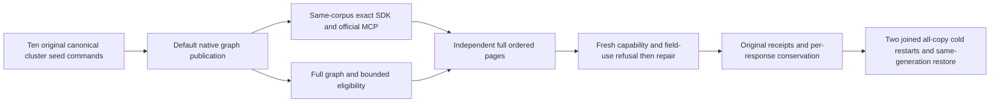

# Adaptive filtered public cluster correctness

REQ-FILTER-PUBLIC-COHORTS-001 / AC-FILTER-PUBLIC-COHORTS-001 refine and [ADR087](../../ADR/ADR-087-filtered-retrieval.md): the same genuine default native graph and1,000 independently authored canonical vectors must serve100/10/1/0.1-percent and low/high-correlated eligibility through real SDK and official MCP. The default exact threshold256 is unchanged: populations1,000/300 exercise Approximate,100/10/1/0 exercise Exact. No graph reconstruction or scalar product switch is permitted.

Literal monotonic dot-product vectors have independent descending top4 and reciprocal-rank full-document goldens. Fixedk4 makes recall>=0.95 require4/4 for this functional corpus; this does not redefine approximate search as globally exact. Duplicate/unknown/empty eligibility remains bounded. Fresh persisted capability and field-use refusal even with an empty allowlist must precede healthy same-client repair. Original pre-cancelled SDK task is joined before healthy reads. Every response observes complete independently expected1,000-document canonical ranking and whole outbox, including after a primary failure; all10 original full public receipts replay through SDK/MCP. Native fifth JsonIgnored receipt fields are not claimed from public JSON.

Close and join every real caller before each all-three Aspire-owned cold cycle, begin all stopped nodes before waiting for health, restore the same generation (never rebuild), compare original index/corpus/checkpoint, and attempt both cycles before aggregated failures. Initial full seed receipts independently bind original commands/mutations/pre-read partition witness and declared ProcessDurable and the configured persisted copy count; their positive opaque positions are actual source-bound values, not predicted physical counters.

This bounded functional corpus does NOT qualify100k/1M recall/performance, measured expansion/fallback costs, graph-shape breadth counters, progress cancellation, physical byte conservation or hardware speed. Existing AdaptiveFilteredPlannerTests actual10k charged fallback/N-1 refusal and independent oracle, AnnPublicCancellationTests held original producer controls, and the complete Linux benchmark/profile gates remain mandatory. No timeout, index policy, public metadata or stored format changes. The new case reuses the existing bounded cluster parent lifetime; no previous case changes.

