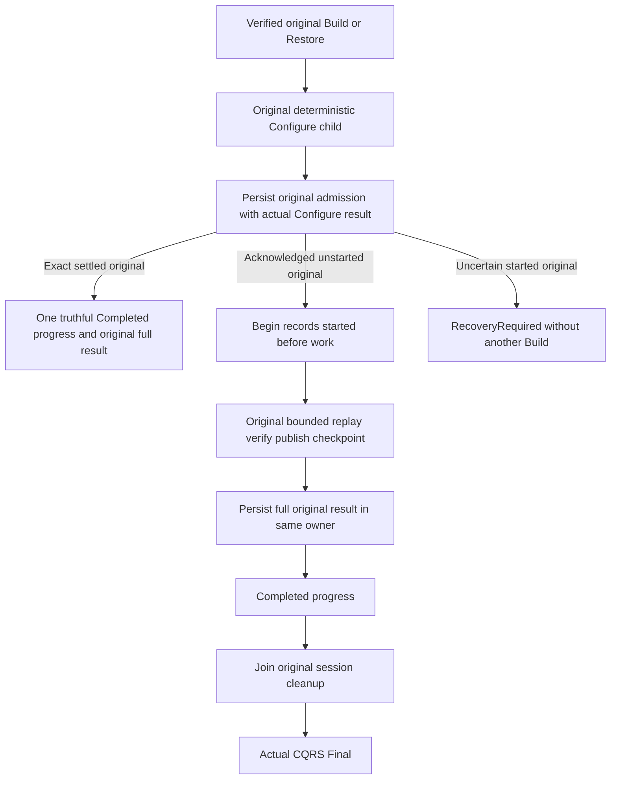

# ANN original operation admission and settled result

Canonical slice: Search. Parent: [Search](../Search.md), [Managed ANN](ManagedAnn.md). Decisions: [ADR-019](../../ADR/ADR-019-managed-ann.md), [ADR-082](../../ADR/ADR-082-cqrs-streams.md), [ADR-125](../../ADR/ADR-125-connection-owned-execution.md). Refines AC-ANN-007 and REQ/AC-ANN-GEN-003/004/006.

## Original operation and order

The original server-authenticated administrator and full typed request remain authoritative. Preserve the original CommandId, NodeId, consumer, index generation, complete optional ANN profile and request bytes. Each child uses the existing bounded connection-owned execution path and freshly reloads persisted administrator authorization. Node-local storage owns admission, started state, publication and settlement; parent activations own no files or handles.



Admit runs after the original Configure command returns its full actual ProjectionConsumerInfo and before Begin or index mutation. Defer Configure progress until admission returns null. Exact settled replay therefore emits only the bounded Completed progress; it does not fabricate the phases of a new build. Original Configure receipt replay must preserve canonical effects. The owner checks exact retained LastRequest before using an older Configure checkpoint to reject a prior parent.

Settle runs only after the actual publication and original checkpoint command have returned, before Completed, successful Abort and Final. It retains every field of the actual AnnMaintenanceResult: CommandId, Consumer, IndexGeneration, Phase, full Source, Count, IndexSha256 and complete nullable original Checkpoint receipt. Abort joins the real session and never erases original admission or result evidence. Preserve primary and every cleanup failure.

Release remains its separate authorized cleanup path. Original-result admission/settlement and ANN progress replay are N/A for Release; it may not replay a previous Build result after releasing that generation.

## Requirements and measurable acceptance

| Requirement | Acceptance criterion and negative/edge flow | Automated mapping |
|---|---|---|
| REQ-ANN-ORIGINAL-001: admit the full original request durably before work. Begin durably records started before index effects. | AC-ANN-ORIGINAL-001: pre-Begin cancellation can retry the same admitted request; genuinely interrupted started work without a settled result yields RecoveryRequired with unchanged complete execution/canonical images, no second Build or replacement command. Explicit authorized new-generation repair must subsequently complete. | Owning admission/recovery tests |
| REQ-ANN-ORIGINAL-002: retain one pending and one last settled original binding per bounded consumer/generation. | AC-ANN-ORIGINAL-002: exact same full request returns the entire original result before/after same-root cold restart; same ID with changed valid full request yields Conflict. Actual later Restore C replaces the last binding; old Build B yields HistoryUnavailable without effects while C repeats exactly. Genuine fresh no-op D is allowed and repeats its complete result, including null checkpoint. | Owning result tests and AnnSettledClusterTests through real .NET SDK and official MCP |
| REQ-ANN-ORIGINAL-003: fresh persisted policy, current pin, node-local owner, original Configure identity and publication checksum remain required for replay and settlement. | AC-ANN-ORIGINAL-003: revoked/changed policy, stale owner/pin and corrupted/missing result cannot return successful replay or mutate the retained original bytes. Independent genuinely authorized scope remains healthy. Full result alone cannot prove unchanged index files; retain actual bounded binary inventory and canonical checkpoint images. | Owning authority/corruption tests and public cluster policy refusal |
| REQ-ANN-ORIGINAL-004: settle the actual complete result before any observable successful completion. | AC-ANN-ORIGINAL-004: interruption before settlement retains pending/uncertain state; after settlement and before Abort/Final, exact original retry obtains that stored full result. Failed settlement never emits Completed or success Final, and joined cleanup failures retain their original ledger. | Owning settlement tests plus actual producer interruption/join and cluster cold replay; original cut receipts required |
| REQ-ANN-ORIGINAL-005: preserve generated serialization and the bounded strict stream grammar. | AC-ANN-ORIGINAL-005: codec roundtrips all original request/profile/Configure/result/source/checkpoint bytes. Legal exact replay has one Completed followed by one Final; ordinary and Release profiles, malformed/mixed phases, duplicate Completed and post-Final progress remain rejected under unchanged frame/byte/deadline bounds. | Unit Search actual generated serializer and AnnMaintenanceStreamShape/CqrsStream tests |
| REQ-ANN-ORIGINAL-006: empty-page checkpoint identity is deterministic and separate from nonempty replay checkpoint receipts. | AC-ANN-ORIGINAL-006: use AnnMaintenanceChildIdentity.Create(original CommandId, AnnMaintenancePhase.Publish, actual page ThroughSequence). Same original retry preserves its checkpoint intent/token and full receipt; different parent identity stays distinct. No random replacement identity may hide an unknown outcome. | parent/original checkpoint tests and full public original result replay |

No power-loss durability or performance claim follows from process restart, source review or a build.

## Frozen internal bridge

Retain existing AnnMaintenanceCapabilityKind ordinals 0 through 7, aliases and IDs. Append AdmitOriginal at ordinal 8 and SettleOriginalResult at ordinal 9. Request appends nullable FullOriginalResult at Id5 and nullable OriginalConfigure at Id6, both default null. Result appends nullable OriginalResult at Id8, default null; Pending remains Id7. These are internal generated inter-grain fields, with no new public SDK/MCP fields or alternate dispatch path.

Admit requires OriginalConfigure and forbids FullOriginalResult, Page and CheckpointIntent. Settle requires FullOriginalResult and forbids OriginalConfigure, Page and CheckpointIntent. Both require the original nonempty session and Build/Restore request. Existing kinds reject these new extraneous fields. The freshly authenticated capability executor calls the owner APIs:

```csharp
Task<AnnMaintenanceResult?> AdmitOriginalAsync(PrincipalRecord verifiedPrincipal,
    AnnMaintenanceRequest originalRequest, ProjectionConsumerInfo originalConfigure,
    CancellationToken cancellationToken);
Task SettleOriginalResultAsync(PrincipalRecord verifiedPrincipal,
    AnnMaintenanceRequest originalRequest, AnnMaintenanceResult fullOriginalResult,
    CancellationToken cancellationToken);
```

Internal capability routing does not bypass the owner's existing admission, memory, cancellation, scoped pin, ownership or atomic replacement gate. No detached task or secondary storage reader may manufacture completion.

## Strict owner format and resource contract

The owning storage change appends nonnull owner.bin Id7 AnnOriginalOperation[] OriginalOperations. Each entry's alias is keyload.server.ann-original-operation and IDs are Key0, PrincipalId1, PolicyEpoch2, PendingRequest3, PendingStarted4, LastRequest5, LastResult6. Existing root aliases/IDs0 through 6 remain unchanged. Owner root/lock/pointer/manifest require strict current AnnProtocol.Version2; unsupported old format, absent/null new field or corrupt generated bytes are explicit refusals. This stage introduces no legacy reader, migration or compatibility fallback.

Count is bounded by existing MaximumOwnedGenerations and retained/generated bytes by existing MaximumManifestBytes, MaximumDiskBytes and MaximumResidentBytes. One pending and one settled entry do not authorize unbounded completed-request history. Persistence is the existing same-owner receipt replacement, with no sidecar file. Later settled binding evicts the previous binding; it never synthesizes an old parent's result from the latest generation.

## Slice ownership and verification

Abstractions/Search retains the public request/result; Orleans/Search Contracts, Execution and Streaming own the appended bridge, parent ordering and grammar. Orleans/OrleansExecution Queries owns its existing freshly authorized capability executor. Server/Search owns the interface implementation, generation-owner receipt and all file/resource lifetimes. UnitTests/Search owns generated-code and stream scenarios; IntegrationTests/Search owns genuine discovered Aspire cluster .NET/official MCP calls. Frontend N/A because this is existing database execution/recovery behavior. Benchmark schema N/A; acceleration remains independently measured.

All parts of the change (shared schema, owning interface/storage, parent and tests) ship together and are verified by the formatter, analyzers, full solution build, unit tests, process recovery and the Aspire replicated-cluster SDK/official MCP tests.

## Decoded request identity and original settlement bytes

REQ-ANN-ORIGINAL-003 and REQ-ANN-ORIGINAL-005 require original request identity to compare every decoded request/profile field. Equal VectorSpace values remain the same request when JSON and generated callers construct different CLR reference graphs. generated bytes continue to preserve those graphs; they are not a semantic identity comparator. Existing strict validation, canonical command fingerprints, aliases, field IDs and persisted formats remain unchanged.

Settlement issuance hashes the freshly authorized and owner-checked original reservation retained in the database. The receiver continues its existing fixed-time SHA256 comparison against that original persisted reservation, with unchanged purpose, epoch, incarnation, child GUID, checkpoint, expiry and size bounds. Tests retain original reservation bytes before invocation and independently assert the complete signed claims against them.

Both original RequestCqrsAnnMaintenanceTests whole flows exercise the same parent GUID and literal VectorSpace values through shared and independent object references, full replay/results and canonical no-effects assertions, followed by their existing malformed/healthy restore/no-op/retirement operations. These source regressions do not qualify runtime, cold recovery, Linux cluster, durability or performance before the owning integrated gates execute.

The original ANN whole flow captures its journal cut after the explicit initial reservation. The independent Build checkpoint receipt therefore counts one later page commit, while its terminal journal also counts the separate initial settlement. Restore counts its fresh configure and checkpoint commits. Complete original receipt, terminal journal, partition identity, empty effects, replay and subsequent lifecycle assertions remain mandatory.
