# AnnProviderQualification within Search

Parent Search/ManagedAnn, ADR-019 and the canonical vector/storage contracts remain authoritative. This scope changes no provider, package, API, serializer alias/field ID, graph algorithm, fallback, scalar mode, budget, timeout, canonical format or WAL.

The selected provider is first-party KeyLoad PackedAnnIndex/Builder/Graph/Vectors/Search and generated-storage codec under the root Elastic License2.0. No Hnsw.Net/USearch/binary is adopted. Existing current .NET10/C#14/centrally pinned assets and their independently owned dependency licenses remain; a local restored asset/license inventory is not feed/signature/target/runtime qualification. Mandatory supported SIMD remains enabled in the normal path. Explicit small-set exact search and bounded approximate queries retain their current result/error contracts.

| Requirement | Whole-operation acceptance |
|---|---|
| REQ-ANN-PROVIDER-QUAL-001: current provider owns immutable bounded vectors/graph and complete results | AC-ANN-PROVIDER-QUAL-001: actual canonical document+vector producer, delete and reinsert revision3 feed the original Build/Search/Save/Load APIs for Cosine, Euclidean and DotProduct. Three literal vectors have independent complete candidate IDs, ordinals, revisions, ordering, scores and eligibility; a held old immutable index remains its original snapshot, while rebuilt current index reflects actual canonical delete/reinsert. Existing10k recall/filter and16-cycle64record stress remain mandatory, not duplicated or replaced. |
| REQ-ANN-PROVIDER-QUAL-002: checksum-valid snapshots still require complete semantic validation | AC-ANN-PROVIDER-QUAL-002: actual PackedAnnStorageFrames Read/Write builds one checksum-valid single-field invalid header/node snapshot for each case: unsupported header Version, impossible EntryPoint, mismatched RetainedBytes, noncontiguous Ordinal, zero Revision, nonfinite Vector, self neighbor, duplicate neighbor. The actual Load API must return its original FormatUnsupported for unknown version or Corruption for the other existing semantic guards, with exact safe detail. No typed error is fabricated and no new broad catch/migration is introduced. |
| REQ-ANN-PROVIDER-QUAL-003: refusal and exact repair cannot mutate canonical history or a healthy original | AC-ANN-PROVIDER-QUAL-003: independently verify actual SHA256 of every original/damaged file and full original frames/source vectors before fault; retain exact original owned file bytes. Every refused Load preserves the complete original storage identity, canonical applied sequence and physical store position, full raw canonical rows, original immutable index results and original file evidence. Restore only exact original owned bytes; real Load and complete search work again. A fresh healthy producer/rebuild, actual replay and two joined same-root canonical storage cold opens preserve all original receipts/private fields/outcome+locator bytes. |
| REQ-ANN-PROVIDER-QUAL-004: actual authority, bounds and lifecycle are retained | AC-ANN-PROVIDER-QUAL-004: the owning fixture uses the actual TestDatabase and CreateConfiguredDatabase with the silo-local canonical ZoneTree store. Every ordinary resource/document/vector setup or mutation enters DatabaseEngine.Apply or ApplyEmbedded through the existing Submit method. Expected receipt position is the pre-operation canonical applied sequence plus one with an independent incarnation/partition witness; physical Store.Position remains separate. Retain the original prepared command, timestamp and exact input for replay. Storage joins before either same-root cold reopen; the complete original storage identity survives guarded absolute/existing/nonempty root validation. Existing inclusive retained/scratch/file/work bounds, cancellation, immutable concurrent queries and current-policy public/maintained capability gates remain mandatory. |

## Frozen finite flow

1. The fixture constructs the actual TestDatabase and borrows its canonical engine/store. Direct bootstrap remains confined to the existing constructor; ordinary operations use commands against that owner and retain its complete original storage identity. Independently provision a real collection and three literal document/vector pairs through actual submission; verify full literal canonical vector records and complete original receipts/outcomes.
2. Build and search the first real packed index under existing validated ANN/storage/work policies. Preserve its owned snapshot while canonical Beta is genuinely deleted, its provider snapshot rebuilt, then the same ID is genuinely reinserted at revision3 with a different literal vector. Rebuild current provider, independently assert all full source/current/old results and filters, then Save a real bounded file with actual flush/close.
3. Read the existing generated header/node frames with their actual API. Prove original header Space/Policy/Count and all original node identity/revision/vector fields against fixture literals, original topology and bytes against the genuine saved index. Change exactly one existing semantic field, Write through the same existing framing API, and independently SHA256 the complete damaged file. This is test-owned corruption, not a new storage format or upstream defect assertion.
4. Load the checksum-valid damaged file through the real provider and require the existing exact typed refusal. Preserve damaged bytes and complete original canonical rows, applied sequence and physical store position, then repeat under a joined original cold owner. The original good in-memory index remains a separately checked immutable control. Exact byte restoration cannot synthesize rows, counters, graph edges, revisions or offsets.
5. Healthy Load/search, original replay and a genuine new healthy producer/rebuild must complete with complete independent oracles. Two original-root cold opens retain the same canonical incarnation/signer, validated options, applied sequence and original command input. Never recreate the TestDatabase root or replace its canonical store. Join file handles and canonical storage in ownership order; retain initiating/cleanup failures and roots where ownership has not settled.

```mermaid
flowchart LR
    Execution[Real canonical producer] --> Index[Build and literal exact comparison]
    Index --> Change[Delete and revision3 reinsert]
    Change --> Save[Original generated-snapshot]
    Save --> Damage[Valid checksum with one invalid semantic field]
    Damage --> Refuse[Actual Load typed refusal]
    Refuse --> Repair[Exact original file bytes]
    Repair --> Cold[Healthy operations and two joined cold proofs]
```

## Scope

The three-metric/eight-fault matrix is a small functional corpus, not a performance, memory-pressure or stress qualification. The existing PackedAnn Recall/Filter/Metric/Validation/Ownership/Concurrency/Reservation/Budget/RuntimeStorage/DeleteReinsertStress/Rebuild cases stay selected. Packed reservation upper bounds are logical admission facts; no allocation/RSS equality or speed claim follows. UI/site are N/A.

## Source mapping and qualification boundary

All four criteria map to `AnnProviderQualificationTests.AcAnnProviderQual001To004ChecksumValidSemanticRefusalRepairsOriginalHistoryAndColdRebuild`: the eight `AnnProviderQualificationDamage` values crossed with Cosine, Euclidean and DotProduct create 24 source argument instances. This is a source inventory, not a compiled test census.

`AnnProviderQualificationOwner` submits commands to the canonical engine and reopens the original ZoneTree root and identity. It is a local single-owner control. `AnnProviderQualificationProducer` independently predicts each full `CommitReceipt` from the pre-operation canonical sequence, partition identity, persistence profile and actual single-owner copy count. `AnnProviderQualificationHistoryAssertions` retains the original prepared command and exact input, complete result including ordered private composition fields, raw `StoredOutcome` bytes and exact scoped locator or explicit global absence. Replay preserves that original command and timestamp. Each submission and authorized outcome resolution is independently bracketed by the complete canonical identity, full bounded row image, physical position and applied sequence.

`AnnProviderQualificationCorpus` provides literal full source vectors/revisions and independent three-metric scores. Results assert complete ordered candidate identity/ordinal/revision/score, filtered eligibility, declared mode, expansion work and positive bounded work/distance/edge/scratch counters. These are finite logical resource controls; no actual allocation or RSS claim follows. The old immutable seed and reinserted indices remain independently checked after subsequent canonical changes. The real generated header/node API is used for every fault, while original frame identities, vector values and actual original topology are checked before damage. Original SHA256 and complete file bytes are first captured from actual Save, not synthesized from expected re-encoded object graphs.

The faulted original file is tested warm and after a joined original-root cold reopen. The only repair is exact restoration of its first genuine bytes. A second cold verifies healthy Load and every original outcome. A new actual healthy document/vector update rebuilds and saves a DISTINCT healthy snapshot; it never overwrites or discards the original repaired snapshot. A final cold verifies both complete files/digests and all original history. File handles are scoped and the canonical storage owner is joined before reopening; the original storage roots must be canonical/existing/nonempty both before close and again after close before constructors can open them, and initialization/body/cleanup failures remain in the existing observed lifecycle ledger. Dispose observes both the complete execution/store close and original source cleanup before rethrowing the original ordered failures; a storage-close failure cannot silently skip the remaining cleanup. No process is killed by this fixture.

The adjacent source inventory preserves every existing PackedAnn provider, ANN, seed/pin/authority and public/recovery class selected for the broader workstream. Existing `AnnProcessRecoveryTests` remains the actual child-process lane; `AnnMaintenanceClusterTests`, `AnnPublicColdClusterTests`, `AnnSettledClusterTests`, `AnnWaitClusterTests`, `AnnPublicClusterTests` and `AnnPublicCancellationTests` remain actual SDK/official MCP/Aspire cluster lanes. None is replaced by the local canonical storage fixture or claimed green here. Existing large recall, delete/reinsert stress, cancellation, concurrent immutable query, admission/resource bounds and retained-history tests remain required.

No architecture or persisted/public contract changes are introduced. ADR-019 and its already accepted later generation/public contracts govern the actual implementation; this child adds missing qualification evidence only. The frozen requirement IDs above do not grant new provider/schema/alias/field IDs or a scalar-disable capability. Consumer UI/site and new dependency delivery are N/A because this packet adds test-only roles and this child specification.
