# AnnProviderQualification within Search (KL-030)

Status: authored complete SourceN candidate. Native structural preflight over fifteen C# bodies has no parse/file400/method64/nesting3 findings; that is not compiler, analyzer, native UID census or runtime proof. Independent full source/API peer of the original complete16 is closed, with two owning-lifetime corrections included in this successor; finite delta recheck and guarded main integration remain pending. No current compiler, native discovery, Unit/process/RF3, Linux, memory/RSS, recall-at-scale or performance qualification. Parent Search/ManagedAnn, ADR-019 and current canonical vector/native storage contracts remain authoritative. This scope changes no provider, package, API, serializer alias/field ID, graph algorithm, fallback, scalar mode, budget, timeout, canonical format, native WAL or replication protocol.

The selected provider is first-party KeyLoad PackedAnnIndex/Builder/Graph/Vectors/Search and generated-native storage codec under the root Elastic License2.0. No Hnsw.Net/USearch/native binary is adopted. Existing current .NET10/C#14/centrally pinned assets and their independently owned dependency licenses remain; a local restored asset/license inventory is not feed/signature/target/runtime qualification. Mandatory supported SIMD remains enabled in the normal path. Existing exact-small and fully charged insufficient-candidate modes are preserved as the frozen algorithm; no new optional or compatibility fallback is introduced. Historical scalar/two-node/obsolete scale evidence remains historical.

| Requirement | Whole-operation acceptance |
|---|---|
| REQ-ANN-PROVIDER-QUAL-001: current provider owns immutable bounded vectors/graph and complete results | AC-ANN-PROVIDER-QUAL-001: actual native canonical document+vector producer, delete and reinsert revision3 feed the original Build/Search/Save/Load APIs for Cosine, Euclidean and DotProduct. Three literal vectors have independent complete candidate IDs, ordinals, revisions, ordering, scores and eligibility; a held old immutable index remains its original snapshot, while rebuilt current index reflects actual canonical delete/reinsert. Existing10k recall/filter and16-cycle64record stress remain mandatory, not duplicated or replaced. |
| REQ-ANN-PROVIDER-QUAL-002: checksum-valid native snapshots still require complete semantic validation | AC-ANN-PROVIDER-QUAL-002: actual PackedAnnStorageFrames Read/Write builds one checksum-valid single-field invalid header/node snapshot for each case: unsupported header Version, impossible EntryPoint, mismatched RetainedBytes, noncontiguous Ordinal, zero Revision, nonfinite Vector, self neighbor, duplicate neighbor. The actual Load API must return its original FormatUnsupported for unknown version or Corruption for the other existing semantic guards, with exact native safe detail. No typed error is fabricated and no new broad catch/migration is introduced. |
| REQ-ANN-PROVIDER-QUAL-003: refusal and exact repair cannot mutate canonical history or a healthy original | AC-ANN-PROVIDER-QUAL-003: independently verify actual SHA256 of every original/damaged file and full original frames/source vectors before fault; retain exact original owned file bytes. Every refused Load preserves source/store/journal identities, position, full raw canonical rows, original immutable index results and original file evidence. Restore only exact original owned bytes; real Load and complete search work again. A fresh healthy native producer/rebuild, actual replay and two joined same-root canonical/native-journal cold opens preserve all original receipts/private fields/outcome+locator bytes. |
| REQ-ANN-PROVIDER-QUAL-004: actual authority, bounds and lifecycle are retained | AC-ANN-PROVIDER-QUAL-004: new owning fixture borrows existing TestDatabase bootstrap and CreateConfiguredDatabase, owns existing TestDatabaseReplicaAdmission and captures actual JournalNodeId. Every ordinary resource/document/vector setup or mutation uses Native.Submit. Next receipt position is the next ORIGINAL JOURNAL index plus actual preapply incarnation/partition/placement witness, separately from canonical Store.Position. Retain the real stamped committed operation and use explicitTime:true for retries. Native materializer joins before original journal/store close; both original physical identities and full nine-field canonical identity survive guarded canonical absolute/existing/nonempty root reopens. Existing inclusive retained/scratch/file/work bounds, cancellation, immutable concurrent queries and current-policy public/maintained capability gates remain mandatory. |

## Frozen finite flow

1. New fixture constructs TestDatabase(nativeReplicaAdmission:false) and a configured database over its actual store; bootstrap/catalog are the existing fixture constructor's only direct setup. Own the existing native replica admission, original replica journal node ID and original canonical identity. Independently provision a real collection and three literal document/vector pairs through actual native submission; verify full literal canonical vector records and complete original native receipts/outcomes.
2. Build and search the first real packed index under existing validated ANN/storage/work policies. Preserve its owned snapshot while canonical Beta is genuinely deleted, its provider snapshot rebuilt, then the same ID is genuinely reinserted at revision3 with a different literal vector. Rebuild current provider, independently assert all full source/current/old results and filters, then Save a real bounded native file with actual flush/close.
3. Read the existing generated header/node frames with their actual native API. Prove original header Space/Policy/Count and all original node identity/revision/vector fields against fixture literals, original topology and bytes against the genuine saved index. Change exactly one existing semantic field, Write through the same existing native framing API, and independently SHA256 the complete damaged file. This is test-owned corruption, not a new storage format or upstream defect assertion.
4. Load the checksum-valid damaged file through the real provider and require the existing exact typed refusal. Preserve damaged bytes and complete original canonical/journal image, then repeat under a joined original cold owner. The original good in-memory index remains a separately checked immutable control. Exact byte restoration cannot synthesize rows, counters, graph edges, revisions or offsets.
5. Healthy Load/search, original native replay and a genuine new healthy producer/rebuild must complete with complete independent oracles. Two original-root cold opens use the same canonical incarnation/signer and original replica JournalNodeId, actual validated options, original applied/committed indexes/term and original raw command payloads. Never recreate a TestDatabase root or substitute a new journal/store. Join file handles, native worker, journal and canonical storage in ownership order; retain initiating/cleanup failures and roots where native ownership has not settled.

```mermaid
flowchart LR
    Native[Real native canonical producer] --> Index[Build and literal exact comparison]
    Index --> Change[Delete and revision3 reinsert]
    Change --> Save[Original generated-native snapshot]
    Save --> Damage[Valid checksum with one invalid semantic field]
    Damage --> Refuse[Actual Load typed refusal]
    Refuse --> Repair[Exact original file bytes]
    Repair --> Cold[Healthy native operations and two joined cold proofs]
```

## Disjoint NEW paths

All new source is under tests/KeyLoad.UnitTests/Search/: Contracts/AnnProviderQualificationProtocol.cs and AnnProviderQualificationDamage.cs; Models/AnnProviderQualificationState.cs and AnnProviderQualificationHistory.cs; Fixtures/AnnProviderQualificationOwner.cs; Helpers/AnnProviderQualificationFlow.cs, AnnProviderQualificationProducer.cs, AnnProviderQualificationPersistence.cs and AnnProviderQualificationCold.cs; Assertions/AnnProviderQualificationResults.cs, AnnProviderQualificationImages.cs, AnnProviderQualificationHistoryAssertions.cs and AnnProviderQualificationCorpus.cs; Serialization/AnnProviderQualificationDamageCodec.cs; Cases/AnnProviderQualificationTests.cs. Child specification: docs/Features/Search/AnnProviderQualification.md. No existing body, dispatcher, shared fixture, global enum, CI/status/README or package file is changed. Any actual product defect requires exact owning-method reservation and a combined repair/regression batch before postimages.

The three-metric/eight-fault source matrix is a small functional corpus, not a performance, memory-pressure or stress qualification. Existing PackedAnnRecall/Filter/Metric/Validation/Ownership/Concurrency/Reservation/Budget/NativeStorage/DeleteReinsertStress/Rebuild cases stay selected. Actual NativeAnn process recovery, native maintenance/public .NET SDK/official MCP RF3 and exact-source Linux runtime/capability gates remain separately required. Packed reservation upper bounds are logical admission facts; no allocation/RSS equality or speed claim follows. UI/site N/A: no visible behavior or published capability claim changes. Main owns guarded integration, compiler/analyzers, compiled native census, actual runners and final qualification; source-only completion cannot close KL-030 or its later KL-031/KL-059 gates.

## Source mapping and qualification boundary

All four criteria map to `AnnProviderQualificationTests.AcAnnProviderQual001To004ChecksumValidSemanticRefusalRepairsOriginalHistoryAndColdRebuild`: the eight `AnnProviderQualificationDamage` values crossed with Cosine, Euclidean and DotProduct create 24 source argument instances. This is a source inventory, not a compiled native test census. Main must discover actual UIDs after the final source is integrated and compiled, select the native TUnit tree nodes, preserve original failures and inspect every resulting field/file oracle.

`AnnProviderQualificationOwner` uses the original `TestDatabaseReplicaAdmission` ordered committed log and its real materializer; it is a genuine local logged-operation control, not a three-voter/Orleans/follower proof. `AnnProviderQualificationProducer` predicts each full `CommitReceipt` before native Submit from the actual partition-placement witness and next journal index, and `AnnProviderQualificationHistoryAssertions` captures the committed stamped operation, full typed result including ordered private composition fields, first real raw `StoredOutcome`, exact scoped locator or explicit global absence, and original entry index/term/native payload. Replay uses that original stamp explicitly; each Submit and public Resolve is independently bracketed by the full canonical nine-field identity, raw complete rows, physical position, journal cut and original journal node ID.

`AnnProviderQualificationCorpus` provides literal full source vectors/revisions and independent three-metric scores. Results assert complete ordered candidate identity/ordinal/revision/score, filtered eligibility, declared mode, expansion/fallback fields and positive bounded work/distance/edge/scratch counters. These are finite logical resource controls; no actual allocation or RSS claim follows. The old immutable seed and reinserted indices remain independently checked after subsequent canonical changes. The real generated header/node API is used for every fault, while original frame identities, vector values and actual original topology are checked before damage. Original SHA256 and complete file bytes are first captured from actual Save, not synthesized from expected re-encoded object graphs.

The faulted original file is tested warm and after a joined original-root cold reopen. The only repair is exact restoration of its first genuine bytes. A second cold verifies healthy Load and every original outcome. A new actual native healthy document/vector update rebuilds and saves a DISTINCT healthy snapshot; it never overwrites or discards the original repaired snapshot. A final cold verifies both complete files/digests and all original native history. File handles are scoped, the real materializer is joined before journal/store close, the original physical roots must be canonical/existing/nonempty both before close and again after close before constructors can open them, and initialization/body/cleanup failures remain in the existing observed lifecycle ledger. Dispose observes both the complete native/store close and original source cleanup before rethrowing the original ordered failures; a terminal materializer fault already joined by its native shutdown cannot silently skip the remaining cleanup. No process is killed by this fixture.

The adjacent source inventory preserves every existing PackedAnn provider, native ANN, seed/pin/authority and public/recovery class selected for the broader workstream. Existing `NativeAnnProcessRecoveryTests` remains the actual child-process lane; `NativeAnnMaintenanceRf3Tests`, `NativeAnnPublicColdRf3Tests`, `NativeAnnSettledRf3Tests`, `NativeAnnWaitRf3Tests`, `AnnPublicRf3Tests` and `AnnPublicCancellationTests` remain actual SDK/official MCP/Aspire RF3 lanes. None is replaced by the local log fixture or claimed green here. Existing large recall, delete/reinsert stress, cancellation, concurrent immutable query, admission/resource bounds and native retained-history tests remain required. Exact-source Linux, full native SIMD targets, RF3 topology/failover/endurance, recall at required scale and performance/profiling gates remain OPEN until their genuine main-owned artifacts exist.

No architecture or persisted/public contract changes are introduced. ADR-019 and its already accepted later native generation/public contracts govern the actual implementation; this child adds missing qualification evidence only. The frozen requirement IDs above do not grant new provider/schema/alias/field IDs or a scalar-disable capability. Consumer UI/site and new dependency delivery are N/A because this packet adds test-only roles and this child specification.
