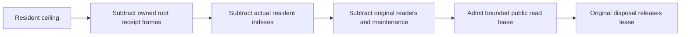

# ANN public resident reservation

Supplement to [Search](../Search.md).

## Confirmed original gap

AnnRootLease.Open reserves four MaximumManifestBytes frames within MaximumResidentBytes. AnnMaintenanceMemory.Available subtracts them. AnnPublicReadAdmission.Reserve currently omits them from both its resident check and remaining-byte calculation, allowing public reservations to consume already owned root receipt memory.

| Requirement | Acceptance and genuine test |
|---|---|
| REQ-ANN-READ-RESIDENT-001: public read admission counts the same original root receipt reservation, all resident slots, existing readers and maintenance ownership before admitting bytes. | AC-ANN-READ-RESIDENT-001: actual real canonical seed/current principal+consumer, original publication and checkpoint create a genuine index owner; receipt+actual index+maximal public lease equals the configured ceiling, never exceeds it. AnnPublicReservationTests. |
| REQ-ANN-READ-RESIDENT-002: saturation refuses before another reservation; actual original lease disposal makes the same capacity reusable. | AC-ANN-READ-RESIDENT-002: second original reservation returns ResourceExhausted; release/reacquire retains exact byte budget and complete canonical image/position. The following exact search returns the independently fixed corpus order `seed-00002`, `seed-00001`, `seed-00000`; expected IDs are not derived from the acquired/current records. Existing public Search subsequently returns its original complete page under current persisted authorization. AnnPublicReservationTests and existing AnnPublicWholeFlow assertions. |
| REQ-ANN-READ-RESIDENT-003: maintain original bytes, resource/current authority and lifecycle contracts. | AC-ANN-READ-RESIDENT-003: no format/schema/alias/Id changes, fake providers or role-bearing contexts; real owner disposes before canonical fixture with primary+cleanup ledger. |

## Slice and qualification

Product: Server/Search/Admission/AnnPublicReadAdmission.cs only. Regression: UnitTests/Search/Cases/AnnPublicReservationTests.cs plus Helpers/AnnPublicReservationFlow.cs. Genuine ZoneTree/ANN ownership is functional unit proof when executed; it is not cluster acknowledgement or production/performance qualification.
