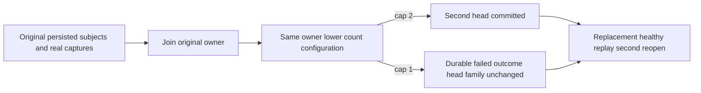

# Configured retained BM25 family count

This native single-owner supplement to [Bm25ConfiguredQuota](Bm25ConfiguredQuota.md) isolates atomic apply count admission. It is not fresh capture count isolation, raw native-WAL inventory, process-kill durability or cluster qualification.

- REQ-BM25-COUNT001 → AC-BM25-COUNT001: genuinely capture one-document/one-term phases under the original budget, then join and reopen the SAME canonical ZoneTree owner with only MaxScanRecords reduced to 2 or 1. A second persisted subject's phase succeeds at 2. At 1 it returns BudgetExceeded with the exact Capacity detail, persists the native silo-local failed outcome with CanonicalSequence=0, advances physical store position by one without changing the canonical applied read cut, and leaves every head key/value byte unchanged.
- REQ-BM25-COUNT002 → AC-BM25-COUNT002: original persisted publisher/subjects, source dependencies and issued phase bytes remain authoritative. Reissuing a phase must satisfy the current resource-admission budget; at the reduced 1 or 2 record limit it returns the exact resource-admission BudgetExceeded without effects. Retry the original already-issued envelope without recapturing admission and compare its full native result, actual token, full retained entry and byte-exact outcome across repeated same-ID replay. Fresh persisted authorization still runs on every retry. Inspect the complete canonical image with the original independently labelled inspection budget.
- REQ-BM25-COUNT003 → AC-BM25-COUNT003: genuine same-key replacement and subsequent healthy publication work at capacity, preserve exact head count, then join and reopen again, preserving original identity and receipts. The shared RecoveryOwner retains original failure aggregation, canonical storage joins and deletion discipline.

Automated mapping: Bm25ConfiguredCountTests.OriginalIssuedPublicationHonorsLowerRetainedCountAcrossSameOwnerColdReopen(int), arguments 1 and 2; Bm25ConfiguredCountTrial owns the operation and independent raw family/result/entry oracles. Dependency: the shared Bm25OriginalPhaseRecovery owner with Reopen(DatabaseLimits? configuredLimits = null), lower-only validation before join, original inspection bounds and configured engine factory and original canonical storage identity.

These cases make no full-cut no-effect claim for atomic quota failure.
