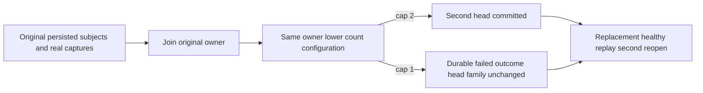

# Configured retained BM25 family count

This native single-owner supplement to [Bm25ConfiguredQuota](Bm25ConfiguredQuota.md) isolates atomic apply count admission. It is not fresh capture count isolation, raw journal inventory, process-kill durability or RF3 qualification.

- REQ-BM25-COUNT001 → AC-BM25-COUNT001: genuinely capture one-document/one-term phases under the original budget, then join and reopen the SAME canonical/replica owner with only MaxScanRecords reduced to 2 or 1. A second persisted subject's phase succeeds at 2. At 1 it returns BudgetExceeded with the exact Capacity detail, persists a native failed outcome and committed/applied entry, and leaves every head key/value byte unchanged.
- REQ-BM25-COUNT002 → AC-BM25-COUNT002: original persisted publisher/subjects, source dependencies and issued phase bytes remain authoritative. Compare full native result, actual token, full retained entry and byte-exact outcome across repeated same-ID replay; inspect complete canonical image with the original independently labelled inspection budget.
- REQ-BM25-COUNT003 → AC-BM25-COUNT003: genuine same-key replacement and subsequent healthy publication work at capacity, preserve exact head count, then join and reopen again, preserving original identity and receipts. The shared RecoveryOwner retains original failure aggregation, store/log joins and deletion discipline.

Automated mapping: Bm25ConfiguredCountTests.OriginalIssuedPublicationHonorsLowerRetainedCountAcrossSameOwnerColdReopen(int), arguments 1 and 2; Bm25ConfiguredCountTrial owns the operation and independent raw family/result/entry oracles. Dependency: immutable Bm25OriginalPhaseRecovery R2 shared owner with Reopen(DatabaseLimits? configuredLimits = null), lower-only validation before join, original inspection bounds and factory/native catalog identity.

Fresh capture count isolation remains OPEN: capture metadata and family reads share the request scan budget. These cases make no full-cut no-effect claim for atomic quota failure. Complete canonical inspection has original source bounds distinct from lower operation count; complete raw replica journal inventory remains OPEN. Both arguments passed in the exact source-bound R27 local native run on 2026-10-12. Every later source image requires its own compilation/rerun; Linux and RF3 gates remain OPEN; an earlier local pass is not a result for a later source image.
