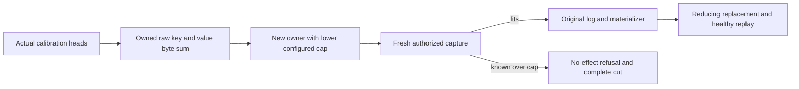

# Configured BM25 publication quota

This Search supplement implements the configured family-budget acceptance of [Bm25CorpusCurrent](Bm25CorpusCurrent.md). It is single-owner functional coverage, not cluster or scale qualification.

- REQ-BM25-QUOTA001 → AC-BM25-QUOTA001: derive an exact byte capacity from complete actual retained key/value arrays produced by genuine capture/publication, then configure a separate owner with that lower MaxBatchBytes. Eight real heads must fit exactly; capacity minus one must refuse the final fresh capture with BudgetExceeded and the exact family Capacity detail, preserving the complete canonical image, position and original journal cut.
- REQ-BM25-QUOTA002 → AC-BM25-QUOTA002: replace an existing head with fewer actual query terms while full, observe lower retained bytes, then publish a fresh healthy replacement restoring the exact capacity. Original phase replay preserves its receipt, retained entry and complete cut.
- REQ-BM25-QUOTA003 → AC-BM25-QUOTA003: capture and issuer keep original persisted principal/field authorization, configured budgets, generated payload and genuine log/materializer. Fixture disposal preserves initiating and cleanup failures.

Automated mapping: Bm25ConfiguredQuotaTests.ConfiguredRawByteCapacityPreservesRefusalReplacementAndReplay(bool), both exact-capacity and one-byte-under arguments; Bm25ConfiguredQuotaFlow owns configured fixtures, Trial owns operations, Bytes owns independent retained raw oracles. Existing publication/kernel tests retain count-quota coverage. Known capture refusals have no effects; a race after capture may commit an original failed receipt during atomic recheck and is not asserted to have no effects.

No quota is raised; no fabricated head or direct canonical transaction is used.

- REQ-BM25-QUOTA004 → AC-BM25-QUOTA004: known capacity-minus-one fresh capture refusal also preserves exact complete retained journal entry values for each of the seven actual admitted publication command IDs. Bm25ConfiguredQuotaRetainedEntries bounds this set by the existing HeadCount, bounds original LastIndex by existing MaxScanRecords and charges serialized observations to original read work. This supplements canonical image/position/applied and journal CUT; it does not inventory all seed/membership entries or raw replica storage bytes. The before/after original entry comparisons include Index and the full original Command<DatabaseCommand> with RuntimePayload.
