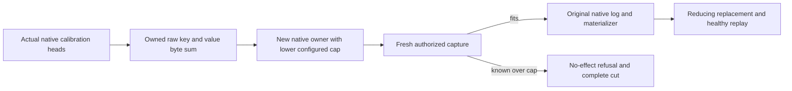

# Configured BM25 publication quota

This Search supplement implements the configured family-budget acceptance of [Bm25CorpusCurrent](Bm25CorpusCurrent.md). It is native single-owner functional coverage, not RF3 or scale qualification.

- REQ-BM25-QUOTA001 → AC-BM25-QUOTA001: derive an exact byte capacity from complete actual retained key/value arrays produced by genuine native capture/publication, then configure a separate native owner with that lower MaxBatchBytes. Eight real heads must fit exactly; capacity minus one must refuse the final fresh capture with BudgetExceeded and the exact family Capacity detail, preserving the complete canonical image, position and original journal cut.
- REQ-BM25-QUOTA002 → AC-BM25-QUOTA002: replace an existing head with fewer actual query terms while full, observe lower retained bytes, then publish a fresh healthy replacement restoring the exact capacity. Original phase replay preserves its receipt, retained native entry and complete cut.
- REQ-BM25-QUOTA003 → AC-BM25-QUOTA003: capture and issuer keep original persisted principal/field authorization, configured budgets, generated payload and genuine log/materializer. Fixture disposal preserves initiating and cleanup failures.

Automated mapping: Bm25ConfiguredQuotaTests.ConfiguredRawByteCapacityPreservesNativeRefusalReplacementAndReplay(bool), both exact-capacity and one-byte-under arguments; Bm25ConfiguredQuotaFlow owns configured native fixtures, Trial owns operations, Bytes owns independent retained raw oracles. Existing publication/kernel tests retain count-quota coverage. Fresh whole-capture record-limit isolation remains OPEN because metadata reads and family scan consume the same MaxScanRecords. Known capture refusals have no effects; a race after capture may commit an original failed receipt during atomic recheck and is not asserted to have no effects.

Source, compiler, native test execution, Linux, process recovery and RF3 gates remain separately OPEN until authentic Main-owned evidence is retained. No quota is raised; no fabricated head or direct canonical transaction is used.
