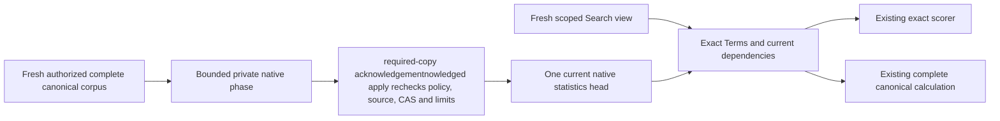
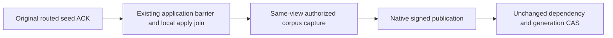
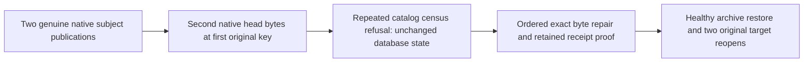

# Search: native current BM25 corpus statistics

Accepted implementation contract. This is one bounded current-format native statistics head, separate from provider postings and distributed read-cut witnesses. [Search](../Search.md), [BM25 dependencies](Bm25InvalidationDependencies.md), [ADR-018](../../ADR/ADR-018-global-rank-fusion.md), [native serialization](../../ADR/ADR-060-native-internal-serialization.md) and [current format](../../ADR/ADR-011-current-native-format.md) remain applicable.

## Scope and ownership

Core owns canonical publication, retained-family admission and read validation under `Features/Search/{Contracts,Serialization,Validation,Admission,Execution,Commands,Queries}/`. Query owns exact canonical capture and read-only reuse under `Features/Search/{Execution,Queries}/`. The existing four-field `KeyLoad.Query.Features.QueryExecution.DistributedTextStatisticsV1` moves mechanically to Core Search Contracts: same namespace, internal visibility, serializer alias `keyload.query.distributed-text-statistics.v1` and IDs0–3. Core already grants Query internal access; existing callers and validation remain authoritative. No duplicate DTO, assembly cycle, public schema or scorer.

Public Search/SDK/MCP results, SQL and initial operation tools remain unchanged. Frontend N/A: no new UI. Execution uses the existing Orleans grains and node-local ZoneTree ownership. Tests use UnitTests/Search and genuine current-format native backup fixtures; these do not substitute for the SDK/official MCP tests on the replicated cluster.

## Frozen native format and private publication

Native family `bm25-corpus-current` has key `KeySpace.Partition(family, partition, collection, field, tokenizerVersion, principalId)`. One replaceable exact query-Terms head exists at that full identity. No whole-vocabulary dictionary, pages, staging/global store or parallel scorer.

Generated head alias `keyload.core.search.bm25-corpus-current.v1` has these immutable field IDs:

| ID | Field | Native type |
|---|---|---|
| 0 | FormatVersion | int |
| 1 | Partition | PartitionRef |
| 2 | Collection | string |
| 3 | Field | string |
| 4 | TokenizerVersion | string |
| 5 | PrincipalId | string |
| 6 | PolicyEpoch | long |
| 7 | SchemaVersion | long |
| 8 | ResourcePolicyDigest | string |
| 9 | SourceOwner | node-local ZoneTree owner identity |
| 10 | SourceOutboxTail | long |
| 11 | CapturePosition | long |
| 12 | CaptureApplied | long |
| 13 | CaptureReadGeneration | long |
| 14 | Incarnation | Guid |
| 15 | Statistics | existing DistributedTextStatisticsV1 |
| 16 | Generation | Guid |
| 17 | PayloadDigest | string |

Private `OperationKind.Bm25CorpusPublicationPhase = 45` uses purpose `keyload-bm25-corpus-publication-verified-v1`. Generated phase alias `keyload.core.search.bm25-corpus-publication-phase.v1`: Id0 CommandId (Guid), Id1 Current (Bm25CorpusCurrentV1), Id2 ExpectedGeneration (Guid?), Id3 OriginalExpiry (DateTimeOffset), Id4 SourcePartition (atomic partition identity and store incarnation). Current.Generation equals CommandId. Native authenticated fingerprint binds the complete phase, expected head and original expiry. A bounded domain-separated SHA256 PayloadDigest binds the native head with its digest empty plus exact native SourcePartition bytes; head IDs remain unchanged.

SourceOwner is the node-local ZoneTree owner identity. SourcePartition binds the actual atomic partition identity and store incarnation. Capture Position/Applied/ReadGeneration are originating-view evidence; never equate them to a receiving copy's local cut. Publication changes Store.Position: never compare post-publication position with pre-publication capture. Existing distributed witnesses retain actual NodeId/current cut authority.

Query capture uses the existing tokenizer `keyload-nfkc-rune-lower-v1`, CanonicalTextTerms/SearchTerms and TextRanker.ForStatistics. A shared canonical tokenizer constant may replace the existing constant's declaration with a forwarding reference; no duplicate analyzer or changed tokenization.

First-run committed apply compares OriginalExpiry with replicated operation.EvaluatedAt, preserving a deterministic outcome across the copies. Original native issuer/capture honors its existing actual cancellation/deadline. Per-replica wall clocks must not decide whether one committed publication succeeds. Deterministic native before-copy work counters retain existing read/scan bounds independently of retained-family admission.

Fresh canonical capture checks retained-family capacity in that same bounded authorized source read view after constructing the exact current head and before issuing any native operation. Known over-capacity fresh capture refuses with complete source/log/receipt no effects. The original-operation retry retains its immutable phase and does not recapture or reapply first-run capacity, dependency or inner-expiry checks. Atomic committed apply independently rechecks capacity before its first family write: a competing publication between capture and apply may produce the existing durable refused-operation receipt; this race is not described as a pre-admission no-effect refusal.

Portable RequireRecord validates strict native shape, complete canonical key and original byte bounds. Because the head does not retain the full historical SourcePartition, it cannot independently recompute that historical PayloadDigest. Publication verifies it with phase Id4; Query recomputes against the fresh partition identity. Current authenticated archive/MAC and exact-copy validation protect transferred bytes; a restored old head stays ineligible for reuse until genuine recapture. No Id18 is added.

Fresh receipt authorization also requires exact current target-subject PolicyEpoch after current administrator/target capabilities. A higher-epoch restore does not revive an old subject-scoped receipt; mismatch refuses the existing safe PermissionDenied without effects. Source-tail/CAS/quota/inner expiry checks stay first-run only, so document changes alone do not invalidate an otherwise currently authorized original receipt. Existing executing-admin outcome epoch and schema stay unchanged.

The explicit internal Server maintenance entry NativeBm25CorpusMaintenance.PublishAsync uses the actual PartitionHost Query capture, then Core CreateVerifiedBm25CorpusPublication outside the read callback, A's private codec and original OrleansNode.ExecuteAsync/native identity-context with joined streaming. It accepts actual server-authenticated administrator identity; no caller roles or fabricated system admin. Query capture happens once. A bounded original-operation overload accepts only the original verified private45 Command<DatabaseCommand>, copies its original native body, uses fresh outer envelope expiry and the same real native route; retries retain that operation instead of recapturing/reconstructing from a head under the same ID. No public catalogue/read kind/SQL/config/scheduler trigger is added. A genuine private caller operation must invoke the entry; DI-only/dead factory is not evidence.

## Requirements and measurable acceptance

| Requirement | Acceptance and operation tests |
|---|---|
| REQ-BM25-CURRENT-001: capture the complete currently authorized canonical corpus and ordered Terms using the same exact scorer and full dependencies | AC-BM25-CURRENT-001: native Bm25CorpusPublicationTests plus existing TextRanker/distributed tests compare independent expected document count, total length and term frequencies, including empty/missing/nonmatching fields and row visibility. Incomplete scans, cancellation and read limits refuse without publication. |
| REQ-BM25-CURRENT-002: publish only through a server-verified private maintenance operation acknowledged by a majority of the copies | AC-BM25-CURRENT-002: fresh actual administrator and fresh target subject Query/DocumentsRead/FieldUse/row-corpus authorization precede capture and apply. Apply rechecks complete canonical dependencies, the partition identity and expected-generation CAS before first write. Generic public factories/envelopes/catalogue reject45. Native revoked-admin/subject, field denial, changed source, CAS conflict and literal healthy fullflows compare complete no-effect state. |
| REQ-BM25-CURRENT-003: bound TOTAL retained current-family raw keys plus values in the partition in the same transaction before first write | AC-BM25-CURRENT-003: retained records <= existing MaxScanRecords and retained bytes <= existing MaxBatchBytes independently of request read/batch/cancellation budgets. Genuine native full/one-over cases assert existing budget refusal and exact no effects; a smaller replacement reduces retained bytes and permits a subsequent healthy head. This is a new retained use of those limits, not a fabricated quota or claim previous code already enforced it. |
| REQ-BM25-CURRENT-004: Search reuses only an exact fresh head and stays read-only | AC-BM25-CURRENT-004: same-view exact Terms plus fresh policy/schema/resource digest, owner/incarnation, outbox tail and the full partition identity admit reuse. Missing/malformed/unsupported/stale heads use the unchanged exact complete canonical calculation with no writes. Mutation, policy/schema-only change, changed Terms and corrupt bytes compare full results/canonical rows/cuts and literal healthy continuation. No approximate, engine or legacy fallback. |
| REQ-BM25-CURRENT-005: preserve original command identity/receipts and current policy fencing | AC-BM25-CURRENT-005: matching original phase body/ID returns its complete original CommitReceipt after fresh admin and target auth; changed same-ID body refuses. First-run expiry/dependency/CAS/quota checks do not rewrite replay semantics. Genuine native append/commit/apply, cold reopen and healthy subsequent publication retain joined cleanup. |
| REQ-BM25-CURRENT-006: native family delivery is coherent before the write entry is admitted | AC-BM25-CURRENT-006: independent sorted family inventory gains exactly this family (83). Backup export and restore validate the complete key/native header inside existing bounds before digest/write. Backup Census validates before canonical scope/global digest. Existing restore source verification plus bidirectional exact rows retains original head bytes without transformation. Actual publication -> native backup/restore/cold flows prove partition/subject isolation, corrupt/unsupported refusal and healthy reopen. No seed-only fake publication, old reader, migration or compatibility path. |
| REQ-BM25-CURRENT-007: qualify the actual product path and any performance claim | AC-BM25-CURRENT-007: TUnit plus the Aspire replicated cluster with the .NET SDK and official MCP prove authorized results, receipt/restart behavior and joined resources. Comparable original CPU/allocation/memory/latency evidence is required for any speed claim; source and native unit controls close none of these independent gates. |

## Native maintenance current local view

REQ/AC-BM25-CURRENT-001/002 require the fresh Server maintenance query overload to join the existing node-local Coordinator.Application read barrier before reading the canonical corpus and its outbox/resource dependencies. A public routed write receipt alone does not prove the selected local copy has applied that write. The barrier uses the smaller of remaining original expiry and existing work.RemainingLifetime with the actual database EvaluationClock. A genuine linked token carries original caller cancellation, work.Cancellation and that deadline into the same barrier; post-wait work.Check remains. Lexical CTS cleanup and actual barrier failures retain the ordered original failure ledger. Preserve original expiry, authorization and all first-run dependency/CAS refusals. Original pre-captured phase retry overload never recaptures, retries or mutates the retained phase.

## Published subject bytes at the wrong canonical key

REQ-BM25-KEYBODY-001 maps to AC-BM25-CURRENT-006. AC-BM25-KEYBODY-001: the actual second published subject head is placed under the first subject's original canonical key. Both heads are genuine, independently admitted native publications; no synthetic header or foreign policy is generated. Two original catalog captures must refuse with exact Corruption and Bm25CorpusProtocol.Invalid before admitting an archive. Baselines follow the deliberate Unit-owned native transaction and include complete bounded canonical rows, actual identity, position, applied position and native journal index/commit. Both original admitted entry and complete result bytes remain unchanged.

Repair restores the original first head bytes even if a refusal/assertion fails, preserving initiating and repair failures in order. Healthy native publication, authenticated pack/unpack/restore, exact subject head bytes and both original target reopens reuse the existing owner and pipeline. The original format-refusal case remains unchanged. Automated mapping: Bm25PortableFamilyKeyBodyTests.ActualPublishedForeignSubjectBytesRefuseCatalogCaptureThenRepairAndSurviveBothNativeReopens (one case, no Arguments).

This bounded unit flow is not SDK/MCP, scale or power-loss proof. Journal evidence is the actual cut plus selected original publication entries/results, not a complete journal inventory. Database no-effects does not promise no temporary backup files; the existing fixture failure ledger and cleanup own those files.
