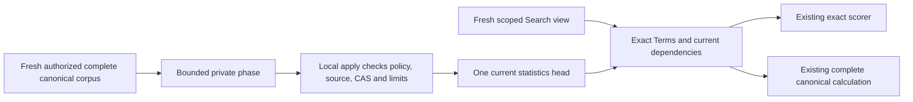
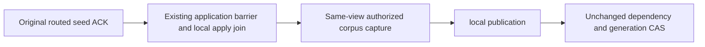

# Search: current BM25 corpus statistics

Accepted implementation contract. This is one bounded current-format statistics head, separate from provider postings and distributed read-cut witnesses. [Search](../Search.md), [BM25 dependencies](Bm25InvalidationDependencies.md), [ADR-018](../../ADR/ADR-018-global-rank-fusion.md), [serialization](../../ADR/ADR-060-internal-serialization.md) and [current format](../../ADR/ADR-011-current-format.md) remain applicable.

## Scope and ownership

Core owns derived publication, retained-family admission and read validation under `src/KeyLoad.Core/Search/`. Query owns exact canonical capture and read-only reuse under `src/KeyLoad.Query/Search/`. Core owns the four-field `KeyLoad.Query.Features.QueryExecution.DistributedTextStatistics` contract with internal visibility, serializer alias `keyload.query.distributed-text-statistics` and IDs0–3. Core grants Query internal access.

Public Search/SDK/MCP results, SQL and initial operation tools remain unchanged. Frontend N/A: no new UI. Execution uses the existing Orleans grains and node-local ZoneTree ownership. Tests use UnitTests/Search and genuine current-format backup fixtures; these do not substitute for the SDK/official MCP tests on the replicated cluster.

## Frozen format and private publication

family `bm25-corpus-current` has key `KeySpace.Partition(family, partition, collection, field, tokenizerVersion, principalId)`. One replaceable exact query-Terms head exists at that full identity. No whole-vocabulary dictionary, pages, staging/global store or parallel scorer.

Generated head alias `keyload.core.search.bm25-corpus-current` has these immutable field IDs:

| ID | Field | type |
|---|---|---|
| 0 | FormatVersion | int |
| 1 | Partition | PartitionRef |
| 2 | Collection | string |
| 3 | Field | string |
| 4 | TokenizerVersion | string |
| 5 | PrincipalId | string |
| 6 | PolicyEpoch | long |
| 7 | SchemaVersion | long |
| 8 | ResourcePolicyDigest | string |
| 9 | SourceOwner | node-local ZoneTree owner identity |
| 10 | SourceOutboxTail | long |
| 11 | CapturePosition | long |
| 12 | CaptureApplied | long |
| 13 | CaptureReadGeneration | long |
| 14 | Incarnation | Guid |
| 15 | Statistics | existing DistributedTextStatistics |
| 16 | Generation | Guid |
| 17 | PayloadDigest | string |

Private `OperationKind.Bm25CorpusPublicationPhase = 45` uses execution `Command<DatabaseCommand>` with verified administrator UserId and server-evaluated Timestamp. Generated phase alias `keyload.core.search.bm25-corpus-publication-phase`: Id0 CommandId (Guid), Id1 Current (Bm25CorpusCurrent), Id2 ExpectedGeneration (Guid?), Id3 OriginalExpiry (DateTimeOffset), Id4 SourcePlacement (actual atomic partition and local storage identity). Current.Generation equals CommandId. The command fingerprint binds the complete phase, expected head and original expiry. A bounded domain-separated SHA256 PayloadDigest binds the head with its digest empty plus exact SourcePlacement bytes.

SourceOwner is the node-local ZoneTree owner identity. SourcePlacement binds the atomic partition and store incarnation. Capture Position/Applied/ReadGeneration describe the originating view. BM25 publication is silo-local derived work: it advances physical Store.Position without advancing the canonical command sequence. Its acknowledgement describes actual local persistence. Existing distributed witnesses retain actual NodeId/current-cut authority.

Query capture uses tokenizer `keyload-nfkc-rune-lower`, CanonicalTextTerms/SearchTerms and TextRanker.ForStatistics through the shared TextProjectionProtocol tokenizer identity.

First-run local apply compares OriginalExpiry with the original command Timestamp. capture retains caller cancellation and its deadline. Existing ReadExecutionBudget counters enforce read/scan bounds independently of retained-family admission.

Fresh canonical capture checks retained-family capacity in the bounded authorized source view before issuing a command. Known over-capacity capture refuses without changing canonical rows, cuts or retained outcomes. Retry retains its original phase and does not recapture or repeat first-run capacity, dependency or inner-expiry checks. Atomic apply independently checks capacity before the first family write. A race after capture may persist a failed command outcome and must be tested against that actual effect.

Bm25CorpusShape.RequireRecord checks strict shape, complete key and byte bounds at the owning BM25 read boundary. A malformed or unsupported optional head is ineligible for reuse; the existing exact canonical query still determines results. Raw backup verifies file integrity and preserves exact head and outcome bytes. Pack/Unpack packages those canonical files without a BM25 schema callback. A restored head remains ineligible until fresh current-identity capture. Phase Id4 supplies the original source identity for publication digest validation; query reuse checks the current dependencies.

Fresh receipt authorization also requires exact current target-subject PolicyEpoch after current administrator/target capabilities. A higher-epoch restore does not revive an old subject-scoped receipt; mismatch refuses the existing safe PermissionDenied without effects. Source-tail/CAS/quota/inner expiry checks stay first-run only, so document changes alone do not invalidate an otherwise currently authorized original receipt. Existing executing-admin outcome epoch and schema stay unchanged.

The internal Server maintenance entry Bm25CorpusMaintenance.PublishAsync uses actual PartitionHost Query capture and Core CreateVerifiedBm25CorpusPublication with the server-authenticated administrator identity. Capture happens once. The original-operation overload retains the bounded verified private45 command, exact input and command ID through the actual connection-grain route. Fresh persisted authorization still applies to retry. Runtime qualification requires execution of this path, beyond DI registration or local fixture source.

## Requirements and measurable acceptance

| Requirement | Acceptance and operation tests |
|---|---|
| REQ-BM25-CURRENT-001: capture the complete currently authorized canonical corpus and ordered Terms using the same exact scorer and full dependencies | AC-BM25-CURRENT-001: Bm25CorpusPublicationTests plus existing TextRanker/distributed tests compare independent expected document count, total length and term frequencies, including empty/missing/nonmatching fields and row visibility. Incomplete scans, cancellation and read limits refuse without publication. |
| REQ-BM25-CURRENT-002: publish through a server-verified private local maintenance operation with truthful persistence acknowledgement | AC-BM25-CURRENT-002: fresh administrator and target subject Query/DocumentsRead/FieldUse/row-corpus authorization precede capture and apply. Apply rechecks canonical dependencies, local storage identity and expected-generation CAS before first write. Generic public factories reject45. Revoked authority, field denial, changed source and CAS conflict preserve their actual outcome/no-effect contracts. |
| REQ-BM25-CURRENT-003: bound TOTAL retained current-family raw keys plus values in the partition in the same transaction before first write | AC-BM25-CURRENT-003: retained records <= existing MaxScanRecords and retained bytes <= existing MaxBatchBytes independently of request read/batch/cancellation budgets. Genuine full/one-over cases assert existing budget refusal and exact no effects; a smaller replacement reduces retained bytes and permits a subsequent healthy head. This is a new retained use of those limits, not a fabricated quota or claim previous code already enforced it. |
| REQ-BM25-CURRENT-004: Search reuses only an exact fresh head and stays read-only | AC-BM25-CURRENT-004: same-view exact Terms plus fresh policy/schema/resource digest, owner/incarnation, outbox tail and the full partition identity admit reuse. Missing/malformed/unsupported/stale heads use the unchanged exact complete canonical calculation with no writes. Mutation, policy/schema-only change, changed Terms and corrupt bytes compare full results/canonical rows/cuts and literal healthy continuation. No approximate, engine or legacy fallback. |
| REQ-BM25-CURRENT-005: preserve original command identity/receipts and current policy fencing | AC-BM25-CURRENT-005: matching original phase body/ID returns its complete original CommitReceipt after fresh admin and target auth; changed same-ID body refuses. First-run expiry/dependency/CAS/quota checks do not rewrite replay semantics. Genuine append/commit/apply, cold reopen and healthy subsequent publication retain joined cleanup. |
| REQ-BM25-CURRENT-006: preserve subject-scoped heads and outcomes through portable local backup/restore | AC-BM25-CURRENT-006: genuine two-subject publication, CreateBackup/VerifyBackup, Pack/Unpack, local Restore and two cold reopens retain exact head bytes and complete original receipts. Source bytes/position remain unchanged. The target receives a fresh physical identity and dispatch pause while canonical sequence/clock, records and outcomes are retained. Optional-head validity is checked by BM25 operations; raw backup does not supply a BM25 schema census. |
| REQ-BM25-CURRENT-007: qualify the actual product path and any performance claim | AC-BM25-CURRENT-007: TUnit plus the Aspire replicated cluster with the .NET SDK and official MCP prove authorized results, receipt/restart behavior and joined resources. Comparable original CPU/allocation/memory/latency evidence is required for any speed claim; source and unit controls close none of these independent gates. |

## maintenance current local view

REQ/AC-BM25-CURRENT-001/002 require the fresh Server maintenance query overload to join the actual node-local coordinator read barrier before reading the canonical corpus and outbox/resource dependencies. The barrier retains original expiry, work lifetime and caller cancellation. Post-wait work.Check, ordered cleanup failures and first-run dependency/CAS refusals remain required. The pre-captured retry overload retains its original phase.

## Portable subject heads and restored eligibility

AC-BM25-CURRENT-006 maps to `Bm25PortableFamilyBackupTests.ActualPublishedSubjectHeadsRemainExactThroughRestoreAndBothReopens`. Two row-restricted subjects have independent head keys, exact bytes and literal corpus statistics. Complete original receipts survive the portable pipeline and both target reopens. The complete bounded source image and position remain unchanged.

The separate existing Bm25CorpusOptionalHeadTests requires malformed or unsupported optional heads to decline reuse without changing complete canonical search results or storage cuts, followed by exact byte repair and healthy reuse. [Restored eligibility](Bm25RestoredEligibility.md) retains fresh policy revoke/repair, new-owner publication and original receipt replay.

This portable source adaptation has not yet been compiled or run. The local fixture owns actual ZoneTree files and joined cleanup. SDK/MCP, cluster operation, process recovery, scale, power loss and performance remain separate open gates.
