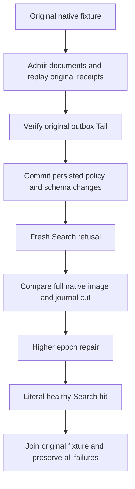

# Search invalidation dependency native control
Status: source joined for the warm and same-owner cold invalidation regressions; current-image execution and independent Linux/RF3/public-client qualification remain OPEN.

REQ-BM25-DEP-001: admitted document Put, Patch, access replacement and Delete must each publish one original outbox entry; matching command replay must retain its complete original receipt without duplicating Tail.
REQ-BM25-DEP-002: principal PolicyEpoch and resource policy SchemaVersion are independent authorization dependencies. Their genuine administrative native commands leave document Tail unchanged while fresh Search immediately enforces changed permissions.
REQ-BM25-DEP-003: rejected Search changes neither full canonical rows/position/identity nor original native journal cut. Higher-epoch/schema repair must permit a literal healthy hit. Body and actual fixture disposal failures remain ordered and retained.

AC-BM25-DEP-001 maps REQ001 to EveryDocumentMutationPublishesOnceAndCurrentPolicyChangesDoNotUseOutboxAsAuthority, with genuine TestDatabase native append/commit/apply and complete original receipt replay.
AC-BM25-DEP-002 maps REQ002/003 to the same test: revoke Query, then repair at higher policy epoch; introduce actual FieldUse policy, then repair grants at a still higher epoch. Each denied read compares complete bounded canonical rows/position/identity and native journal cut. Schema and epochs are exact returned native administrative results.
AC-BM25-DEP-003 maps REQ003 to original joined TestDatabase disposal under ServerFailureObserver. No fabricated context, provider, clock, transport or new storage owner.

Canonical map: tests/KeyLoad.UnitTests/Search/Cases/Bm25/Bm25InvalidationDependencyTests.cs (TUnit case), Helpers/Bm25InvalidationDependencyFlow.cs (native operation and image owner). Existing Search.md REQ-SR-001/SR-005 and ChangeFeeds.md outbox semantics remain authoritative. This test adds no persistent statistics schema/quota/product API. It is native kernel control, not elected RF3/SDK/MCP/cold qualification. Original DistributedSearchRf3Tests false/true flows remain unchanged.

## Persisted head invalidation across original native cold reopen (proposed)

REQ-BM25-DEP-004 → AC-BM25-DEP-004: the new OriginalPersistedHeadFallsBackAfterDocumentAndPolicyChangesAcrossSameOwnerColdReopens case first publishes a real private45 head, then admits Patch, access-replacing Put, Delete and Put. Each literal outbox increment and complete original mutation receipt/retained entry replay is required. After joining/reopening the same canonical and distinct replica identities, the exact originally observed native head bytes remain retained yet ineligible while fresh canonical Search returns the literal repaired document without native effects. Document changes do not invalidate an otherwise authorized old publication receipt: exact original result/entry replay still succeeds.

REQ-BM25-DEP-005 → AC-BM25-DEP-005: native Query revocation at subject epoch2 and actual higher resource schema FieldUse restriction preserve Tail; a second original same-owner reopen preserves their complete canonical image and native journal CUT. Fresh Query and old phase issuance refuse PermissionDenied without effects. Query grant repair at epoch3 still lacks FieldUse; epoch4 field-grant repair allows literal healthy Search but does not revive epoch1 publication authority.

REQ-BM25-DEP-006 → AC-BM25-DEP-006: fresh epoch4/schema publication replaces only the original head generation with literal one-document/two-token corpus, becomes eligible in the real same-view head reader, and retains its complete CommitReceipt/native entry through exact original replay. Original RecoveryOwner.RunAsync owns both real reopen lifetimes and ordered primary/disposal failures; no alternate owner/provider or clock is created. Canonical bounded all-row image, position/applied and journal CUT are complete within original limits; selected original typed entries are not all raw replica journal bytes.

Canonical additions: Search/Cases/Bm25ColdInvalidationTests.cs, Helpers/Bm25ColdInvalidationTrial.cs and Assertions/Bm25ColdInvalidationAssertions.cs. Reuse existing Bm25OriginalPhaseRecoveryOwner/Flow/State without changing their original case or Count arguments. This distinct dependency case is native Unit control only; proposed source integration, compiler/runtime, Linux, process-kill and genuine RF3 SDK/official MCP qualification remain OPEN. Existing distributed flows and original local cold receipts remain unchanged.

