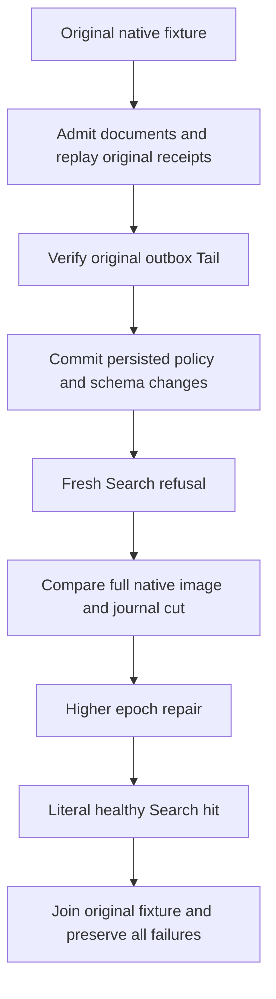

# Search invalidation dependency native control
Status: source-only proposed regression; product persisted-statistics capacity/publication remains OPEN.

REQ-BM25-DEP-001: admitted document Put, Patch, access replacement and Delete must each publish one original outbox entry; matching command replay must retain its complete original receipt without duplicating Tail.
REQ-BM25-DEP-002: principal PolicyEpoch and resource policy SchemaVersion are independent authorization dependencies. Their genuine administrative native commands leave document Tail unchanged while fresh Search immediately enforces changed permissions.
REQ-BM25-DEP-003: rejected Search changes neither full canonical rows/position/identity nor original native journal cut. Higher-epoch/schema repair must permit a literal healthy hit. Body and actual fixture disposal failures remain ordered and retained.

AC-BM25-DEP-001 maps REQ001 to EveryDocumentMutationPublishesOnceAndCurrentPolicyChangesDoNotUseOutboxAsAuthority, with genuine TestDatabase native append/commit/apply and complete original receipt replay.
AC-BM25-DEP-002 maps REQ002/003 to the same test: revoke Query, then repair at higher policy epoch; introduce actual FieldUse policy, then repair grants at a still higher epoch. Each denied read compares complete bounded canonical rows/position/identity and native journal cut. Schema and epochs are exact returned native administrative results.
AC-BM25-DEP-003 maps REQ003 to original joined TestDatabase disposal under ServerFailureObserver. No fabricated context, provider, clock, transport or new storage owner.

Canonical map: tests/KeyLoad.UnitTests/Features/Search/Cases/Bm25InvalidationDependencyTests.cs (TUnit case), Helpers/Bm25InvalidationDependencyFlow.cs (native operation and image owner). Existing Search.md REQ-SR-001/SR-005 and ChangeFeeds.md outbox semantics remain authoritative. This test adds no persistent statistics schema/quota/product API. It is native kernel control, not elected RF3/SDK/MCP/cold qualification. Original DistributedSearchRf3Tests false/true flows remain unchanged.

