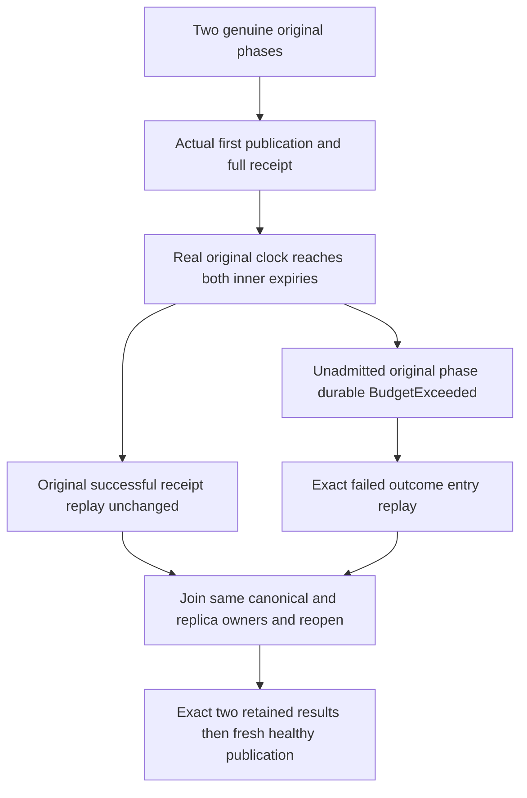

# Search: original BM25 phase inner-expiry native operation

Parent contract Bm25CorpusCurrent.md REQ/AC-BM25-CURRENT-005 and its deterministic first-run expiry paragraph remain authoritative. No product error, expiry, payload, alias, quota or authority change is proposed.

## Requirements and acceptance

REQ-BM25-EXPIRY-001 -> AC-BM25-EXPIRY-001: capture two actual original private45 operations through the existing RecoveryFlow before publishing either. Publish the first with its full genuine CommitReceipt. Retain actual NativePayload and full native entry. Wait using the actual database EvaluationClock and CancellationToken until the later original phase expiry, with the interval bounded by the observed original expiry and existing request lifetime. The existing issuer reissues the same original phase only after the clock has actually reached expiry; independently require new operation.EvaluatedAt >= original OriginalExpiry. The already-admitted first operation still returns its exact original complete result/receipt with full canonical image, position, applied and journal CUT unchanged. The original phase bytes are never reconstructed or altered.

REQ-BM25-EXPIRY-002 -> AC-BM25-EXPIRY-002: submit the other originally captured but unadmitted phase after its OriginalExpiry. Require actual BudgetExceeded and exact Bm25CorpusProtocol.Changed detail, null Json/NativeValue. This is a genuine silo-local committed failed outcome: physical store position advances by one, the canonical applied read cut remains unchanged, and the local stored outcome has CanonicalSequence=0. The actual entry carries its original full phase body, and the retained family keys/values remain unchanged. Do not assert complete store-image or journal no effects: the local outcome is a real admitted effect. Same-ID retry returns the exact complete failed result and leaves full post-failure state/selected entry unchanged.

REQ-BM25-EXPIRY-003 -> AC-BM25-EXPIRY-003: join and reopen the SAME RecoveryOwner once. Preserve complete canonical state, original identities and journal CUT, both selected actual entries and original phase bytes. Fresh current authorization still applies; repeat the already-successful and durably-failed original operation replays exactly without recapture under either ID. Capture a genuinely fresh-ID phase with expected generation equal to the first actual successful head, publish it, and require literal one-document/one-token statistics plus the original literal healthy Search. Existing owner cleanup retains body, fatal and every join/disposal failure; roots survive failure.

## Canonical map
New tests/KeyLoad.UnitTests/Search/Cases/Bm25/Bm25OriginalExpiryTests.cs owns OriginalInnerExpiryRefusesFirstApplyButPreservesAdmittedReceiptThenColdReplayAndFreshHealthyPublication. Helpers/Bm25OriginalExpiryTrial.cs owns actual operations/wait. Assertions/Bm25OriginalExpiryAssertions.cs owns complete result, native entry, family bytes and cut comparisons. Existing Bm25OriginalPhaseRecoveryOwner/Flow/State remain unchanged. Product/public/frontend/infrastructure changes: N/A; original native unit log/materializer and real ZoneTree are reused. No fake clock, provider, transport or manually fabricated phase/receipt is permitted.

Scope limits: complete bounded canonical rows, native applied/store-position observations and the two selected original typed outcomes do not qualify a concurrent cross-store snapshot, process-kill, power-loss, SDK/MCP or performance behavior. Native execution and delivered-source qualification remain separate. Timing must cross the actual expiry boundary; it cannot assume ordinary execution is slow. Caller cancellation aborts the original wait and is joined by the existing owner.