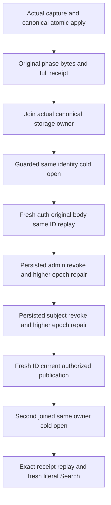

# Search: original BM25 private-phase cold recovery

Status: source integrated for REQ-BM25-CURRENT-005. This is local single-owner development evidence. [Current BM25 contract](Bm25CorpusCurrent.md) and ADR-127 remain authoritative.

## Canonical slice and ownership
The UnitTests/Search roles own the test case, operation trial, configured original owner, publication/authentication flow and complete canonical-state assertions. Product, public DTOs and private45 schema remain unchanged. Server, Query and Core implementation dependencies are existing BM25 capture/publication. Frontend N/A; the fixture uses the actual canonical ZoneTree owner; this local mechanism does not qualify a replicated cluster.

The fixture creates one configured TestDatabase and retains its complete original canonical storage identity. After joining the original owner, it reopens the same existing root and incarnation through ZoneTreeExistingStore and creates the configured engine over that store. It does not bootstrap another root, reconstruct a retained phase/head or replace the transport. Every acquired original/cold storage owner is joined, failures retain owned evidence, and successful cleanup deletes only the fixture-owned root.

## Requirements and acceptance
| Requirement | Acceptance/test mapping |
|---|---|
| REQ-BM25-RECOVERY-001: retain the actual original verified private45 body and complete terminal result across joined close/reopen | AC-BM25-RECOVERY-001: OriginalPhaseReceiptColdRecoveryHonorsCurrentAdminAndSubjectEpochsThenFreshPublicationIsHealthy compares actual retained outcome bytes, original command input, complete `Result<object>` and CommitReceipt; canonical identity, rows, local position, canonical applied sequence stay exact on original same-ID replay after the first cold open. |
| REQ-BM25-RECOVERY-002: fresh executing-admin authorization and its outcome epoch fence still govern retained receipts | AC-BM25-RECOVERY-002: actual root-owned persisted publisher epoch2 revocation rejects issuer and original submission with literal PermissionDenied and complete post-policy state unchanged; epoch3 admin repair does not revive epoch1 outcome. A new publication succeeds under the current admin. |
| REQ-BM25-RECOVERY-003: fresh target-subject grants and exact phase target epoch govern old receipts | AC-BM25-RECOVERY-003: actual subject epoch2 removes Query, issuer/submission deny without effects; epoch3 restored grants still deny the old epoch1 phase. A genuinely recaptured fresh-ID phase succeeds with literal target epoch3. |
| REQ-BM25-RECOVERY-004: recovery preserves ownership and joined cleanup | AC-BM25-RECOVERY-004: second complete close/reopen retains current receipt/full canonical state and original entry/body; the same original successful current phase replays exactly, then a fresh publication and literal Search hit succeed. Original body, every cleanup failure and fatal cause are retained by the existing ServerFailureObserver ledger. |

Complete image means every canonical row read in complete storage pages, plus the applied sequence and physical store position. These observations do not prove a concurrent cross-store snapshot, process crash, power loss or cluster acknowledgement. Policy mutations are actual admitted changes; no-effect baselines are captured after those changes. Historical failed receipts are not republished as healthy. Replay uses the original phase input and freshly validated issuer authority, without reconstructing a head or recapturing under the old ID.

