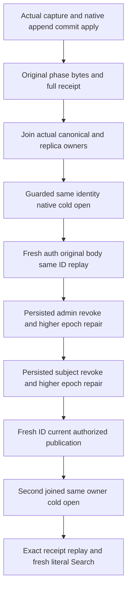

# Search: original BM25 private-phase native cold recovery

Status: future source preview for REQ-BM25-CURRENT-005. No source integration, compiler, execution, process-kill, RF3, SDK/MCP or durability claim follows from this packet. [Current BM25 contract](Bm25CorpusCurrent.md) and ADR-127 remain authoritative.

## Canonical slice and ownership
Five new UnitTests/Search roles own the test case, operation trial, configured original owner, publication/authentication flow and complete canonical-state assertions. Product, public DTOs and private45 schema remain unchanged. Server, Query and Core implementation dependencies are existing native BM25 capture/publication. Frontend N/A; infrastructure uses the actual existing native unit log/materializer, not an elected RF3 cluster.

The fixture creates one genuine configured TestDatabase with native admission and its mandated original sibling replica directory. After joining the original admission and canonical owner exactly once, it opens that SAME canonical identity/incarnation with ZoneTreeExistingStore and the SAME original replica identity through CreateTargetAdmission. No bootstrap, new incarnation, rebuilt phase/head or replacement transport is used. Every acquired original/cold admission and store is joined, and failure keeps owned evidence; success deletes only the two fixture-owned directories.

## Requirements and acceptance
| Requirement | Acceptance/test mapping |
|---|---|
| REQ-BM25-RECOVERY-001: retain the actual original verified private45 body and complete terminal result across joined native close/reopen | AC-BM25-RECOVERY-001: OriginalPhaseReceiptColdRecoveryHonorsCurrentAdminAndSubjectEpochsThenFreshPublicationIsHealthy compares actual retained entry bytes, NativePayload bytes, full OperationResult and CommitReceipt; canonical identity, rows, physical position, applied index and original native journal last/commit/term cut stay exact on original same-ID replay after the first cold open. |
| REQ-BM25-RECOVERY-002: fresh executing-admin authorization and its outcome epoch fence still govern retained receipts | AC-BM25-RECOVERY-002: actual root-owned persisted publisher epoch2 revocation rejects issuer and original submission with literal PermissionDenied and complete post-policy state unchanged; epoch3 admin repair does not revive epoch1 outcome. A new publication succeeds under the current admin. |
| REQ-BM25-RECOVERY-003: fresh target-subject grants and exact phase target epoch govern old receipts | AC-BM25-RECOVERY-003: actual subject epoch2 removes Query, issuer/submission deny without effects; epoch3 restored grants still deny the old epoch1 phase. A genuinely recaptured fresh-ID phase succeeds with literal target epoch3. |
| REQ-BM25-RECOVERY-004: recovery preserves native ownership and joined cleanup | AC-BM25-RECOVERY-004: second complete native close/reopen retains current receipt/full canonical state and original entry/body; the same original successful current phase replays exactly, then a fresh publication and literal Search hit succeed. Original body, every cleanup failure and fatal cause are retained by the existing ServerFailureObserver ledger. |

Complete image means every canonical native row, with a fail-closed MaxScanRecords traversal and actual before-copy read budget, plus position/applied and journal CUT. It does not mean all raw replica journal rows, a process crash, power loss or RF3 acknowledgement proof. Policy mutations are real admitted changes; no-effects baselines are taken AFTER those changes. Historical failed receipts are not republished as healthy. Replay uses the original actual phase body and fresh native issuer authority; no head reconstruction or recapture under the old ID.

Qualification remains OPEN: exact-source Linux build/TUnit, configured Server maintenance caller, process recovery, genuine Aspire RF3 SDK/official MCP and performance/fault gates are separate. This packet adds a native kernel cold operation; it does not retire or qualify any original UID.

REQ-BM25-RECOVERY-005 → AC-BM25-RECOVERY-005: the future configured-count companion may call Reopen(DatabaseLimits? configuredLimits = null). Null preserves the original captured factory. A supplied limit is validated before joining and may change only MaxScanRecords to the same or a lower positive value; every other original limit, native option group, movement checkpoint and evaluation clock stays unchanged. The new Core owner is created by the existing TestDatabaseEngineFactory with the actual opened native catalog owner. Original canonical/replica identities and joined lifecycle remain unchanged. The complete canonical assertion inventory uses the ORIGINAL observation record/read limits separately from the constrained operation limit; it never claims those observation bounds apply to publication. A owns the distinct configured-count Case/Trial/spec mapping; its source and operation execution gate remain OPEN before this criterion can pass.
