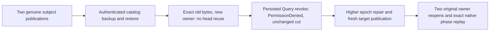

# Restored BM25 eligibility and original native replay

This Search supplement maps [Bm25CorpusCurrent](Bm25CorpusCurrent.md) REQ/AC-BM25-CURRENT004–006. It adds acceptance coverage, without changing stored formats or restored owner authority.

- REQ-BM25-RESTORED001 → AC-BM25-RESTORED001: two row-restricted subjects retain exact native head bytes through the real archive pipeline. The target has a different incarnation; both old heads decline reuse. Literal visible document IDs/JSON and complete ranked source/target pages match, without changing canonical rows, position, identity, applied state or native journal cut.
- REQ-BM25-RESTORED002 → AC-BM25-RESTORED002: target persisted Query removal produces literal PermissionDenied before effects. The refusal baseline follows policy publication; complete source and target cuts remain unchanged. Restore with a higher actual returned epoch permits a fresh target publication; an old head never regains eligibility merely from restored grants.
- REQ-BM25-RESTORED003 → AC-BM25-RESTORED003: original source publication payload and receipt remain byte-exact and replay on the original source. A newly admitted target publication retains its own payload, receipt and current head through two original target reopens and cached replay. The untouched sibling head remains byte-exact and ineligible. Every read/replay baseline includes all canonical rows, owner identity, store position, applied position and retained journal index/commit/term cut.

Automated mapping: `Bm25RestoredEligibilityTests.ActualRestoredHeadsDeclineReuseUntilCurrentAuthorizationAndFreshPublicationThenReplayAcrossBothReopens` (one case, no Arguments). Existing `EventingArtifactFixture.RunAsync(nativeAdmission:true)` owns the original canonical/replica resources and joined failure ledger. Helpers own policy, bounded assertions and orchestration; no copied fixture or owner.

The journal oracle is a retained native cut plus selected original issued operation bytes and durable receipt, not complete journal inventory. This small functional corpus is not RF3, process-kill, scale, performance or power-loss qualification. Source joined; current compiled-image execution, compiler verification and exact-source Linux execution remain OPEN. Public SDK/official MCP and RF3 gates remain required separately.
