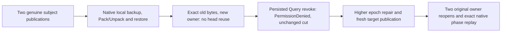

# Restored BM25 eligibility and original native replay

This Search supplement maps [Bm25CorpusCurrent](Bm25CorpusCurrent.md) REQ/AC-BM25-CURRENT-004..006. It adds acceptance coverage, without changing stored formats or restored owner authority.

- REQ-BM25-RESTORED001 → AC-BM25-RESTORED001: two row-restricted subjects retain exact native head bytes through native backup, Pack/Unpack and local Restore. The target has a different physical identity and paused dispatch while canonical records, outcomes, sequence and clock remain preserved. Both old heads decline reuse. Literal visible document IDs/JSON and complete ranked source/target pages match without changing canonical rows, position, identity or the actual canonical/store cut.
- REQ-BM25-RESTORED002 → AC-BM25-RESTORED002: target persisted Query removal produces literal PermissionDenied before effects. The refusal baseline follows policy publication; complete source and target cuts remain unchanged. Restore with a higher actual returned epoch permits a fresh target publication; an old head never regains eligibility merely from restored grants.
- REQ-BM25-RESTORED003 → AC-BM25-RESTORED003: the original source native command, exact Input and complete receipt remain byte-exact and replay on the original source. A newly admitted target publication retains its own native command, receipt and current head through two target reopens and replay. The untouched sibling head remains byte-exact and ineligible. Every read/replay baseline includes all canonical rows, owner identity and actual canonical sequence/store-position pair.

Automated mapping: `Bm25RestoredEligibilityTests.ActualRestoredHeadsDeclineReuseUntilCurrentAuthorizationAndFreshPublicationThenReplayAcrossBothReopens` (one case, no Arguments). Existing `EventingArtifactFixture.RunAsync` owns the real canonical ZoneTree source/target and joined failure ledger. Helpers own policy, bounded assertions and orchestration.

The oracle uses actual storage cuts, exact retained native commands, complete receipts and canonical rows. This source adaptation has not yet been compiled or run. The small local corpus does not qualify a cluster, process-kill recovery, scale, performance or power loss. Public SDK/official MCP and cluster gates remain open separately.
