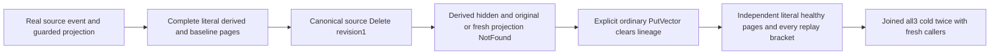

# Deleted source and explicit canonical vector replacement

This proposed Search-owned acceptance strengthens existing REQ/AC-LINEAGE-001/002/003 in EventProjectionLineage and ADR-089. It adds no worker, checkpoint, provider, serializer, library, API or generation contract. Public SDK and official MCP use the existing Aspire RF3 owner and original deadlines.

- REQ-LINEAGE-DELETE-PUBLIC-001 / AC-LINEAGE-DELETE-PUBLIC-001: genuine canonical source/target/baseline documents, source event and guarded projection produce independently literal full ranked rows and full original receipts. The original event identity, document revision and reducer are retained immutable requests; prepublication SDK/MCP placement independently binds receipt incarnation/epoch.
- REQ-LINEAGE-DELETE-PUBLIC-002 / AC-LINEAGE-DELETE-PUBLIC-002: delete the canonical source at expected revision1; derived target becomes ineligible while ordinary baseline stays visible. Original successful projection command replay and a fresh identical projection GUID strictly return NotFound under current source authority. Each individual SDK/MCP refusal is followed by full literal current documents/ranks and unchanged exposed outbox relative to the post-delete baseline. No pre-mutation no-effects or raw journal claim.
- REQ-LINEAGE-DELETE-PUBLIC-003 / AC-LINEAGE-DELETE-PUBLIC-003: an explicitly authorized ordinary PutVector on the still-present target at document revision1 clears prior lineage/effect through native PutCanonicalVector. Independent vector [0,1] and query [0,1] place baseline before derived under exact cosine tie/id order; both complete ranked rows and all metadata match literals. Deleted source remains unavailable. Old projection requests cannot resurrect lineage; each original replacement receipt replay immediately preserves the full current matrix/outbox.
- REQ-LINEAGE-DELETE-PUBLIC-004 / AC-LINEAGE-DELETE-PUBLIC-004: join original callers before each of two all-three same-volume cold cycles. Fresh callers retain deleted-source strict refusals, exact original successful non-projection receipts and independently healthy replacement vector pages. All initiating body and cleanup failures remain ordered/joined. Runtime/Linux qualification remains OPEN.

Native source: VectorProjectionEligibility.IsEligible refuses missing/deleted/revised source; DatabaseEngine.VisibleVertex returns NotFound for deleted source. ReauthorizeVectorProjection checks current VisibleVertex even for cached successes. PutCanonicalVector deletes the existing Effect and Lineage before writing the original vector. No actual result normalization or output-derived score/expected document is allowed.

Canonical target doc: docs/Features/Search/EventProjectionDeletedSourcePublic.md. Proposed responsibility folders: Search Cases, Models, Helpers, Assertions. One no-Args case; native UID UNKNOWN until authentic discovery. Checkpoint N/A: this is the existing explicit projection mutation, not a consumer worker. UI/library/public API N/A. Requirement preview precedes implementation; final native API/code scope remains subject to parent finite review.

The full original Seed, projection, Delete and replacement receipts bind independently captured placement/partition/incarnation/epoch, exact literal mutations and positive quorum position. After source Delete, projection receipts are current-authority NotFound; they are never reclassified as successful replay. Generic official MCP safety maps NotFound to its fixed generic detail, while SDK retains the existing graph-vertex safe detail. Event identity/Data/head/revision/sequence are independently literal; the original server-authored RecordedAt is retained unchanged, not predicted from a client clock. Each StreamPage has its own positive read cut; no cross-node atomic cut equality is claimed. Full public outbox equality after every result/refusal/replay is relative to the known post-mutation baseline with tail6→7→8. No raw private lineage record/canonical journal/no-append proof or autonomous worker checkpoint is claimed. Ordinary replacement behavior proves the native cleared-lineage contract through public current eligibility.

Canonical roles: Search Contracts/EventProjectionLineageR41Protocol, Models/EventProjectionLineageR41State, Helpers/Seed/Operations/Replay/Trial, Assertions/Pages/Canonical/Refusal and Cases/EventProjectionLineageR41Tests. One new noArgs test with UID unknown; native Ready/compiler/exact-source Linux RF3/fault/endurance gates remain OPEN.

Each individual reader SDK and official MCP ranked-page response is immediately followed by a separate administrator full canonical-document/event/outbox observer; that observer issues no search and cannot recurse. SDK NotFound is compared as the complete five-field Errors.Problem built from independent declared code/detail, preserving null Value. MCP retains its distinct existing closed safe detail and dispatched identity. Native ApplyMutations emits exactly one outbox entry for each expanded declared mutation; AppendOutbox increments tail exactly once, establishing initial five mutations then projection6, source Delete7 and ordinary vector replacement8. Redaction of absent protected paths is bound separately to the exact native FieldProjection contract, rather than inferred from the returned page.
