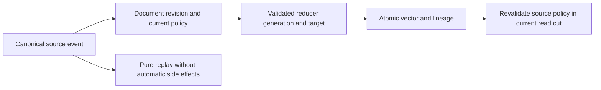

# EventProjectionLineage within Search

Decision: [ADR-089](../../ADR/ADR-089-event-projection-lineage.md).
The first callable operation is a typed `ApplyVectorProjection` batch mutation.
Its input binds the actual same-partition StreamRef/generation/event revision and
event ID, canonical source EntityRef/current document revision/input field,
reducer ID/version/generation and a PutVector target. All identities are immutable;
arbitrary inference bytes never override a changed source document. Cross-partition
projection effects use the remote transfers of [Messaging](../Messaging/RemoteTransfers.md), not this mutation's transaction.

Canonical lineage is a new generated ZoneTree record beside the canonical
vector, committed with its effect. It contains identity, input revision, source
policy/classification and reducer generation, not copied raw event/document PII.
Validate source event existence/generation/revision/ID, source document visibility,
source field-use and target write grant in the same apply cut. Reject missing,
deleted, changed, revoked or classification-incompatible source/target; target
classification may not weaken the source field. Current visible-vector reads
must revalidate lineage source visibility/field use/policy and revision in their
same canonical read cut, so later reclassification/revocation cannot leak a vector.

Source and target may be different canonical collection/table entities in the
same atomic partition; target ExpectedDocumentRevision is checked independently.
Classification is free-form and has no stronger/weaker ordering. Every effective
source classification matched to the input field must occur with exact ordinal
equality among effective target-vector-field policies. Additional target classes
are allowed; an unclassified source adds no classification requirement. Reuse
existing path/policy evaluation. Apply rejects unauthorized/stale inputs; vector
eligibility skips hidden/deleted/revised/field-denied/incompatible inputs while
retaining actual corruption and budget/cancellation failures. Reauthorize the
current reader; never substitute equality with the producer's policy epoch.
`IAuthorizationPolicy.GetEffectiveFieldPolicies(ResourceDefinition,
string)` is added and its Security implementation over the existing canonical Overlaps
matcher. It borrows immutable persisted policies without materializing a second
matching implementation. Classification tests cover exact, ancestor, descendant,
wildcard and nonmatching paths through that actual evaluator.

Dedup key binds source event, source revision, reducer generation and target full
vector identity. Identical replay reuses the canonical effect receipt; changed
payload conflicts. Stale job result fails RevisionConflict without modifying any
vector/lineage.
The private effect key encodes `DistanceMetric` as its stable integer value in
key codec v1. Both apply and lineage-based lookup use that same representation;
the key codec and every existing scalar tag remain unchanged.
Ordinary PutVector replacements delete prior derived lineage,
rather than leave a false provenance claim. A reducer is pure computation by
default; event replay emits no automatic jobs/external side effects. Projection
workers consume the committed outbox with stable consumer/filter/generation and
exclude their own projection mutation; no feedback loop or checkpoint advance
before a complete effect. This later worker must use Orleans CQRS.

| Requirement | Acceptance and mapped tests |
|---|---|
| REQ-LINEAGE-001: bind effect to actual immutable input identity | AC-LINEAGE-001: exact source event/revision/reducer passes, stale/missing/wrong-stream/generation/ID fails atomically; independent real-store vector oracle. `EventProjectionInputTests` |
| REQ-LINEAGE-002: policy and sensitive lineage remain authoritative | AC-LINEAGE-002: source hidden/revoked/field-reclassified and weaker target classifications cannot produce/search protected derived vectors; no raw PII in lineage or diagnostics. `EventProjectionPolicyTests` |
| REQ-LINEAGE-003: dedup, restart and replay do not duplicate effects | AC-LINEAGE-003: identical retry/reopen preserves one effect/lineage, changed output conflicts; ordinary vector replacement removes lineage; pure replay causes no side effects. `EventProjectionReplayTests` |
| REQ-LINEAGE-004: workers and freshness are bounded and explicit | AC-LINEAGE-004: later outbox worker does not consume its own writes, advances only contiguous committed prefix, and WaitForIndex succeeds only for that prefix or returns explicit failure/timeout. Planned `EventProjectionWorkerTests`/cluster SDK/MCP tests |
| REQ-LINEAGE-005: online generation lifetime preserves readers | AC-LINEAGE-005: online build/catch-up/swap/restart and reader leases preserve updates/deletes and completed old readers. Planned online-generation/process/cluster tests; the projection mutation does not qualify this |

## Stages

1. The projection mutation adds the new Abstractions/Core projection input, mutation, lineage and dedup helpers (`EventProjectionInputTests` and related named tests), together with the VisibleVectorReads lineage validation and the PutVector upsert cleanup. Central Mutation JSON discriminator/structure/capability/apply and allowlist joins and the SQL/SDK/MCP joins are integrated once.
2. Source/data contracts use the generated Orleans serialization and stable aliases/IDs; there is no JSON persistence fallback or sidecar authority.
3. The outbox worker (generation checkpoint/replay, explicit WaitForIndex, FTS swap/reader contracts) is specified in the sections below and in [FullTextProjection](FullTextProjection.md) and [OnlineGenerationLifetime](OnlineGenerationLifetime.md); the current principal-scoped FTS is untouched by the projection mutation.
4. Process and SDK/official MCP tests on the replicated cluster cover the uploaded/event/job/vector path, current policy, restart and node loss.

Pausing projections retains canonical lineage and effects; older nodes reject unknown capabilities before execution. No existing canonical bytes are rewritten. UI is N/A; the pure reducer API is a server/worker operation, not a general workflow-engine compatibility claim.

## Projection mutation cluster and process tests

`EventProjectionClusterTests` maps AC-LINEAGE-001/002/003 to real event/document/vector mutations and reads through the .NET SDK and official MCP client on the Aspire-owned replicated cluster: exact input binding, idempotent receipt reuse, stale/conflicting rejection without state changes, live source revision/policy eligibility, and a scoped node-loss replay case with committed-state verification. This proves the explicit projection mutation operations, not the outbox worker or generation lifecycle.

Process recovery runs one real ApplyVectorProjection through the CanonicalCrashBoundary (HeaderWritten, PayloadWritten, JournalFlushed, MutationApplied at index 0, ApplyCompleted) with genuine owned child process kills after seeding actual canonical source/target documents and the exact source event and persisting the original operation. Reopen preserves one complete cut: the canonical vector, its lineage/effect, the original outcome and the outbox entry are all absent or all committed (JournalFlushed and later require committed state), checked by an authorized exact search for the caller-visible oracle and retained records for the atomicity oracle. Retrying the same operation reuses its token and effect with no new outbox entry, a changed payload rejects without modifying the committed vector, and a following source revision change makes the derived vector ineligible. Process kill is not power-loss evidence.

## Public lineage repair

REQ-SEARCH-LINEAGE-PUBLIC-013 / AC-SEARCH-LINEAGE-PUBLIC-013 are specified in [Search](../Search.md). A revoked official MCP request is refused by HTTP authentication before tool dispatch (an HttpRequestException with HTTP 401 rather than a CallToolResult); the test asserts that actual exception and status plus the absence of the credential and source canary, validates the canonical five-field Unauthenticated problem and the absent operation GUID with the unauthorized probe on the same node and key, and keeps the SDK refusal, the privileged model before and after, the next-epoch repair, the healthy vector and the original receipt replay through both cold passes. Cold capture starts exactly one independent client-owned task per node in the ordered inventory, each joining its own administrator and reader SDK/MCP lifetimes under the original token; all tasks settle before any fault or cancellation is surfaced, while kill, begin and restart stay sequential.

## Autonomous ANN maintenance

REQ-LINEAGE-004/005 and AC-LINEAGE-004/005 require a bounded ANN maintenance owner over canonical committed vectors. This does not authorize server embedding inference: application embedding output remains the separately guarded ApplyVectorProjection operation. AppendEvents-only application consumers and ANN canonical-vector consumers have distinct filters, identity and checkpoint/effect ownership, and own derived effects never feed the application input loop.

`ProjectionConsumerDefinition` appends nullable `AnnProjectionMaintenanceProfile` (Id3: collection, field and full VectorSpace) and `ProjectionConsumerInfo` appends nullable `ProjectionMaintenanceAuthority` (Id5) captured from the server-authenticated Configure principal, original command, incarnation and policy epoch. Capture and validation occur in the original same-partition transaction with fresh persisted ClusterAdministrator and scoped VectorSearch/field-use authorization; a null profile keeps the generic contract and a malformed pair refuses. The optional `AnnMaintenanceRequest` Id9 profile is the same immutable value as the definition's Id3: it is selection, never caller authority, and a mismatch of generation, request or consumer fails closed before index mutation. The Id9 bytes are part of the signed request envelope and content fingerprint, so a same-ID request with a changed profile conflicts. The optional Definition.AnnMaintenance and Info.MaintenanceAuthority members use property-level `JsonIgnore(WhenWritingNull)`, leaving null public JSON byte-identical. Configuration and every eligibility read validate the persisted `ResourceDefinition.VectorProfiles` and require exact full VectorSpace equality when the field has a configured profile.

Work delivery uses Orleans `[StatelessWorker]` grains that accept ANN projection events (a committed source update, delete or reprojection of a configured consumer), buffer them in memory and, on an Orleans timer whose interval is a typed option, submit the batch through the signed connection stream to the node-local ZoneTree owner; no worker checks leadership. The buffer is disposable: after a restart, bounded discovery over the projection-consumer family rebuilds the work. Discovery scans only the actual projection-consumer family within the existing MaxScanRecords/MaxQueryReadBytes under one Store.Read view; each decoded row must match its canonical ConsumerKey (a malformed row is Corruption), released and generic consumers are not autonomous work, and a per-row authorization refusal is reported as a bounded closed code without hiding other rows or accepting a skipped corrupt record. The work observation is call-local, never persisted or public, and the required horizon is the actual partition OutboxHead.Tail. Canonical effects and checkpoint are atomic; pending, retry, cancel or unknown outcomes never imply a successful publication or its absence.

Each operation dispatches through the real stable connection owner as a separately signed typed `MaintainAnnIndex` (`AnnProjectionJobDispatch`): the codec creates the command, the original request identity scope and connection execution identity are restored, the result must be the actual `AnnMaintenanceResult` with the original command ID, consumer, generation and Completed phase, and every error or UnknownWriteOutcome is a failure with no custom retry, timeout or accepted-unknown. The handler uses the fresh persisted principal and the original request. A coordinator identity binds Consumer, Generation and the node GUID of the root; a request retained on another root keeps its original node and authority and refuses instead of being rewritten.

Cold publication discovery reads exact owned receipt pointers through a read-only owning ANN seam (`IAnnMaintenance.ReadPublishedAsync`, observation alias `keyload.ann-projection-publication` with Consumer, IndexGeneration, Source, Count and IndexSha256) validating checksums, format, identity, source, current policy, index and watermark under the original worker's memory grant; RAM slot existence, job ACK, canonical checkpoint, newest directory and a missing outcome are not freshness or absence proofs. The result source is the actual Publish capture and the manifest source is the verified build capture; settlement requires the exact generation, count and digest, original consumer/root/incarnation/schema/policy/read-generation/dependency/corpus/horizon, and nondecreasing published-to-result physical and applied positions. Policy, schema or generation incompatibility fails closed and requires a fresh explicitly authorized generation.

Whole-operation acceptance covers configure/Build, committed source update/delete/reprojection, Restore with a published watermark and full literal ANN results, old/stale/revoked/corrupt/no-history refusal with complete no-effects, authorized repair, original exact replay, cancellation and resource joins, process restart, and real SDK/official MCP/both Q1 flows on the replicated cluster across cold restarts. The original-operation owner, its stream grammar and the retained-result replay are specified in [AnnOriginalResult](AnnOriginalResult.md).

## Initial ANN enrollment

`ConfigureProjectionConsumerRequest` appends nullable `InitialAnnMaintenance` (Id4, type `AnnMaintenanceRequest`) and `ProjectionConsumerInfo` appends the same nullable field (Id6), both with `JsonIgnore(WhenWritingNull)`; only an actual initial manual Build supplies it, an ordinary autonomous-only Configure, a fresh Restore or an already-configured automatic parent leaves it null, a repeated supplying request must be full byte equal to the original (a different reservation is Conflict), and null never deletes. The original Configure transaction validates the full Build, command, consumer/generation, configured vector profile, actual node/incarnation and the persisted administrator/scoped vector+field access, and stores reservation, profile and authority in the same consumer record within the existing MaxBatchBytes/consumer limits. A released generation is refused.

The owner (`AnnOriginalOperation`) retains `InitialRequest` (immutable per generation) and `InitialSettled`, which is set only by successful exact full-result settlement. `IAnnMaintenance.ReadEnrollmentAsync(principal, initialRequest, token)` returns an internal `AnnProjectionEnrollment` (alias `keyload.ann-projection-enrollment`: InitialRequest, LastRequest, LastResult); null means a deferred manual enrollment and is never authorization to Build, and a nonnull result needs a matching canonical reservation, exact initial identity, InitialSettled, no pending or uncertain work and a verified current publication/checkpoint. Empty worker state with a canonical manual reservation first joins ReadEnrollmentAsync (null returns without scheduling; nonnull seeds the original request, exact last request/result and publication horizon and never schedules another initial Build); without a manual reservation the autonomous original Build is persisted before dispatch.

The canonical settlement of a completed initial Build is acknowledged through the canonical consumer record: `ProjectionConsumerInfo` appends `InitialAnnMaintenanceSettled` (Id7, default false, `WhenWritingDefault`), `CommitProjectionBatchRequest` appends nullable `InitialAnnMaintenanceSettlement` (Id4, an opaque owner-signed proof, not caller authority) and `AnnMaintenanceCapabilityResult` appends nullable `EnrollmentSettlementIntent` (Id9). The proof (`AnnProjectionSettlementClaims`, alias `keyload.core.ann-projection-settlement-claims`) binds the purpose, incarnation, principal, policy epoch, configure command, consumer, index generation, initial command, SHA256 digests of the initial request and original result, checkpoint, node, store identity, expiry and settlement command; it is signed with the existing generated binary/HMAC framing and expires with the original empty projection batch token. Only the owner, after Publish, the final original checkpoint and the independently verified full original result, mints it, and the empty projection batch token, the proof and the complete empty-effects `CommitProjectionBatchRequest` are persisted atomically with the full-result settlement before the parent dispatches. Core `CommitProjectionBatch` validates the projection token, the fresh administrator and effect admission and then the proof in the same transaction: zero effects, After=Through=the original checkpoint, the exact consumer/generation and request digest, the configured principal/configure/incarnation/policy and the derived settlement child command; only then does it set the marker and write the ordinary completed-receipt for the child under an explicit ann-initial-settlement key. Ordinary empty pages never observe that receipt.

Parent order: initial manual Configure reservation, AdmitOriginal before Begin, Begin/Capture/Build/Publish/final checkpoint, SettleOriginalResult (the full result and the exact settlement intent retained durably), the signed CommitProjectionBatch of that intent through the connection grain with acknowledgement from every configured copy, then Completed/Final with the unchanged original result; there is no Final before the canonical acknowledgement. A failure between settlement and canonical acknowledgement keeps the reservation and permits neither competing autonomous nor later manual work, and an expired never-acknowledged intent refuses under the token contract (no renewal, fake outcome or retry loop). While the canonical marker is false, a distinct parent and autonomous discovery defer even if the local InitialSettled is true. Once it is true, a different owner (for example after the activation moved to another node's store) persists its own fresh immutable Build request under the current partition identity, authority, profile and corpus; it never adopts an absent foreign result or signs the old intent, and the old original request on a root without its retained result is a qualified HistoryUnavailable with no effects. Retained replay of an acknowledged result performs the same canonical child before Final.

A bounded retired-identity ledger (`AnnOriginalOperation.RetiredOriginals`, element alias `keyload.server.ann-retired-original-identity`: CommandId and the SHA256 of the full request) records an original replaced by a later result exactly once in the same receipt replacement: a known retired command with the same hash returns HistoryUnavailable with no effects, a changed request under that command is Conflict, a retained current result replays first, and a fresh no-op request stays admitted. The ledger is charged to the original MaxManifestBytes/resident root grant before retention (overflow is BudgetExceeded and clears nothing), and only the canonical Released operation plus actual slot/reader/file retirement removes the record; ordinary source invalidation preserves original pending/result/enrollment evidence. Generation Release first marks the canonical consumer Released, keeping its immutable reservation and marker, and rediscovery is prevented. The root serializes each receipt read-modify-write under a short synchronous lock so a selected reader's retirement cannot overwrite newly admitted metadata, and a released entry is kept while any owned leaf lacks a real slot or current pointer. A reader acquired before Release keeps returning its complete literal results; a new public search then returns HistoryUnavailable, the pointers are absent, the record is unchanged except Released and the leaf remains until the reader is disposed.

REQ-ANN-ENROLL-001 / AC-ANN-ENROLL-001: a manual full-profile Configure concurrent with discovery before Admit keeps the original command/session/principal/profile and full final/checkpoint, and the autonomous path creates no competing initial effects. REQ-ANN-ENROLL-002 / AC-ANN-ENROLL-002: a manual Build, a later committed vector/outbox write, an autonomous Restore, the exact current publication/corpus/watermark and replay settle; replacing the full result preserves the enrollment marker and an old original request is an exact retained result or a qualified HistoryUnavailable. REQ-ANN-ENROLL-003 / AC-ANN-ENROLL-003: cancellation before Begin is an exact authorized retry, interrupted started work is RecoveryRequired and deferred, cold restart does not steal the reservation, and revoke/refusal retains the original bytes until an epoch repair or new generation. REQ-ANN-ENROLL-004 / AC-ANN-ENROLL-004: an autonomous-only nonnull profile still completes its initial durable Build, a released generation never re-enrolls and a new generation succeeds within the unchanged limits. REQ/AC-ANN-ENROLL-005: manual Configure, discovery before Admit, Publish and Settle, then the canonical acknowledgement; a crash or cancel between settlement and acknowledgement keeps the reservation and an authorized retry completes the same result and child. REQ/AC-ANN-ENROLL-006: a different owner after the canonical acknowledgement performs its own Build and a later committed-vector Restore with independently expected corpus, index and watermarks; pending acknowledgement never licenses takeover. REQ/AC-ANN-ENROLL-007: corrupt, missing, changed or expired proof and revoked or changed policy preserve the full canonical and images with no marker or effects, repair then produces healthy work, and a same-root cold restart preserves the full result, intent, receipt and release accounting. The direct signed owner operations (both `RequestCqrsAnnMaintenanceTests` methods) cover original Build replay, conflict, Restore C, fresh no-op D, old B refusal and the pinned reader, but not autonomous scheduling or the cluster flows.
