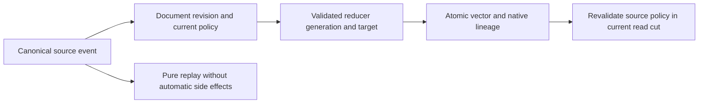

# EventProjectionLineage within Search

Root accepts stage P1 for KL-097 on 2026-10-04.
Decision: [ADR-089](../../ADR/ADR-089-event-projection-lineage.md).
The first callable operation is a typed `ApplyVectorProjection` batch mutation.
Its input binds the actual same-partition StreamRef/generation/event revision and
event ID, canonical source EntityRef/current document revision/input field,
reducer ID/version/generation and a PutVector target. All identities are immutable;
arbitrary inference bytes never override a changed source document. Cross-partition
projection effects require KL-094, not this mutation's transaction.

Canonical lineage is a new native-generated ZoneTree record beside the canonical
vector, committed with its effect. It contains identity, input revision, source
policy/classification and reducer generation, not copied raw event/document PII.
Validate source event existence/generation/revision/ID, source document visibility,
source field-use and target write grant in the same apply cut. Reject missing,
deleted, changed, revoked or classification-incompatible source/target; target
classification may not weaken the source field. Current visible-vector reads
must revalidate lineage source visibility/field use/policy and revision in their
same canonical read cut, so later reclassification/revocation cannot leak a vector.

Source and target may be different canonical collection/table entities in the
same atomic partition; target ExpectedDocumentRevision is checked independently.
Classification is free-form and has no stronger/weaker ordering. Every effective
source classification matched to the input field must occur with exact ordinal
equality among effective target-vector-field policies. Additional target classes
are allowed; an unclassified source adds no classification requirement. Reuse
existing path/policy evaluation. Apply rejects unauthorized/stale inputs; vector
eligibility skips hidden/deleted/revised/field-denied/incompatible inputs while
retaining actual corruption and budget/cancellation failures. Reauthorize the
current reader; never substitute equality with the producer's policy epoch.
Root adds `IAuthorizationPolicy.GetEffectiveFieldPolicies(ResourceDefinition,
string)` and its Security implementation over the existing canonical Overlaps
matcher. It borrows immutable persisted policies without materializing a second
matching implementation. Classification tests cover exact, ancestor, descendant,
wildcard and nonmatching paths through that actual evaluator.

Dedup key binds source event, source revision, reducer generation and target full
vector identity. Identical replay reuses the canonical effect receipt; changed
payload conflicts. Stale job result fails RevisionConflict without modifying any
vector/lineage.
The private effect key encodes `DistanceMetric` as its stable integer value in
key codec v1. Both apply and lineage-based lookup use that same representation;
the key codec and every existing scalar tag remain unchanged.
Ordinary PutVector replacements delete prior derived lineage,
rather than leave a false provenance claim. A reducer is pure computation by
default; event replay emits no automatic jobs/external side effects. Projection
workers consume the committed outbox with stable consumer/filter/generation and
exclude their own projection mutation; no feedback loop or checkpoint advance
before a complete effect. This later worker must use native Orleans CQRS.

| Requirement | Acceptance and mapped tests |
|---|---|
| REQ-LINEAGE-001: bind effect to actual immutable input identity | AC-LINEAGE-001: exact source event/revision/reducer passes, stale/missing/wrong-stream/generation/ID fails atomically; independent real-store vector oracle. `EventProjectionInputTests` |
| REQ-LINEAGE-002: policy and sensitive lineage remain authoritative | AC-LINEAGE-002: source hidden/revoked/field-reclassified and weaker target classifications cannot produce/search protected derived vectors; no raw PII in lineage or diagnostics. `EventProjectionPolicyTests` |
| REQ-LINEAGE-003: dedup, restart and replay do not duplicate effects | AC-LINEAGE-003: identical retry/reopen preserves one effect/lineage, changed output conflicts; ordinary vector replacement removes lineage; pure replay causes no side effects. `EventProjectionReplayTests` |
| REQ-LINEAGE-004: workers and freshness are bounded and explicit | AC-LINEAGE-004: later outbox worker does not consume its own writes, advances only contiguous committed prefix, and WaitForIndex succeeds only for that prefix or returns explicit failure/timeout. Planned `EventProjectionWorkerTests`/RF3 SDK/MCP tests |
| REQ-LINEAGE-005: online generation lifetime preserves readers | AC-LINEAGE-005: KL-039 build/catch-up/swap/restart and reader leases preserve updates/deletes and completed old readers. Planned online-generation/process/RF3 tests; P1 does not qualify this |

## Ordered execution and ownership

1. Luna query_wave owns new Abstractions/Core Features/Search projection input,
   mutation/native lineage/dedup helpers and named UnitTests/Features/Search files.
   It also owns Core/Features/Search/VisibleVectorReads.cs and the private PutVector
   Upsert region in GraphAndSeries.cs for exact live lineage validation/cleanup.
2. Root owns central Mutation JSON discriminator/structure/capability/apply and
   native allowlist joins, canonical shared docs/status, SQL/SDK/MCP/RF3 joins.
3. Source/data contracts use existing generated Orleans serialization and stable
   aliases/Ids. No JSON persistence fallback or sidecar authority. Complete and
   self-review P1 before root's actual Aspire gates and checkpoint commit.
4. Freeze outbox worker, generation checkpoint/replay, explicit WaitForIndex and
   native FTS swap/reader contracts before P2; keep current principal-scoped native
   FTS untouched during P1. KL-039 remains separate until its full lifetime proof.
5. Real process and SDK/official MCP RF3 test the uploaded/event/job/vector path,
   current policy, restart and leader loss. Complete KL-097 still requires them.

Baseline: build22/formatter22 passed; unit18 passed3060; scalar22 has the recorded
comparison-host failure. Rollback pauses projections and retains canonical lineage
and effects; older peers must reject unknown capabilities before execution. No
existing canonical bytes are rewritten. UI N/A; pure reducer API is server/worker
operation, not a general workflow-engine compatibility claim.

## P1 public RF3 test stage

Luna query_wave owns new
`tests/KeyLoad.IntegrationTests/Features/Search/Cases/EventProjectionRf3Tests.cs`
and uniquely named projection `Helpers/` or `Assertions/` files. Map
AC-LINEAGE-001/002/003 to real event/document/vector mutations and reads through
the .NET SDK and official MCP client on the existing Aspire-owned Docker RF3
fixture. Assert exact input binding, idempotent receipt reuse, stale/conflicting
rejection without state changes and live source revision/policy eligibility.
Add a scoped fixture-supported leader-loss replay case with committed-state
verification. This proves explicit P1 operations, not the unimplemented P2
outbox worker or generation lifecycle. No shared fixture, production contract,
topology or gate changes are delegated. Root owns integration and actual tests.

## P1 canonical process recovery stage

Luna query_wave next owns new CrashHost Search Helpers and RecoveryTests Search
Cases/Assertions/Helpers for one real ApplyVectorProjection operation through
the existing CanonicalCrashBoundary. Root owns the CrashHostApplication mode
join. Seed actual canonical source/target documents and the exact source event,
then persist the original operation before arming the next atomic commit. Cover
HeaderWritten, PayloadWritten, JournalFlushed, MutationApplied at index0 and
ApplyCompleted using genuine owned child process kills, StorageTrialLease and
existing killed-process file readiness, never another test caller or observer.

AC-LINEAGE-001/002/003 require reopen to preserve one complete cut: canonical
vector, its native lineage/effect, original outcome and outbox entry are either
all absent or all committed. JournalFlushed and later require committed state.
Use actual authorized exact search for the caller-visible vector oracle and
native retained records for the independent atomicity oracle. Retrying the same
original operation reuses its exact token and effect with no new outbox entry;
changed payload rejects without modifying the committed vector. A following
source revision change makes the derived vector ineligible under current reads.
Preserve complete original data and receipt assertions; process kill is not
power-loss evidence and does not qualify P2/RF3.

Prepare the scoped source patch outside the checkout while root verifies its
frozen prior compilation, with exact base/post hashes and dispatch instructions.
Use existing published dependencies, true ZoneTree/Core/Query execution and
bounded owned cleanup retaining primary and cleanup failures. No doubles,
implicit native-format rewrites, builds/tests/formatter or Git are delegated.
Root applies harness and dispatch together, self-reviews, and runs the actual
Aspire recovery cases and required full gates before recording runtime evidence.




## TASK-KL067-PUBLIC-LINEAGE-REPAIR-COLD-013

REQ-SEARCH-LINEAGE-PUBLIC-013 / AC-SEARCH-LINEAGE-PUBLIC-013 refine REQ-LINEAGE-002/003, AC-LINEAGE-002/003 and current persisted authorization under ADR-015/022/089. Extend SAME original AcLineage002SourceHiddenFromPersistedReaderCannotProduceVisibleDerivedVector after its complete baseline-only SDK/official MCP oracle. Keep original worker Node1, SDK reader Node2 and official MCP Node3 calls, same command/credential/partition/event/vector/row policy and deadline. Preserve the actual original full projection receipt.

Configure the actual returned reader principal at checked current epoch+1 with Revoked=true. The original SDK and official MCP search must return Unauthenticated without protected result/credential/source disclosure. Full privileged ordered source/derived/baseline document literals and SAME physical query cut bracket those read-only refusals; acknowledged policy mutation and admitted receipt replay are not called globally no-effect. Genuine next-epoch ConfigurePrincipal repair retains original capability and field grants, removes only source-hiding row restriction/owner. Healthy SDK/MCP return independent complete redacted derived+baseline results, original references/revision1/ordered input+embedding omissions/rank1/61+1/62/null explanations.

Warm owners settle before two fixture-owned all-three same-volume cold passes. Begin all original restart owners before health waits. Fresh real SDK/MCP clients must preserve complete literal model/vector results and SAME original receipt bytes, exact persisted node/incarnation and nondecreasing generation/replication Applied; physical query cut remains a separately captured, nondecreasing same-node fact. Replayed successful commands may advance actual replication state, never fabricate or rewrite receipt IDs/cuts. Existing ServerFailureObserver and RequestCqrsRf3Callers.RunOwnedAsync retain primary/cleanup failures and genuine HTTP/MCP lifetime. No new product API/schema/Id/quota/timeout/retry/provider or trusted roles.

Exact original public declarations and native UIDs are bound by isolated compiler/discovery proof; declarations do not establish runtime PASS. Local-image enrollment is ONLY three exact original EventProjectionRf3Tests methods, with current native typed admission verified before source join. Existing AcRpol004PolicyAckFencesReadersCursorsAndStaleRetriedUpdatesAcrossRf3 remains unchanged as KL066 four-route current-policy/cursor/repair/cold owner. Read-owned BuildInputs READY4 is an explicit separate dependency. Owning private compiler/analysis, fresh source/producer/copy guards, exclusive fixture-owned normal SIMD50 RF3 and delivered exact-source Linux coverage/fault gates remain OPEN. Rollback removes only this original-case continuation/helpers/exact selector additions; no canonical bytes or policies migrate.


### TASK-KL067-OFFICIAL-MCP-REVOKED-TRANSPORT-016

REQ/AC-LINEAGE-002/003 and ADR015/022 preserve the same original public AcLineage002 operation. Its genuine revoked official MCP request is refused by native HTTP authentication before tool dispatch, yielding HttpRequestException with HTTP401 rather than CallToolResult. The owning fixture must assert that actual exception/status and absence of original credential/source canary; reuse McpUnauthorizedProbe on the same original node/key to validate bounded canonical five-field Unauthenticated Problem and absent operation GUID. Preserve original SDK refusal, complete privileged model/cut before and after, persisted next-epoch repair, complete healthy vector and original receipt replay, and BOTH all-three cold passes. No transport/product/provider change, extra timeout/cap/retry or synthetic result. Original failure remains immutable; private successor requires owning compile and the same original whole-operation runtime.


### TASK-KL067-COLD-CAPTURE-OWNER-R17

REQ/AC-LINEAGE-002/003 retains both original all-three-node cold continuations and complete image/vector/receipt/status/cut oracles. Capture starts exactly one independent client-owned task per existing ordered node inventory. Each task joins its own administrator and reader SDK/official MCP lifetimes under the unchanged original token. All three tasks settle before any collected original fault/cancellation is surfaced; successful results retain node inventory order. Kill/Begin/Restart and their shared runtime ownership remain sequential. This bounded capture change is not proof of the historical health failure cause and introduces no deadline, retry or quorum change.


## TASK-KL097-AUTONOMOUS-ANN-001 — committed-vector P2 implementation contract

REQ-LINEAGE004/005 and AC-LINEAGE004/005 require a bounded native durable ANN maintenance owner over canonical committed vectors. This does not authorize server embedding inference: application embedding output remains the separately guarded ApplyVectorProjection operation. AppendEvents-only application consumers and ANN canonical-vector consumers have distinct filters, identity and checkpoint/effect ownership; own derived effects must not feed the application input loop.

ProjectionConsumerDefinition appends nullable AnnProjectionMaintenanceProfile Id3 (collection, field, full VectorSpace); ProjectionConsumerInfo appends nullable ProjectionMaintenanceAuthority Id5 captured from the actual server-authenticated Configure principal, original command, incarnation and policy epoch. Capture and validation occur under the original same-partition transaction, with fresh persisted ClusterAdministrator AND scoped VectorSearch/field-use authorization. Null profile retains the deliberate generic contract; malformed paired authority refuses. No new quota, legacy reader, migration or provider.

Autonomous work uses the existing pinned native durable-job provider and bounded options. Per-silo leader discovery joins TransportReady/read barrier and actual post-apply wake, then routes each operation through the real stable connection owner and separately signed typed maintenance. Canonical effects and checkpoint are atomic; pending/retry/cancel/unknown outcomes do not imply successful publication or absence. All task/producer/reader/grant/file ownership is genuinely joined.

Cold publication discovery reads only exact owned receipt pointers through a new read-only owning ANN seam, validating checksums, format, identity, source, current policy, native index and watermark. RAM slot existence, job ACK, canonical checkpoint, newest directory and missing outcome are insufficient freshness/absence proofs. Policy/schema/generation incompatibility fails closed and requires a fresh explicitly authorized generation.

Complete operation evidence is mandatory: configure/Build, committed source update/delete/reprojection, Restore/published watermark and full literal ANN results, old/stale/revoked/corrupt/no-history refusal with complete no-effects, authorized repair, original exact replay, cancellation/resource join, process restart and real SDK/official MCP/both Q1 RF3 cold/healthy flows. READY8 tests only the original canonical consumer transaction/replay/cold join. Product implementation, focused execution, source/image/case binding, coverage and Linux gates remain OPEN.


## TASK-KL097-AUTONOMOUS-ANN-001 signed profile closure

The approved AnnMaintenanceRequest optional native Id9 profile is the SAME immutable value as ProjectionConsumerDefinition Id3: Collection, Field and complete VectorSpace (Id, dimension, metric, model, version). The parent copies it only into its original Configure child definition. Capture and use require current persisted original principal/epoch/incarnation and scoped VectorSearch/field-use; profile bytes are selection, never caller authority. Every generation/request/consumer mismatch fails closed before index mutation. Null retains the original explicitly generic maintenance contract, not a compatibility path.

Existing independently signed request envelopes/content fingerprints must include the complete generated native Id9 bytes. Same-ID requests with a changed profile conflict; parent child signing, original request identity and session NativeSerialization byte equality must include it. Do not reconstruct a partial equality from collection or space ID, omit model/version, or trust retained policy. No changes to phase grammar, ordinary two-frame protocol, typed payload validation order, limits, cancellation or cleanup. External ANN owner composes Request/ParentFlow (and its actual owning fingerprint when needed); this lane owns the product profile/authority/eligibility/index seam.

REQUIRED full operations: original generic Build/Restore/Release remains exact; configured autonomous profile executes the real Configure child and original signed Build/Restore path; changed collection/field/full-space under same ID refuses with complete canonical no-effects and original receipt retained. Actual persisted revoke/epoch mismatch refuses before publication; new authorized generation repair proceeds to genuine indexed result, exact current watermark, replay and same-root cold. Native serializer/signing/shape tests supplement those whole operations and cannot qualify them alone. All runtime and Linux gates remain OPEN.


### Null-profile JSON and configured-space closure
The optional Definition.AnnMaintenance Id3 and Info.MaintenanceAuthority Id5 use property-level System.Text.Json.Serialization.JsonIgnore(Condition=WhenWritingNull). Original null public JSON and JsonData-projected fingerprints remain byte-identical; native generated IDs remain present and nonnull values participate fully in native signing, serialization and immutable equality. Request.MaintenanceProfile Id9 remains a nullable init property on the original nine-argument request constructor, owned externally. No global ignore or regenerated predecessor digest is allowed.
Configuration and every eligibility read validate the actual persisted ResourceDefinition.VectorProfiles through native VectorFieldProfiles.Validate(Corruption) and require exact full VectorSpace equality when that field has a configured profile. This is the same optional-profile rule used by canonical PutVector admission: no invented required schema profile and no override of configured schema. Current authorization and the resource are acquired on the same bounded transaction/read view.
Whole operation verification must retain literal old generic null JSON/fingerprint and generated roundtrip receipts, nonnull profile native full-byte mismatch refusal, configured-space mismatch no effects, repaired scoped configure/Build/Restore/current index/full public results and cold. Runtime gates remain OPEN.


### Published authority observation join
A feature-local AnnProjectionPublication generated observation uses alias keyload.ann-projection-publication.v1, Id0 Consumer, Id1 IndexGeneration, Id2 Source, Id3 Count, Id4 IndexSha256 (the existing hexadecimal digest shape). INativeAnnMaintenance.ReadPublishedAsync is an internal read-only addition, not a public operation/endpoint or maintenance receipt. The existing service original operation admission and SAME EnsureOwner/root/worker are authoritative. Inside that original worker, reserve the existing MaintenanceMemory grant before CapturePinned or native Load allocations; use half of the actual available grant for the bounded current capture, then only the remaining owned-memory bound for the published load. No independent quota or new native reader/root is created. Exact Published pointer and root inventory, manifest digest, native index digest/count/space, original persisted checkpoint and independently hashed original corpus are all required. Pending/missing state yields qualified refusal, never first-issuance proof. Final current-policy eligibility and exact stored authority/profile equality are rechecked before returning; result serialization is charged to the same read budget. The original worker completes and original memory/operation leases are actually joined before completion. Every initiating and cleanup exception remains in the existing ServerFailureObserver ledger. No Store.Read view crosses await.


### Native signed maintenance dispatch
AnnProjectionJobDispatch is feature-owned execution, not an alternate dispatcher: use actual codec.CreateCommand(MaintainAnnIndex), generated native payload, original GrainRequestIdentityScope and NativeConnectionExecutionIdentity, then existing IConnectionGrain.ExecuteStreamAsync and GrainRequestStreamConsumer.DrainWithPurposeAsync. Purpose deferred-resolves from codec.Verify of that same signed request at original Started/first Progress; no new typed read before Started or early Failed. Full result must be actual GrainValue AnnMaintenanceResult with original CommandId/consumer/generation and Completed phase. Every error/UnknownWriteOutcome remains a failure; no custom retry, timeout or accepted-unknown. Handler uses fresh current persisted principal and original request; native jobs own bounded attempts under existing policy. Identity restoration/disposal and initiating/fatal/cleanup errors are joined and retained through the existing failure shape before return. Exact request/output native bytes and original replay receipt remain oracles.


## TASK-KL097-DURABLE-INITIAL-002 — original owning intent and native scheduling receipt

The autonomous Build is explicit initial work for a newly opted-in configured consumer generation, not an inference from absent publication, outcome, expiration or directory. The coordinator first persists the exact generated AnnMaintenanceRequest, current immutable configured authority and full profile on its native durable value; only after acknowledged WriteStateAsync does it schedule the real native DurableJob. A returned job ID is persisted separately. Scheduling cancellation/uncertainty retains that SAME original request; native replay may schedule another at-least-once delivery of that same command, never mint a replacement effect identity. A native returned ID is matched when present; prior uncertain schedule without returned ID is permitted only when metadata exactly binds the retained original command and the actual target grain.

A single generation coordinator retains initial request, one pending request/job ID, last full settled original result, and explicit blocked error. Generated state alias keyload.orleans.ann-projection-job-state.v1: Id0 Authority; Id1 InitialRequest; Id2 PendingRequest nullable; Id3 JobId nullable; Id4 LastResult nullable; Id5 BlockedError nullable. Every declared durable component is created in the grain constructor via the actual IDurableStateManager.GetOrAddValue API before native recovery. Persisted value sizing uses the SAME existing RuntimeJournalOptions.MaximumJournalBytes and database MaxBatchBytes; no new limit is introduced. Original native provider accounts for encoded journal storage/metadata. Explicit metadata consists of one native original-request digest under annRequestSha256; existing native MaximumMetadataBytes applies before encoding/allocation. Metadata has no credentials, raw records or caller roles.

After successful actual maintenance completion, final fresh persisted eligibility and exact request/result identity are checked before replacing pending with the actual full result in one durable write. Publication/source/checkpoint validation precedes watermark use; a native scheduling receipt alone never marks index freshness. Missing/corrupt publication after initial settlement refuses; only a verified exact publication permits a subsequent original Restore request. An uncertain operation remains pending and replays its SAME original command; no broad custom retry loop. Revocation/epoch mismatch blocks the original generation, retained request/result remains unchanged. Canonical policy repair requires an explicitly newly configured authorized generation, preserving original old-generation refusal.

The grain remains nonreentrant with actual default native DurableJobs attempts/concurrency. A separately signed connection operation is used for every effect. Current ReadBarrier and actual original root NodeId/incarnation/placement are revalidated before dispatch, and no storage view crosses await. An activation moved to a different native root refuses OwnershipLost; no silent rewrite of original request node/root/placement. Automatic new-leader native-index reconstruction and remote publication-read routing remain OPEN until their exact original-source/authority boundary is implemented and qualified; this finite state implementation must not claim that gate.

Whole operation gates: actual initial configure→journaled intent→native schedule returned ID→Build full result/publication; committed update/delete→Restore full result/watermark; same command delivery replay no second effects; cancellation after persisted intent keeps original request; changed/revoked epoch exact refusal/full no effects; restored journal+same native root cold continues original pending/settled requests. All are OPEN until real operation executions, including real provider/ZoneTree/SDK/MCP where required.


## TASK-KL097-CURRENT-DISCOVERY-003 — canonical post-apply scope

Bounded discovery scans only the actual projection-consumer family, using existing MaxScanRecords/MaxQueryReadBytes and copied pagination keys under one current Store.Read view. Each decoded row must exactly match its canonical ConsumerKey; malformed native bytes/key mismatch is Corruption, never ignored authority. Released/generic consumers are not autonomous work. Eligibility, persisted principal, original configure authority, configured full VectorSpace, actual placement and outbox head are read under that same bounded view; no cached principal/view crosses an await. Per-consumer authorization rejection is explicit and does not turn another family into first-issuance proof. The returned internal work observation owns consumer state/principal/current physical placement/current local NodeId and actual logical outbox horizon. A grain-service cycle runs only after native transport readiness, current leader/read barrier and final leader recheck, then signs/schedules through the exact generation grain. This is discovery after real apply, not a commit callback effect inside the atomic transaction.

AnnProjectionWork and discovery page are call-local immutable internal observations, not persisted/public types and not authority to bypass final admission. Existing Store NodeId/incarnation and original Placement are retained in the actual original maintenance request. Current horizon is the real partition OutboxHead.Tail; publication ThroughSequence must cover this actual requested horizon, no physical Position/log-index substitutions. Journal grain idle recovery retains pending; only exact successful full canonical result/publication may settle it. Native scheduling/dispatch/producer cleanup remains joined.


### Durable original horizon / settled-request refinement (same unsealed draft)
State appends Id6 RequiredThroughSequence:long and Id7 LastRequest:AnnMaintenanceRequest?. RequiredThroughSequence is the actual original admitted logical outbox horizon for the pending request. LastRequest retains the exact request bound to LastResult/native returned job, allowing a duplicate native delivery after acknowledged settlement to verify full metadata and return without effects. The bounded state holds only original initial request, one pending and one last-settled request/result. Replacing pending never synthesizes an older result; an obsolete delivery not matching current pending or retained settled binding explicitly refuses. These fields are internal native current-format additions in the new alias, not appended to an existing released contract; measure the complete state under original journal/batch bounds before each allocation/write.


### Actual per-silo producer and default-deny graph closure
The Search AnnProjectionGrainService uses native GrainService lifecycle, ReplicaConsensus.TransportReady, leader→ReadBarrier→leader sequence and existing RecurringDueWait change/fallback/cadence only. Original RuntimeJournalAdmission.SchedulingToken cancels admission; same active Schedule task is genuinely joined on cancellation before shutdown. Base Stop and original discovery task are joined together. The service schedules IAnnProjectionCoordinatorGrain.ScheduleAsync only via exact generated generation identity. The default-deny graph adds precisely this service→schedule transition and native IDurableJobHandler.ExecuteJobAsync→existing IConnectionGrain.ExecuteStreamAsync transition, preserving all prior edges. Existing Server Orleans registration adds only the real Search grain service; existing strict binary journal and configured native DurableJobs provider/bounds remain unchanged. Diagnostics expose only closed ErrorCode, never exception/principal/profile/body/token/endpoint.


### Discovery refusal isolation
Per-row PermissionDenied/Unauthenticated/TokenInvalidated is retained as a bounded closed-code rejection in that page, not a healthy scope and not a skipped corrupt record. Other independently authorized rows may continue in the same canonical ordered page. Corrupt native bytes/key mismatch remain page failure; no fallback decodes or authority repair. Per-generation scheduling refusals are likewise observed with closed code while genuinely joining each original task, without suppressing cancellation/fatal failure or changing native attempt policy.


### Current result cut versus persisted publication cut
The original maintenance result Source is the actual Publish capability current capture; native manifest Source belongs to the actual verified build capture. Existing native source validation permits intervening unrelated physical commits with unchanged scope/corpus/logical horizon. Do not replace either original cut or compare them as a synthetic identical wrapper. Settlement requires exact native generation/count/lowercase index digest, original consumer/root/incarnation/schema/policy/read-generation/dependency/corpus/logical horizon, and nondecreasing actual published→result physical/applied positions. Each cut must remain internally coherent and bounded by current native owner position through the original capture APIs. Full original result Source bytes are retained unchanged; published watermark uses only the stored native manifest Source. No scheduling receipt or logical/physical domain substitution qualifies freshness.


### Actual silo physical-owner admission
The coordinator additionally receives the existing Server-registered PhysicalShardRecord identifying its real host. Fresh canonical placement must match that host's PhysicalShardId/incarnation/voter identities before creating the original initial request. Use the actual current canonical PlacementEpoch in that request; do not treat the startup record's initial epoch as current authority. Activation elsewhere refuses OwnershipLost rather than constructing a local request for a remote placement. A retained request always compares exact original placement epoch to current canonical placement. Published read-generation is allowed to precede the result capture read-generation across genuine cold reopen, as in the existing native restore contract; preserve both actual values, never rewrite original Source.


# TASK-KL097-ORIGINAL-ANN-RESULT-004 — owning streaming interop

Status: frozen private owning contract; implementation and runtime OPEN. No Parent/Execution source replacement in this packet.

Existing owner: KeyLoad.Orleans.INativeAnnMaintenance; Server implementation NativeAnnMaintenanceService under the original admitted operation, SAME NativeAnnGenerationOwner worker/root and memory admission. All identities are original native values, never caller roles.

Exact internal signatures to compose in the owning interface:

```csharp
Task<AnnMaintenanceResult?> AdmitOriginalAsync(
    PrincipalRecord verifiedPrincipal,
    AnnMaintenanceRequest originalRequest,
    ProjectionConsumerInfo originalConfigure,
    CancellationToken cancellationToken);
Task SettleOriginalResultAsync(
    PrincipalRecord verifiedPrincipal,
    AnnMaintenanceRequest originalRequest,
    AnnMaintenanceResult fullOriginalResult,
    CancellationToken cancellationToken);
```

Order: original typed validation and fresh persisted administrator/scoped authority → original Configure child, retaining its full actual ProjectionConsumerInfo → AdmitOriginalAsync BEFORE Begin/session/index mutation. A nonnull result is the exact stored full original Completed result; return it without Begin or another effect. Null means acknowledged original admission with no started native work yet, including genuine fresh no-op. Ordinary Release remains its original separate path. Settle only AFTER actual Publish and original checkpoint command result, fresh authority recheck, BEFORE Completed/Final and successful Abort. On failure, Abort joins the actual session but never erases the original request/result evidence. Initiating and ALL cleanup errors remain the original ledger.

Native owner.bin appends nonnull Id7 NativeAnnOriginalOperation[] OriginalOperations. Each actual consumer/generation key retains one active request and one last settled request/full result. New alias keyload.server.ann-original-operation.v1: Id0 Key, Id1 PrincipalId, Id2 PolicyEpoch, Id3 PendingRequest nullable, Id4 PendingStarted bool, Id5 LastRequest nullable, Id6 LastResult nullable. Existing root aliases and IDs0..6 remain exact. NativeAnnProtocol.Version advances to strict current format2 for root/lock/pointer/manifest; absent/new-field/null, old format and corrupt bytes are explicit refusals, never migration/fallback. Count uses existing MaximumOwnedGenerations and bytes use existing MaximumManifestBytes/MaximumDiskBytes/MaximumResidentBytes. Complete original request/profile/result/receipt bytes are retained; same-ID changed full native request is Conflict.

Admit reads fresh actual pin/current consumer/principal/policy/root/placement in its original bounded cut. Exact LastRequest returns exact LastResult only under current policy/incarnation/source authority. Lower original Configure checkpoint than current checkpoint proves an older parent: HistoryUnavailable/no effects. PendingStarted original work without settled full result is RecoveryRequired/no second Build/no replacement checkpoint; it is not silently inferred to be a fresh request. A fresh distinct parent may replace pending only through explicit authorized generation repair; it may not hide an unresolved original operation. A fresh unchanged/no-op request with no prior uncertain work remains supported. Missing/corrupt stored result is not successful null. Started is persisted by the original native Begin owner BEFORE actual index work; settlement atomically replaces pending with exact acknowledged full result in the SAME existing root receipt replacement. Later parent replaces the single retained settled binding; older same parent has qualified HistoryUnavailable/no effects, not a synthesized current result.

Automatic pending native durable-job replay consults the same binding. An uncertain native operation is an explicit blocked recovery gate until its exact original result is available or a new authorized generation repair is configured. No custom retry, random replacement command, new empty receipt, newest-directory selection, no-op blanket refusal or quota/clock change.

Required whole oracles: initial Build full result including original checkpoint; same ID full native result before/after same-root cold; actual Restore C then old Build B HistoryUnavailable and current C exact replay; genuine fresh no-op D/null full replay; revoked/changed policy denial with original bytes retained; cancelled pre-Begin original admission retains same command; interrupted started work RecoveryRequired with complete no effects on duplicate, explicit new-generation repair healthy; corrupt/missing result refusal and independent healthy authorized scope. Native durable state settlement remains AFTER this owner receipt. These runtime gates are OPEN.


### Original receipt resident and settlement ownership
The existing native MaintenanceMemory budget reserves four MaximumManifestBytes ownership frames for the bounded owner receipt, generated bytes/atomic pending replacement and fixed-shape typed graph. This is deducted from the original MaximumResidentBytes, not a new quota or limit increase. Root open refuses insufficient existing resident admission before decoding; native receipt writes measure the complete generated root before encoding. Existing disk admission already reserves the original three MaximumManifestBytes receipt files; the same owner.bin replacement adds no sidecar. The root retains one original operation entry per consumer/generation under MaximumOwnedGenerations.
Admission occurs before Begin and reserves/joins its own original operation/memory lease. Settlement while the matching session is still active borrows that SAME verified session memory lease, expands it under the original budget, includes session retained bytes, and neither opens a second memory grant nor disposes the session. Abort later joins that exact session. Signed capability SessionId/full request/principal must match before settlement. Replay admission does not return or mutate another session. Whole resource/error operation gates remain OPEN.


### Original signed ANN whole-flow regression extension
Keep both existing RequestCqrsAnnMaintenanceTests methods/UID/deadlines and every literal seed/search/checkpoint/frame/malformed/release assertion. Through the SAME actual ConnectionGrain, original Build replay must return full exact stored AnnMaintenanceResult bytes and unchanged complete canonical/native .bin image. After real canonical Change and Restore C, old B must HistoryUnavailable/no payload/no native or canonical effects; current C repeats full exact result. Fresh no-op Restore D validates literal current count/index and original canonical checkpoint receipt, then same D repeats its complete actual issued result. Existing frame oracle retains every ordinary full phase check and adds only the exact one-Completed settled-replay grammar, with unchanged identity/sequence/full frame checks. Genuine native provider/cold/automatic scheduling remain separate mandatory operation gates OPEN; these two signed whole flows do not substitute for them.


### Original native Begin responsibility extraction
The service retains its SAME gate, beginning flag, session publication, operation admission, disposal join and callback. NativeAnnMaintenanceBeginning owns the existing bounded seed/memory/capture/session construction sequence with the same borrowed gate and EnsureOwner callback; original initiating/cleanup errors and memory transfer order stay exact. First capture deducts the same root receipt reservation before allocating seed data, including when no owner has yet been opened. This is a responsibility extraction under unchanged defaults, not a second storage owner or partial-class limit bypass.


### Native-root coordinator identity and startup closure
The new unpublished coordinator identity alias binds Id0 Consumer, Id1 Generation and Id2 NodeId to the actual native root returned by the current authorized discovery cut. This is a per-native-root durable owner, not a replacement command or a remote index read. A newly eligible leader/root has its own initial request written durably before scheduling; retained requests on another root keep their original NodeId/placement/authority and refuse rather than being rewritten. Native journal capacity remains unchanged. Activation placement still verifies the actual physical owner. The producer waits for original RuntimeJournalAdmission.WaitAsync after TransportReady before scheduling; shutdown joins the same active task and original service. The published ILocalDurableJobManager provides ScheduleJobAsync and CancelAsync only: there is no invented job-status query, terminal poll or reschedule based on absence. At-least-once recovery remains the selected native provider contract; pending jobs preserve their original binding and uncertain started native effects remain fail closed.


### Same original command changed-payload refusal
Both unchanged signed ANN cases additionally submit the genuine same initial CommandId with Build changed to Restore after original Build acknowledgement. The full native request fingerprint must reject Conflict with empty protected payload, exact complete canonical/native bytes and unchanged cut; then the same original Build must return its full acknowledged result without effects. This is an actual signed ConnectionGrain operation followed by healthy replay, not a DTO-only equality assertion. No deadlines, data, UID, provider or authority are changed.


### Native durable value validation before reuse
The same new coordinator state owner validates every recovered typed value before it can be reused or scheduled: required original authority/initial Build identity and full profile, bounded native size/job identity, paired retained last request/result, exact result command/consumer/generation/source-policy/root lineage, allowed pending mode and defined blocked refusal. Missing/default/corrupt current-format members explicitly refuse Corruption; no old-format defaults or replacement command are inferred. Validation remains inside the existing native state owner and original journal/batch bounds, with no separate cache/provider/schema or additional query.


### Generation lifecycle responsibility closure
NativeAnnMaintenanceLifecycle owns the original generation Release sequence and joined native-owner disposal, using the same service's locked owner getter/open callback and session clearing callback. The service retains original closed/admission/disposal task state; original request/scope validation, worker serialization, root-directory selection and result bytes stay exact. No second owner, detached disposal or changed lifecycle is introduced. Extraction keeps the service structurally bounded after canonical formatting instead of compressing inline code.


### Exact native node identity type
Fresh native AnnMaintenanceRequest and AnnProjectionWork declare NodeId as Guid. The new unpublished coordinator identity Id2 and ScheduleAsync node argument therefore use that SAME Guid, reject Guid.Empty, and never stringify it as authoritative input. Generated identity hashing serializes the native Guid directly; no public alias or existing ID/type changes.


### Released original retention joins actual native retirement
The new/unpublished NativeAnnOriginalOperation alias appends Id7 Released:bool=false. Explicit freshly authorized generation Release marks its original binding released in the SAME checksummed root receipt replacement that removes Published/Pending pointers. It does not discard an active reader's generation or original retained charges. NativeAnnSlotRetention removes an original released entry only after every real matching slot is gone and no same-key Published/Pending pointer remains, after successful original file/root removal. Uncertain replacement/cleanup retains the entry and closes uncertain receipt admission. Ordinary Restore retiring an old leaf cannot remove the current original result because Released is false. No public DTO/alias/field, quota, deadline or implicit authority changes. Both original signed flows now end with actual original Release, fresh next-generation Build with literal current corpus, exact full result replay, then genuine Release/cleanup. This is first-publication current native schema refinement, not compatibility or migration.


### Original receipt concurrent reader-retirement ordering
The same NativeAnnRootLease serializes each immutable receipt read/modify/write under its own short synchronous Lock. Native index work/Store.Read/await never executes under this lock. This prevents a real selected-reader retirement from overwriting newly admitted/settled original metadata (or vice versa); it is not a broad generation-owner lock across snapshot acquisition. A released entry is conservatively retained if any owned leaf is not accounted by a real slot/current pointer; no missing-key fallback guesses that files have closed. Existing physical reader/index/file accounting and native error identities remain unchanged.


## TASK-ANN-INITIAL-ENROLLMENT-001


ConfigureProjectionConsumerRequest appends nullable init InitialAnnMaintenance at Id4, type global::KeyLoad.AnnMaintenanceRequest, property-level JsonIgnore WhenWritingNull. ProjectionConsumerInfo appends nullable init InitialAnnMaintenance at Id6 with the same type/null attribute. No profile flags, constructor changes, new family, capability, or operation kind. Only an actual initial manual Build supplies this field. An ordinary autonomous-only Configure leaves it null. A fresh Restore or already-configured automatic parent leaves it null. Existing nonnull reservation cannot be overwritten: repeated supplying request must be full native-byte equal to the original; a different supplied reservation is Conflict. Null means no reservation change, never deletion. Released generation remains refused.

The original Configure atomic transaction validates the original full Build, command, consumer/generation, complete configured vector profile, actual NodeId/incarnation/placement and current persisted administrator/scoped vector+field access. The reservation and profile/authority are put in the SAME consumer record. Original full native bytes participate in canonical signed request content and result identity. This is bounded by existing MaxBatchBytes/consumer limits, not a new retained grant. The native root Adopt must compare the reservation against its actual full original request. No admission can infer reservation from a frame, caller role, timer or empty native root.

Parent owns selecting initial manual Configure from actual canonical missing-state observation; missing-state races are settled atomically by Configure. A pre-read is not authority. Sending null after another manual Configure never permits the autonomous producer to ignore the persisted reservation. Existing b2552c Admit-after-Configure, before-Begin ordering remains.

## Durable native boundary

NativeAnnOriginalOperation (new unpublished contract) appends InitialRequest Id8 and InitialSettled Id9. InitialRequest is immutable for its generation; only successful exact native full-result settlement of that initial request sets InitialSettled=true in the same owner receipt replacement. LastRequest/LastResult replacement does not change either initial field. Pending/preBegin/started/uncertain evidence cannot set it. Incomplete/invalid marker is Corruption. Current published authority/corpus/checkpoint and current persisted policy remain mandatory; no native newest-directory inference.

INativeAnnMaintenance appends internal ReadEnrollmentAsync(PrincipalRecord principal, AnnMaintenanceRequest initialRequest, CancellationToken token) returning Task<AnnProjectionEnrollment?>. Internal generated AnnProjectionEnrollment alias keyload.ann-projection-enrollment.v1 has Id0 InitialRequest, Id1 LastRequest, Id2 LastResult (all original typed values). Null is an advisory deferred manual enrollment, never authorization to Build. A nonnull result requires matching canonical reservation, exact initial native identity, InitialSettled, no pending/uncertain work, exact retained current result and verified native current publication/checkpoint, under original memory/read/work admission. Missing native marker after cold remains deferred. No request grain/signed bypass is introduced: this read stays the current selected native owner read already used by the durable coordinator, after its quorum barrier/fresh canonical eligibility.

Empty coordinator state plus canonical manual reservation first joins ReadEnrollmentAsync. Null returns without scheduling or state mutation; the existing autonomous recurring owner later observes original settlement. Nonnull seeds original InitialRequest, exact LastRequest/LastResult and publication horizon into native durable state, then uses existing NextAsync for genuinely later outbox work. It never schedules another initial Build. Empty coordinator state without manual reservation persists its autonomous original Build BEFORE native job dispatch as already frozen.

Active native generation always retains initial marker separately from full original-result replacement/eviction. Original generation Release first marks the canonical consumer Released, preserving its immutable InitialAnnMaintenance. Only actual native pointer/file/reader cleanup may remove the released native original entry; canonical Released prevents rediscovery, and its immutable reservation remains. No active marker is freed to make room. The existing MaxOwnedGenerations/manifest bytes/resident charge remain unchanged. Native original request/result arrays and new marker bytes are included in actual native Measure, checksum, strict v2 format and allocation admission before write; missing/corrupt/old format fail closed without reader fallback.

## Owners and whole-operation obligations

This owner: ChangeFeeds schema/Core Configure validation+atomic state, native original receipt/root/query/service, durable coordinator adoption and native state. External owner: Parent initial missing-state selection/Configure forwarding, discovery/scheduling integration and concurrent public whole cases. Parent/Execution streaming paths stay external; capability8/9 and b2552c remain unchanged unless a separately guarded explicit successor is delivered.

REQ-ANN-ENROLL-001 / AC-ANN-ENROLL-001: actual manual full-profile Configure concurrent with discovery before Admit retains the original command/session/current principal/profile and full native final/checkpoint; autonomous creates no competing initial effects.
REQ-ANN-ENROLL-002 / AC-ANN-ENROLL-002: settle manual Build, later committed vector/outbox write, native durable autonomous Restore with actual job receipt, exact current publication/corpus/watermark and replay; replacing full result preserves original enrollment marker; old original request is exact retained result or qualified HistoryUnavailable/no-effects, never synthesized current result.
REQ-ANN-ENROLL-003 / AC-ANN-ENROLL-003: preBegin cancellation exact authorized retry; started crash remains RecoveryRequired/deferred; cold does not steal reservation; revoke/refusal retains original bytes, actual epoch/new-generation repair then healthy work.
REQ-ANN-ENROLL-004 / AC-ANN-ENROLL-004: genuine autonomous-only nonnull profile still completes initial durable Build; original released generation never re-enrolls; new generation independently succeeds within unchanged limits.

Native generated codec/signature/null-original byte identity, full Unit and process restart, SDK/official MCP/RF3 failover/cold are mandatory OPEN gates. No runtime PASS or cause beyond the source-proven initial enrollment gap is claimed.


### Explicit retirement versus source invalidation

Only the already authorized canonical generation Release may mark native original/enrollment entries Released. Existing Unpublish calls caused by dependency/history invalidation remove publication authority but preserve original pending/result/enrollment evidence. The explicit Release Stage passes its exact retirement intent to the same atomic native pointer replacement. There is no ordinary invalidation path that can authorize original-entry reclamation.


### Existing original Unit generation retirement continuation

Both unchanged RequestCqrsAnnMaintenanceTests declarations now use actual full MaintenanceProfile input. After original Build/replay/conflict/Restore/prior refusal/no-op/Release, retain the actual last leaf identity before Release; require actual old native directory and original-retention entry gone only after real joined Release, preserve canonical released full reservation, then fresh consumer/generation Build produces independent literal changed corpus, exact original full result replay and genuine Release. No fixture generation quota/default/deadline changes. Actual automatic/cold/process/RF3 enrollment still OPEN; these two cases are direct signed owner operations, not autonomous-job credit.


### Native retirement write certainty

Publication invalidation/explicit retirement derives the next receipt purely and persists it through the same bounded SaveOriginal owner path. Native inventory and actual encoded-byte admission happen before write; a known BudgetExceeded keeps the original healthy state. An actual replacement failure retains the original uncertainty fence until owning close/recovery. Pointer removal and Released marker remain in one replacement; no failed pin/file cleanup can remove the retained original entry. Other original physical cleanup ordering is unchanged.


## Canonical acknowledged ANN enrollment (TASK-ANN-INITIAL-ENROLLMENT-002)

# TASK-ANN-INITIAL-ENROLLMENT-002 — canonical acknowledged initial settlement

Status: frozen narrow successor to initial-enrollment-interop-r2 (c84d450d…). Source/native codec/whole runtime gates OPEN. R1/R2 and original-result-interop b2552c remain immutable. This is not a new capability family, provider, clock or retained quota.

## Exact additive schema and ownership

- KeyLoad.ProjectionConsumerInfo: Id7 bool InitialAnnMaintenanceSettled, default false, property-level WhenWritingDefault. Existing InitialAnnMaintenance Id6 and MaintenanceAuthority Id5 unchanged. Marker lives in the canonical consumer until genuine generation Release; last native-result eviction cannot clear it.
- KeyLoad.CommitProjectionBatchRequest: nullable init string InitialAnnMaintenanceSettlement at free Id4, property-level WhenWritingNull; original four positional parameters/alias/Ids0..3 unchanged. It is an opaque native owner-signed proof, not caller authority.
- New Core generated internal KeyLoad.Core.AnnProjectionSettlementClaims, alias keyload.core.ann-projection-settlement-claims.v1: Id0 Purpose string; Id1 Incarnation Guid; Id2 PrincipalId string; Id3 PolicyEpoch long; Id4 ConfigureCommandId Guid; Id5 Consumer ProjectionConsumerRef; Id6 IndexGeneration long; Id7 InitialCommandId Guid; Id8 InitialRequestSha256 byte[]; Id9 OriginalResultSha256 byte[]; Id10 Checkpoint long; Id11 NodeId Guid; Id12 PhysicalPlacement PhysicalShardRecord; Id13 ExpiresAt DateTimeOffset; Id14 SettlementCommandId Guid. SHA256 sizes fixed; every identity validated. Native Sign/Verify uses the existing KLT2 generated binary/HMAC framing and existing maximum token-character bound. No JSON compatibility path. ExpiresAt is exactly the existing original empty projection batch token expiry, not a new lifetime.
- NativeAnnOriginalOperation (unpublished new contract) Id10 nullable CommitProjectionBatchRequest InitialSettlementIntent. Exact original intent is retained with the acknowledged native result in the same bounded checksummed owner receipt replacement; unchanged root/manifest/resident/native disk grants charge all bytes before allocation/write. Unknown replacement failure keeps owner uncertain and fails closed.
- AnnMaintenanceCapabilityResult: free Id9 nullable CommitProjectionBatchRequest EnrollmentSettlementIntent. External capability schema/Parent owner adds this field; this owner implements actual storage/Execute adapter. Existing result OriginalResult Id8 remains exact, capabilities AdmitOriginal8/SettleOriginalResult9 unchanged. No additional action/kind.

Core/Abstractions owners: Features/ChangeFeeds/Contracts/ChangeFeeds.cs; Core Features/ChangeFeeds/Execution/ProjectionOutbox.cs plus meaningful feature-local settlement validation/identity helper and generated claims contract. Native owners: Server Features/Search Serialization/NativeAnnOriginalOperation, original validation/storage/root/Queries and capability adapter. Durable owners: Orleans Features/Search existing AnnProjectionJobExecution/Coordinator/State owner. External retains AnnMaintenanceParentFlow, Request profile and capability schema; no direct storage access from Parent.

## Actual signed proof and transaction

Only the native owner, after actual Publish, final original checkpoint and independently verified full original AnnMaintenanceResult, can mint the proof. It must match the canonical immutable InitialAnnMaintenance native bytes, current persisted configured authority/profile/incarnation/policy and original checkpoint. It reads the existing ReadProjectionBatch with ThroughSequence=the original checkpoint to obtain a genuine empty page at that exact checkpoint; no checkpoint/effects are advanced to manufacture enrollment. The existing derived child identity is AnnMaintenanceChildIdentity.Create(initial.CommandId, Completed, original.Checkpoint), so no new child phase/identity algorithm. Proof binds that same settlement child, exact initial request/result digests, original node/placement and all canonical identities.

The original empty projection batch token, proof and complete empty-effects CommitProjectionBatchRequest are persisted atomically with native full-result settlement BEFORE Parent dispatch. Actual native root replacement uncertainty cannot expose a completed enrollment. Repeated Settle/admission returns the exact retained intent and full original result, never re-signs/replaces them with fresh bytes or a current checkpoint.

Core CommitProjectionBatch validates the existing projection token, fresh persisted administrator and effect admission first, plus signed settlement proof in the SAME transaction/view. It requires zero effects, claims After=Through=original checkpoint, exact canonical consumer/generation/full initial-request digest, configured principal/configure/incarnation/policy, original node/placement, derived child command and original checkpoint. Invalid/missing/mismatched proof cannot set the marker. Successful settlement writes InitialAnnMaintenanceSettled=true plus an ordinary native projection receipt for this genuine empty settlement child under the existing projection-receipts family with an explicit ann-initial-settlement plus child-command key suffix (not the generic After/Through key) in the same existing canonical transaction, allowing only the existing completed-receipt expiry exception. The existing projection-token completed-receipt expiry check selects that same purpose-closed child key only when this signed settlement field is supplied. Ordinary empty pages cannot observe or return an enrollment child receipt. No generic empty-batch behavior changes. Outer saved outcome remains full original command/policy-fenced receipt; fresh auth never trusts a retained proof or local marker.

## Exact Parent order / ACK uncertainty

Initial manual full-request Configure reservation → AdmitOriginal before Begin → actual Begin/Capture/Build/Publish/final checkpoint → native SettleOriginalResult (full result AND exact canonical settlement intent durably retained) → existing signed CommitProjectionBatch of that returned original intent through the original request grain/RF3 acknowledgment barrier → Completed/Final carrying unchanged original full AnnMaintenanceResult. No Final before genuine canonical ACK. On retained replay, AdmitOriginal returns exact full original result AND its retained intent; Parent performs the same canonical child before Final. A failure/cancellation after native settlement but before canonical ACK remains reserved; it does not permit competing autonomous or later manual work. An expired never-acknowledged original intent refuses under the existing token contract; no token renewal, fake outcome, retry loop or fallback is authorized.

## Failover and later work

Canonical marker false: distinct parent admission and autonomous discovery defer/refuse even if local native InitialSettled=true. Only the exact original parent may finish its retained native result/intent. Missing local original result is not success and cannot produce old B's result.

Canonical marker true: a current NEW physical owner may persist its OWN fresh immutable Build request and actual durable-job state before dispatch under current placement/authority/profile/corpus; it does not adopt an absent foreign native result, sign old B's intent or mark old B locally completed. Same-root owner may adopt only independently validated current native publication and retained exact result. A new local generation receipt distinguishes its local initial request from the canonical immutable manual reservation: canonical settled permission is checked in the actual current view, not inferred from missing native files. Later manual/auto work retains fresh authorization and actual watermarks. Original B on a root without its exact retained result is qualified HistoryUnavailable/no effects, never synthetic success.

Release remains the genuine canonical Released operation followed by actual native pointer/reader/slot/file retirement. Only then may the native original entry/intent be reclaimed. Canonical reservation and settled marker remain historical in the Released consumer; Released prevents rediscovery. Ordinary source invalidation must not masquerade as Release.

## Whole operation gates

REQ/AC-ANN-ENROLL-005: manual Configure→pre-Admit discovery→native Publish/Settle→canonical ACK; concurrent auto produces no competing original effects. Crash/cancel between native settlement and canonical ACK retains reservation; exact authorized retry completes the same native full result and canonical child, with exact receipt/replay/no-effect checks.
REQ/AC-ANN-ENROLL-006: genuine different-owner failover after canonical ACK performs its own durable fresh Build and later committed-vector Restore, matching independently expected corpus/index/watermarks; old original B is full retained replay or HistoryUnavailable/no effects. Pending canonical ACK never licenses takeover.
REQ/AC-ANN-ENROLL-007: corrupt/missing/changed/expired proof and revoked/changed policy preserve full canonical/native images, no marker/effects; actual persisted scoped repair/new generation produces healthy work; same-root cold preserves full original result/intent/receipt and release accounting. Generated byte/hash/signature null-original compatibility and complete Unit/process/SDK/official MCP/RF3 operations remain mandatory OPEN runtime gates.


# TASK-ANN-ORIGINAL-IDENTITY-003 — bounded retired parent identity

Successor to canonical-enrollment-settlement-interop-r4 SHA7bee5885…; external Parent order/result9 remains unchanged. Product/runtime gates OPEN.

NativeAnnOriginalOperation adds unpublished Id11 NativeAnnRetiredOriginalIdentity[] RetiredOriginals. New internal generated alias keyload.server.ann-retired-original-identity.v1 has Id0 Guid CommandId, Id1 byte[] RequestSha256 (exact SHA256 length). Native request hashing uses the same full generated native request bytes, including the complete optional profile. No additional public/profile/capability/family, clock or count quota.

When actual acknowledged C replaces native last result B, B's identity/hash is appended in the SAME owner full-result/intent receipt replacement, exactly once; older full results are not retained or synthesized. Same command/native hash known retired returns HistoryUnavailable/no effects; changed same command returns Conflict. Retained current full-result replay precedes retired checks. Genuine fresh no-op D remains admitted even when original Configure/checkpoint cuts are equal; original lower Configure marker remains an independent positive old-parent proof.

The retained identity ledger is bounded and charged by the SAME original MaxManifestBytes/resident root grant and checksum/current-format root inventory, before retention/allocation/write. Each actual retired original has a distinct nonempty command and fixed native SHA256; count/byte overflow refuses BudgetExceeded without replacing the prior root, clearing a marker, evicting active identity or raising a limit. Actual native serialized root admission remains authoritative; the fixed digest-length necessary capacity check rejects no source-produced ledger that fits the existing native manifest. Duplicate/default/wrong-length identities, current pending/last included as retired, or uncertain replacement are fail closed. Canonical generation Release plus actual native slot/reader/file retirement removes the complete native record/ledger; no ordinary source invalidation can do so.

Whole required operations: actual BuildB→RestoreC→fresh no-opD→old B/C refusal→current D exact replay, changed old command Conflict, unchanged canonical/native byte cuts on refusals, genuine fresh no-opE/full nullable result and same-root cold repetitions; actual original checkpoint/result bytes stay exact. Admission pressure must refuse then genuinely Release/join and healthy fresh generation. No getter/census-only or fabricated prior identity test qualifies this contract.


## TASK-ANN-OWNER-WHOLE-006 — original reservation and canonical settlement controls

Exact SOURCE60 R5 predecessor manifest4afdd1d2407967e69a42200fc2896551dd8fb5887e63841df909ca6569d5c515; no public field/phase/job/family changes. Preserve both original RequestCqrsAnnMaintenanceTests declarations, UIDs, fixture, deadlines and every prior phase/literal/replay/retirement oracle. Before original signed Build, execute its genuine derived Configure child through the existing native canonical commit/admission fixture, with full immutable initial request/profile; independently assert complete canonical consumer/authority and false settlement. A distinct signed competing parent must return RecoveryRequired with no protected payload and full canonical/native cut unchanged, including genuinely absent native root. Then SAME original signed Build must complete, preserve full original result and original signed empty canonical settlement child, and expose true canonical marker only after actual ACK. Verify native pending cleared, actual full LastResult/request, original reservation, and complete signed proof identities/digests/expiry plus genuine existing token claims. Repeat original same-ID replay/no effects. All later B/C/D/E retired equal-cut refusals, complete healthy search and Release/file/native metadata retirement remain. No automatic job/failover or RF3 credit follows from these embedded Unit cases.

Native API correction: actual CommitProjectionBatchRequest.Effects Id3 is ImmutableArray<Mutation>. Reject IsDefault rather than impossible null; still require exact zero effects. Source-only native proof does not equal compiler/runtime PASS.


## TASK-ANN-RETAINED-PHASE-007 — authenticated original result replay frame shape

SOURCE60 R5 → owner tests R6 → external canonical18 are exact predecessors. Original fresh signed Build/Restore phase assertions remain unchanged. External retained replay first performs the SAME original authorized canonical ACK and then emits only Completed progress before returning the complete retained original result; AnnMaintenanceStreamShape explicitly admits only null→Completed for this branch. It must not falsely emit fresh Configure/Capture/Build/Publish activity. Only the existing retained original replay helper selects the closed replay assertion: exactly Started, successful Completed progress, successful Final; full RequestId/AnnPhase/safe message/null unrelated fields/EventType, exact sequence ordering, complete native result and unchanged canonical/native cuts. No absent, extra, malformed, wrong-owner or after-Final frame is accepted. Release stays its original ordinary two-frame shape. The same original two case declarations/UIDs/deadlines and native50 remain. This is test protocol conformance, not new product phases or acceptance PASS.


# TASK-ANN-PINNED-ORIGINAL-RETIREMENT-008

REQ-LINEAGE005 / AC-LINEAGE005, REQ/AC-ANN-ENROLL004/007 and ADR089 retain the SAME two original RequestCqrsAnnMaintenanceTests operations and original deadlines. Before their actual signed generation Release, acquire one genuinely authorized selected reader from the actual E publication. Preserve all prior B/C/D/E full result, conflict and no-op assertions. Capture the actual full native original record before Release. After Release, Published/Pending pointers are absent, the original record is exact except Released=true, and the actual original index leaf remains while the reader is held. The retained reader returns the complete independently literal changed vector and exact-small-set candidate, with unchanged canonical cut and native files. A new ordinary public approximate search must return HistoryUnavailable, preserving complete canonical/native bytes. The SAME actual reader must then Dispose, preserving operation and disposal failure identities through the existing lifecycle observer. Only after genuine release assert file/original retention removal; continue the original fresh next-generation Build/full exact replay/Release sequence. No new test declaration, field, limit, generation authority, production seam or timeout. This is test-only closure, not automatic failover/RF3/cold credit.

Returning physical owner with older publication and misplaced activation recovery stay OPEN: no stale publication, directory choice, implicit rebuild, synthesized original or second Begin is licensed.


# TASK-ANN-CANONICAL-SETTLEMENT-REPLAY-009

REQ/AC-ANN-ENROLL001/005/007 and ADR089 preserve the SAME original RequestCqrsAnnEnrollmentAckTests declaration. Its existing completed Build supplies the real retained InitialSettlementIntent, separate from the index manifest checkpoint intent. Read the actual canonical original outcome through the independent scoped outcome-key oracle. Execute the exact original settlement child through freshly authenticated signed Connection CommitProjectionBatch and require full original native ProjectionBatchResult equality, original outcome/consumer/complete canonical and native-file cut unchanged. Reuse the original command ID with the settlement proof omitted, then altered; each full-body collision must return Conflict with no protected payload or effects. Repeat the unmodified original child and parent to prove healthy full original replay after refusals. Preserve the later original healthy parent and immutable enrollment checks, all deadlines, UID and native50/SIMD. No fake signed proof, trust role, synthetic receipt, new production API, retry loop, fallback or quota. Native ACK-before-Final concurrency, restart and RF3 gates remain separate OPEN.


# TASK-ANN-NATIVE-API-CLOSURE-010

This current-main successor applies the already frozen optional native Request MaintenanceProfile init Id9 contract, preserving the original nine constructor arguments/IDs0..8/alias, property-level WhenWritingNull, complete nonnull native serialization/fingerprint identity and no compatibility reader. Existing XML summaries describe canonical ACK and bounded GrainService ownership without behavior changes. Native registered existing KeyLoad.Storage, KeyLoad.Query and TUnit.Enums imports are used. The real canonical whole-store oracle returns ordered string[] of complete hex key:value pairs; comparisons retain every row/full bytes with ordinal order rather than changing that API or adding generated stub overloads. Pending R8/R9 operations compose once, with the same actual string[] oracle corrected in new helpers. Their immutable original packets remain history. Build/runtime/source image/UID discovery remain OPEN.


# TASK-KL097-REMOTE-PUBLICATION-R99

REQ/AC-KL097-REMOTE-001..004 are frozen in [Native ANN remote publication reads](RemoteAnnPublicationReads.md). The existing public WaitForAnnIndex/ApproximateSearch Connection consumer routes only to the currently settled original publisher through authenticated native voter/store observation. Same-view source and target persisted scope/field/policy/local owner fences surround every awaited child and protected decode. Existing strict old-root pending/job ownership remains unchanged. The complete original six-owner SDK/official MCP migration and two-cold method is authored; compile, native UID/image and Linux/RF3 qualification remain OPEN. No original failures are reinterpreted.
