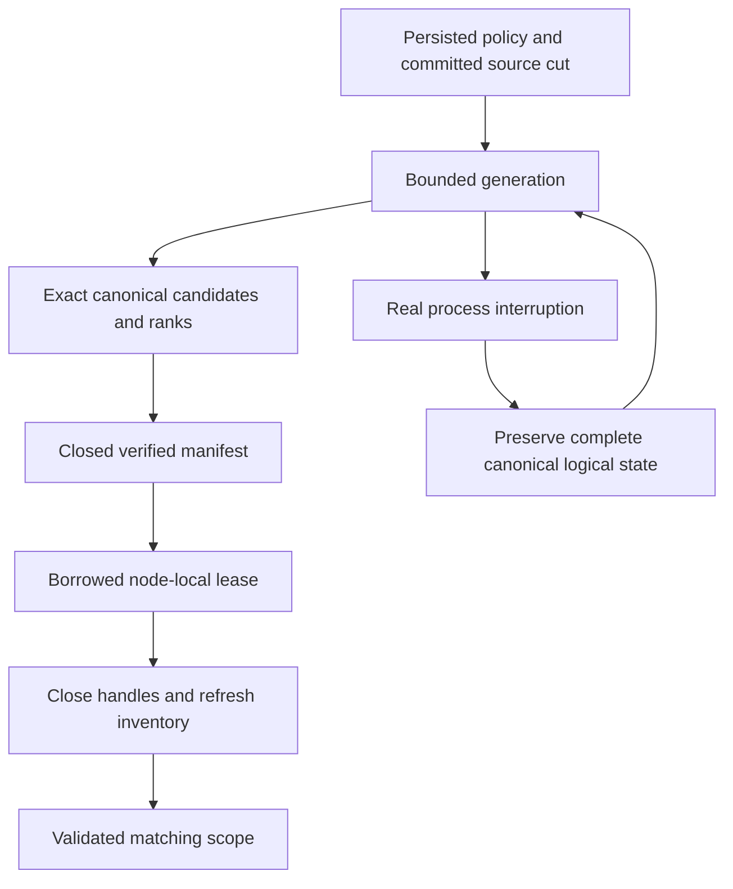

# FullTextProjection within Search

Decision: [ADR-078](../../ADR/ADR-078-full-text-projection.md). ZoneTree.FullTextSearch is the selected full-text provider (ADR-071). This document specifies candidate generation, distinct from the broader online index management of [OnlineGenerationLifetime](OnlineGenerationLifetime.md) and the event-driven projection lineage of [EventProjectionLineage](EventProjectionLineage.md). The index is a disposable node-local derived index owned by the silo-local ZoneTree owner; canonical documents, the persisted projection consumer and persisted authorization remain the authority, and a write is acknowledged after every configured copy confirms it.

|Requirement|Acceptance and automated evidence|
|---|---|
|REQ-FTS-001: the selected provider stays a derived index|AC-FTS-001: the published ZoneTree.FullTextSearch package at the version centrally pinned in `Directory.Packages.props` and ZoneTree posting files are used; exact canonical identities/scores/ties and all RRF branch ranks agree on a real-store Unicode/digit/short/repeated/missing-field/collision corpus|
|REQ-FTS-002: scope, privacy and freshness remain canonical|AC-FTS-002: a source cut/read-generation/incarnation/partition/principal/policy/schema/field mismatch cannot reuse a generation; mutation/delete/revocation/hidden-row tests preserve persisted checks and never leak unauthorized counts or payload|
|REQ-FTS-003: lease, storage and work are bounded|AC-FTS-003: saturation, exact/excess posting/record/token/metadata/disk/file/deadline bounds and cancellation return exact failures without partial success; handles release and the following request succeeds|
|REQ-FTS-004: staged generations and restart cannot supply partial truth|AC-FTS-004: actual write/publication interruption, malformed/unknown/link generation and reopen/rebuild tests preserve canonical bytes, recognize only owned cleanup and serve only a fully verified source cut|
|REQ-FTS-005: node-local ownership and public cluster joins are real|AC-FTS-005: node-local handles are unaffected by activation routing changes; SDK/official MCP text/hybrid results on the Aspire replicated cluster stay exact after node loss, restart and a current-source rebuild|
|REQ-FTS-006: measured qualification is honest|AC-FTS-006: exact-SHA Linux build/TUnit/process/cluster tests, package signature and original provider artifacts pass; matched scale/resource measurements precede any acceleration claim|
|REQ-FTS-007: settlement yields the request execution safely|AC-FTS-007 ([ADR-081](../../ADR/ADR-081-awaited-search-execution.md)): one analytical reservation acquired before scheduling spans the complete awaited search and cleanup; first publish/reuse/replacement, bounds/cancellation and healthy following calls pass (`TextAsyncProjectionTests`, `TextAsyncAdmissionTests`, `TextAsyncClusterTests`); the SDK/official MCP results and node health stay correct through the connection boundary|

Client/MCP wire changes are N/A (the existing SearchRequest and search output stay unchanged), frontend is N/A, and canonical storage migration is N/A because the disposable index is reconstructed from unchanged committed data. Positive, negative, edge and error cases use real ZoneTree, the provider, persisted policy and real client operations. Fault-injection hooks: the five-plus-one process cuts (`TextProjectionProcessRecoveryTests.AcFts003004005ProcessCutsPreserveCanonicalCutAndRebuildSearch`, ten cases) dispatch the mode from the last RecoveryProcess argument before ordinary commit-stage parsing; lifetime/settlement tests retain failed-release handles and both cancellation and cleanup failures, and compare all canonical logical key/value state across the real process cuts.

## Selected-provider capability audit

REQ-FTS-AUDIT-001 / AC-FTS-AUDIT-001 retain the centrally pinned ZoneTree.FullTextSearch and ZoneTree packages from `Directory.Packages.props` and the execution `IndexOfTokenRecordPreviousToken<ulong,ulong>` derived generation; there is no alternative provider.

|Capability|Actual ownership/API|Exact proof/boundary|
|---|---|---|
|Token postings and bounded candidates|`RuntimeTextIndex.Open` primary index, configured synchronous WAL; range/token/record keys|`TextProjectionParityTests` and hash-collision arguments; candidate completeness/revalidation stay KeyLoad-owned|
|English/Ukrainian Unicode query|KeyLoad frozen canonical tokenizer, token postings, authorized canonical documents|`TextBilingualLifecycleTests` exact hello/ПРИВІТ references/full JSON/revision/redaction and one-branch rank 1/61|
|Ranking|KeyLoad exact lexical corpus scoring and RRF over the canonical scoped cut|vs-canonical Unicode scores/ties/hybrid; no BM25 promise from the postings API|
|Delete and immutable command replay|canonical authorized DeleteDocument, source-cut generation replacement|the delete removes only the Ukrainian result; the same-ID receipt bytes, store position and all bytes stay stable; English is unchanged|
|reopen/rebuild|dispose the projection and canonical ZoneTree, reopen the canonical owner and the same projection root|deleted output and English full literal retained, unknown principal denied with full-store no-effect, healthy continuation|
|Authorization/freshness|persisted canonical policy/read cut governs candidates|`TextProjectionAuthorityTests` revocation/hidden rows/field denial/stale revision; unknown-principal denial|
|Analyzer/stemming/stopwords/phrase/public grammar|not exposed by the current KeyLoad public text profile|explicitly unsupported/unavailable, no inferred provider parity|
|Formats/migration|current typed owned projection manifest/index generation; disposable rebuild only|malformed/unknown/link projection tests; no Lucene index compatibility or legacy fallback|

The same-ID immutable replay through the official MCP administrator after a node loss (`TextClusterSiloRestartTests.AcFts005UpdatedTextAndProjectionRecoverAcrossSiloLossAndRejoin`, node-loss variant) returns receipt bytes equal to the original and the independently checked command ID, atomic partition, token authority, durability and three literal mutation receipts; SDK and official MCP search before and after replay and after all nodes rejoin equal the independent ordered literal document/rank oracle (replaced English text, removed Ukrainian/original English postings, surviving vector ranking, deleted document absent). The explicit removal of a disposable projection (`TextProjectionRemovalTests`) rebuilds only current literal rows from the canonical store while the store bytes and position stay unchanged, and a later insert becomes visible through replacement. A final successful SDK document read after delete uses the nullable `Document` field of `DocumentReadResult` (Document=null for absence). Result-mismatch diagnostics report only the client path, result counts and at most three row ordinals with fixed field-difference categories, never document JSON, identities, grants, credentials, query text or private values.

## Incremental maintenance

REQ-FTS-INCREMENTAL-001 / AC-FTS-INCREMENTAL-001: canonical documents and the persisted projection consumer are authority. An explicit text maintenance operation owned by the node-local host runs on the caller's connection grain; fresh persisted cluster-administrator authority is required for every seed, page, publication, ACK, restore and release, and there is no background dispatcher or implicit query-time ACK. It reuses the additive `ReadProjectionBatchRequest` Id3 ThroughSequence; consumer generation, resources and kinds are immutable (the kinds are exactly putDocument, patchDocument and deleteDocument of one collection). The fixed upper bound U comes from the same-cut canonical snapshot, head and active-consumer authority; missing retained history is HistoryUnavailable, and a released or replaced consumer cannot authorize old work. The initial seed is a bounded complete current corpus at the pinned upper; bootstrap ACKs cover only batches through that upper after seed completeness is verified, subsequent pages apply their actual chronological Before/After changes, and current source/corpus/policy/schema verification precedes publication.

REQ-FTS-INCREMENTAL-002 / AC-FTS-INCREMENTAL-002: a distinct current-format generation lives in the separate owned `text-projections` root (no reinterpretation of format 1). Its receipt binds NodeId, incarnation, data epoch, atomic partition, collection, field, analyzer/hash versions, consumer/name/generation, the canonical upper and dependency digest, stable record IDs (positive, unique, monotonic, never reused in the generation), revisions and deleted tombstones, the checkpoint and the tracked paths and inventory; there is no retained JSON body copy, the metadata has no KeyLoad record ceiling, and manifest file reads and writes are bounded by `TextExecutionOptions.MaximumDiskBytes`. `TextIndexMaintenanceRequest` (shared DTO): Id0 CommandId, Id1 Consumer, Id2 Collection, Id3 Field, Id4 IndexGeneration, Id5 NodeId, Id6 the partition identity, Id7 Build/Restore/Release mode. Build captures a bounded complete seed (and rejects an already enrolled identical consumer/generation), Restore loads the enrolled generation and applies retained outbox updates (never a silent rebuild) and Release fences the generation and releases its canonical pin through a distinct fresh authorized child. The route is `/search/text/maintain` and the on-demand official MCP tool `keyload_search_text_maintain`; SDK, MCP and the SQL CALL decode the same DTO through the existing signed parent, and each configure/read/commit/release effect is a fresh signed child with the original cancellation and frame admission. The parent page ceiling is the minimum of `KeyLoad:TextIndexMaintenance` MaximumReplayPages (default 32, hard 64) and the remaining CQRS frame capacity divided by three progress frames per page after reserving eight terminal/start/recovery frames. An original pending intent is replayed and published before its original canonical checkpoint is reconciled, historical bootstrap pages ACK without applying older revisions, an empty page still creates the empty generation when no manifest exists, and terminal success needs no pending intent, a completed bootstrap, the exact admitted upper/checkpoint and the verified inventory.

REQ-FTS-INCREMENTAL-003 / AC-FTS-INCREMENTAL-003: one page and generation mutation is serialized under the node-local owner gate, with no mutation while a borrowed query lease exists. Before the first posting change a checksummed typed pending intent (`intent.bin`) is persisted with the exact consumer/generation/after/through, signed batch token, stable references and revisions and bounded old/new hashed token triples derived with the canonical NFKC/Rune tokenizer and SHA256-le64-v1 under the same budget. Updates use `IndexOfTokenRecordPreviousToken<ulong,ulong>.DeleteRecord(token,id,previousToken)` and `UpsertRecord(token,id,previousToken)` (never `DeleteRecord(id)`, which scans the complete index outside the caller budget), deletions before additions, idempotently; deleted tombstones keep their revision and older revisions fail closed. The WAL is synchronous; handles are joined and the inventory captured before the durable generation checkpoint is published, and only then is the canonical `CommitProjectionBatchRequest` issued with the original command ID, token and empty effects. A crash before publication replays the exact persisted intent (an `incremental.pending` artifact is retired only after validating the complete intent and ownership), a crash after publication resumes only the original ACK with fresh authorization, and a crash after the ACK uses the immutable receipt. A mismatched intent, receipt, generation, checksum or inventory fails closed and is preserved; there is no retry loop, new command ID, source-history guess or legacy format.

REQ-FTS-INCREMENTAL-004 / AC-FTS-INCREMENTAL-004: public search always uses fresh canonical row/field authorization and complete literal source/revision validation in one read cut; the index holds only derived hashes and never authorizes output or ranking, and the exact lexical/RRF arithmetic, budget and no-partial-result rules stay unchanged. REQ-FTS-INCREMENTAL-005 / AC-FTS-INCREMENTAL-005: a bilingual real-store fixture, actual same-ID update/delete receipts and chronological pages are checked at seven process boundaries with a real RecoveryProcess, original canonical checkpoint ACK and healthy continuation. REQ-FTS-INCREMENTAL-007 / AC-FTS-INCREMENTAL-007: one maintenance session keeps one original ReadExecutionBudget (timestamp, counters, token, grants, byte/result constraints) across signed child phases; each child adds its own current cancellation token through an internal disposable stage scope that is removed only after the stage work joined, nested admission is rejected, and the original during-work cancellation leaves no partial publication or ACK and a retained original intent.

|Required boundary|Actual owner event|RecoveryProcess stage|
|---|---|---|
|Intent flush|`PersistIntent` completes before the owner observer|`IncrementalIntentFlushed`|
|First deletion|first exact-triple `DeleteRecord` returns|`DeletionWritten`|
|First addition|first exact-triple `UpsertRecord` returns|`AdditionWritten`|
|inventory|handles flush/join and the inventory is captured|`InventoryFlushed`|
|Checkpoint publication|complete manifest publication finishes|`ManifestPublished`|
|Canonical ACK|the journal receipt passes fresh checkpoint, original intent and inventory validation|`CanonicalCheckpointAcknowledged`|
|Intent retirement|the original pending `File.Delete` returns|`PendingIntentRetired`|

The ordinals 0 to 4 of the fault stages are preserved and the appended stages occupy 5 to 9; they are diagnostics, never authority or a public operation, and a null observer allocates no callback. Each case retains the acknowledged bilingual update/delete, the selected and removed queries, stable IDs/revisions/tombstones/token triples, the canonical digest, applied/store positions and joined children, readers and locks; recovery uses the persisted intent, an identical command replay after retirement leaves the journal, applied and store positions unchanged, and healthy revision 3 plus a cold child preserve the complete digest, the receipt and the index identity. Process-kill evidence only, not power-loss. process ownership (`ReplicaCrashNode`-style child with its stores, materializer and text maintenance service) joins the service, materializer, DI owner and all stores. A corrupt byte in the current manifest (`TextIncrementalCorruptionTests.DamagedManifestRejectsWithoutCanonicalEffectsThenExactRepairRestoresHealthy`) or in the durable `intent.bin` makes a fresh Restore or an owner with the same Build identity throw the exact fatal Corruption before checkpoint/publication with unchanged canonical bytes and preserved damaged evidence; only an owned exact-byte repair (primary and repair failures retained) lets the same operation complete, never an implicit rebuild.

The owner admits exactly one durable generation leaf per consumer/generation identity (a checksummed enrollment binds the source scope, partition identity and original Build command before index work); a released consumer identity is not reusable (a new Build uses a new consumer identity and a positive generation) and Restore selects the one enrolled identity, never the latest directory. The same immutable original Build command and payload digest may resume the enrolled generation and its original persisted checkpoint intent; an expired never-acknowledged page token is rejected and a committed original receipt may be replayed only through the canonical exact-intent contract. Release first invokes the immutable ReleaseProjectionConsumer child, retains its `ProjectionConsumerInfo` (optional `TextIndexMaintenanceResult` Id8 `ReleasedConsumer`), then a fresh signed local capability verifies the released consumer/generation/definition and source authority before the tracked generation is retired: every registered owner of the verified leaf disposes before a strictly validated directory deletion, and unknown files, reparse points, locks or incomplete deletion are failures with retained roots. REQ/AC-FTS-INC-010: the internal signed capability admits only a nonempty parent/session identity, the actual node ID, a positive generation, a defined mode and a defined phase (Release phase and Release mode must match); this follows the signed child/administrator boundary and precedes filesystem mutation. REQ/AC-FTS-INC-013: MaintainTextIndex is an Orleans parent, not a Core atomic payload; a standalone `RuntimeCreateOperation` is rejected UnsupportedCapability before any canonical change.

REQ/AC-FTS-INC-011: the nullable Id9 `IndexedThroughSequence` exposes the actual published manifest/checkpoint upper for Build/Restore (null for Release), while `Source.ThroughSequence` reports the fresh canonical observation and is never relabelled as the indexed prefix; completion means the requested immutable prefix settled, an exact original Build replay after an update/delete keeps the old indexed upper, and a fresh Restore reaches the new upper with the literal updated/deleted state. The manifest keeps `LastSettledCheckpointRequest` (Id14 of the manifest, format version 2, and Id8 of the capability result) holding the exact last acknowledged original `CommitProjectionBatchRequest`: it is formed only after the genuine canonical acknowledgement, charged under the original budget, published through the checksummed envelope before the pending intent is deleted, and validated cold (manifest version, checksum, inventory, owner/read cut/consumer authority). A parent with no pending recovery whose settled evidence matches the deterministic `TextMaintenanceChildIdentity(parent CommandId, Checkpoint, ThroughSequence)` replays only that original signed commit (no `ApplyIntent`/`PreparePage`, no fresh token, no synthesized receipt), recovering the full `ProjectionBatchResult`; a different parent does not borrow it, and missing or corrupt settled authority fails closed. Versions other than 2 and missing mandatory evidence are refused (no legacy reader). A lower original Configure checkpoint than the fresh Begin checkpoint proves an older parent (HistoryUnavailable before index effects unless the exact child is in the pending intent or settled request); an equal checkpoint is a genuine no-op that returns the original nullable checkpoint without a new receipt.

REQ-FTS-INC-014–016 / selected maintained generation: `SearchRequest` Id13 carries an optional `TextIndexSelection(consumer, generation)` (null omitted from JSON; no new operation, route or tool) which needs a nonempty text branch and the same logical partition. Query calls `ISelectedTextProjection.AcquireSelected` with the original view, freshly admitted principal/resource and budget; a selected provider never falls back to bootstrap and the unselected signature is unchanged. The selected lease visits tokens and verifies candidates with stable manifest IDs, the physical index is owned by a bounded generation reader slot (maintenance waits for readers before mutation or retirement and shutdown joins them), and the required cut and corpus are captured in the same view. An actual update/delete makes the selected prefix stale (HistoryUnavailable, no partial result, canonical state unchanged) until an explicit Restore. REQ/AC-FTS-INC-017: the slot counts successful read-only posting iterator advances for the exact consumer/generation (once per successful NoRefresh `Next`, before inspecting the key); every advance keeps the original budget charge and token/deadline checks, so cancellation returns the original token with no partial result after real work, joins the lease and index owners and leaves a healthy follow-up. Bootstrap and selected readers share one counted composite admission that is transferred into the original lease wrapper; the count never refuses a reader, and shutdown joins both reader kinds before files. An ordinary Query/DocumentsRead principal revoked at an increasing policy epoch gets Unauthenticated before generation lookup (a missing generation never leaks source-history information), and explicit release (the canonical ReleaseProjectionConsumer with byte-identical same-ID replay, then the protected local Release) turns selected lookup into HistoryUnavailable after the selected readers settle. REQ-FTS-SELECT-014 / AC-FTS-SELECT-014: the bounded MCP writer admits exactly ErrorCode.HistoryUnavailable paired with the fixed literal `The text projection does not match the authorized source cut.`; any other pairing keeps the generic safe failure, and the unit writer operation checks the full five-field problem, null result and execution identity at the inclusive byte boundary. REQ-FTS-INC-ORACLE-001 / AC-FTS-INC-ORACLE-001: receipt/result replay and complete public-value byte arrays are compared by ordered byte content (`SequenceEqual`), never by array identity. REQ-FTS-INC-INVENTORY-002 / AC-FTS-INC-INVENTORY-002: the writable owner settles eviction, joins background work and saves ZoneTree metadata before disposal and the exact complete inventory capture, single-segment garbage collection is disabled for this sealed disposable projection, and selected reads cannot refresh the inventory or rebuild authority; a damaged manifest fails with the owned projection Corruption detail.

## Maintenance results through the public routes

REQ-TEXT-MAINTENANCE-SQL-001 / AC-TEXT-MAINTENANCE-SQL-001 (`TextMaintenanceClusterTests.ProtectedTextMaintenanceReplaysBilingualUpdateDeleteAcrossAllPublicPaths`, arguments Sdk, Mcp, SdkSql, McpSql): the first Build and the following bilingual update/delete, Restore, Release and original receipt replay exercise the SQL maintenance operation (`EXEC keyload_search_text_maintain @arguments`, compiled by the ScriptDOM-based SqlOperationCompiler as one exact public procedure identifier and one variable reference) through the SDK SQL and official MCP SQL clients; the command identity is preserved, and the wrong-owner refusal (OwnershipLost with its detail) and every receipt/state/privacy/no-effect assertion stay. Release error parity: the SDK keeps the exact owned released-generation detail, while the official MCP envelope keeps its closed safe-error contract (`TokenInvalidated` with `The database operation could not be completed.` for this non-allowlisted detail); the expectation is never computed through the production mapper and no internal detail is exposed. REQ-FTS-PUBLIC-FAILURE-DETAIL-001 / AC-FTS-PUBLIC-FAILURE-DETAIL-001 (refining REQ/AC-FTS-003/004/005/006/007): on failure only, the test assertion explanations preserve the closed sanitized ErrorCode and the code-derived MCP status and append the already-parsed SDK `Problem.Detail` or MCP `StructuredContent.error.detail`; a missing, malformed or non-string detail contributes an empty detail, and raw responses, exceptions, provider state, documents, credentials, caller identities and request IDs are never printed.

Same-owner search children: REQ-SEARCH-CONNECTION-CHILD-001 / AC-SEARCH-CONNECTION-CHILD-001 (with REQ/AC-CLIENT-CONNECTION-001/002 and ADR-125): the ANN, text and online-text parents execute their separately issued child capabilities by borrowing the same connection grain's `ExecuteStreamAsync` implementation, never an outgoing call to the same activation; the private owner supplies the delegate, and no public caller or DI observer can supply execution authority. Parent scope and identity validation, the fresh persisted administrator check, the child RequestId/CommandId, the child envelope and the original expiry are kept; the producer is drained and disposed before the identity scope is restored, partition commands use independent Graph-authorized request grains, and the online text path keeps frame observation over the borrowed stream. The regression flows are the existing and Aspire SDK, official MCP and SQL caller flows: owner-mismatch refusal with an unchanged corpus, build/restore/publication, exact original receipt replay, bilingual update/delete literals, lease/cancellation/unknown outcomes with joined Abort, and same-root cold recovery.

The online-publication process recovery cases corrupt the selected staging
manifest after the faulted child has exited and its file handles are released.
A separate real child must refuse the damaged generation with `Corruption` before
emitting its bounded completion witness. The parent then restores the exact
original bytes; cold recovery and a further cold verification retain the original
full receipt and the healthy publication. This exercises on-disk validation with
a newly opened derived owner.

Connection-owned maintenance Task children publish the existing request-start
and producer-settlement observations while their signed child identity is bound.
The original child Task and observations join before identity, cancellation and
owned payload cleanup; observation failures preserve the original operation failure.

## Open selected-generation qualification

The current embedded selected-generation flow fails its second lookup after a
successful first lookup. A bounded before/after inventory observed a change only
to the native `execution/index1/0.json` metadata file. The protected physical
inventory then refuses the changed digest. This also reproduces without Orleans;
it is not evidence of corrupted document or posting data.

[ZoneTree issue 209](https://github.com/ZoneTree/ZoneTree/issues/209) retains the
published package/source identity, original operation flow and the clean-reopen
metadata rewrite attribution. The existing integrity assertions remain active.
Selected-generation recovery, release and performance qualification remain open;
the issue report is not a delivered repair.
