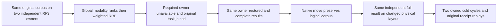

# Global branch ranking across an actual owner layout change

REQ-RANK-LAYOUT-001 / AC-RANK-LAYOUT-001 refine [ADR096](../../ADR/ADR-096-global-branch-windows.md) and KL057. Existing kernel layout arrays remain mandatory; the genuine public distributed search must preserve the SAME original logical partitions/documents/vector values and full independently authored weighted-RRF output after native partition movement changes two independent RF3 owners into one physical owner holding both original logical scopes. RF3 replicas are never relabelled shards.

The new GlobalBranchLayoutRf3Tests same whole operation preserves two variants selecting actual SDK or official MCP for unavailable-shard proof. Genuine six-node TwoRf3MembershipWave, original DistributedSearchRf3Seed and real MovePartition are reused without production/shared helper changes. Four public routes (SDK/MCP plus canonical selected-SQL EXEC wrappers) match fixed full hit/reference/revision/body/redaction/RRF/contribution literals. Same document ID in different partitions remains distinct; missing vector contribution is zero. The request uses strict exact complete windows; native current DistributedSearchPageV1 has NO cursor, so no synthetic continuation is introduced. Native sorted tie, truncated/approximate/missing window and exact modeled byte controls remain required.

Fresh persisted vector capability withdrawal on the receiving owner refuses before partial success; explicit original-principal repair is applied to both actual owners before movement so an unrelated divergent catalog cannot be mistaken for a ranking defect. Both layouts retain full logical documents and complete selected-partition outbox after EACH response, with independent primary/conservation failure aggregation. Original seed receipts and retired movement result replay remain complete public contracts. Physical position counters do not cross owners: InstalledReceipt independently binds the new owner authority/token only; it never orders a local leaf store position. Warm cuts are positive local positions. During each cold wave, every leaf cut belongs to the independently captured native Store.Position values of its actual three-voter owner group, and the complete six-owner raw images/positions before and after reads/replays must match. After movement both logical scopes bind the target group; no logical receipt or coordinator Applied counter is used as a local cut floor/ceiling. Opaque statistics epochs may change with authentic source evidence, never forced equal.

The unavailable shard control actually kills the three original destination containers through owned native runtime, joins the original selected SDK/MCP task before all stopped resources are started/rejoined, and demands typed OwnershipLost with no partial page, followed by full healthy output. Complete canonical source state after restore must stay fixed. Close/join callers before each of two full owned six-node cold cycles; attempt both and retain all original operation/disposal errors. Both cold waves repeat the complete literals, permission epoch, original commands/receipts and published placement.

SourceN only: native declaration UIDs/counts UNKNOWN, semantic/native N and compiler/full analyzers, actual runtime/Linux provenance OPEN. No profile/quota/deadline, index, serialization, alias, storage, operator or authentication changes. No performance/fanout/hardware claim follows from this small functional corpus. Missing-owner exact error branch, movement receiving catalog/authority prerequisites and all current real APIs require final source review/native admission before adoption. Full task remains pending distributed bounds/independent physical evidence and complete Linux fault/quality/profile gates.

The missing-owner restart scenario is bound to the actual target physical-owner incarnation, selected SDK/MCP caller and a fresh owned artifact ID. The closed node4/5/6 receipt paths use the existing native restart filename contract directly; the node1/2/3-only helper is not reused. Each successful full-file length/SHA256 capture is retained before aggregate/disposal failures are thrown, including partial restart cleanup. Native receipt files are bounded at 65,536 bytes and contain native runtime provenance, never query bodies or credentials. Every later cold wave and the final outer error ledger independently reread every retained original; a failed earlier capture or cold attempt cannot erase successful evidence. This is artifact conservation, not a new runtime/fault qualification claim.
