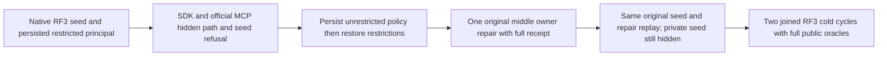

# KL055 public current row policy across graph paths

REQ/AC-GSEARCH-002/004/006 and architecture KL055 require hidden intermediate vertices to stop traversal without applying endpoint predicates to valid intermediate collections. Existing public label-lineage and leader-loss operations do not exercise persisted row-owner restrictions on a middle vertex. This new-only test stage adds `GraphSearchPathPolicyRf3Tests.HiddenIntermediateStopsAllOperatorsUntilPersistedPolicyAndOwnerRepairSurviveReplayAndTwoCold`.

The real Aspire Docker RF3 fixture owns nodes, original clients and shutdown. A persisted non-administrator principal reads a five-document/two-collection graph. Initially a foreign-owned middle vertex hides the two-hop endpoint, while a direct endpoint remains visible. Complete independently authored GraphRetriever, GraphScope+AllowedIds and selected-hit GraphExpansion results must agree through actual SDK and official MCP. Explicit hidden middle/private seeds return NotFound with no result. Full administrative document/edge projections, complete original receipts and partition outbox are conserved after each public read/refusal. This is public semantic conservation, not a claim of private raw-storage or equal cross-call cut positions.

A real persisted policy ACK temporarily removes row restrictions and restores the full path; a second ACK reinstates restrictions and hides it again on the same authenticated clients. One original immutable native Commit changes middle row ownership under revision1. Its complete independent revision2 receipt uses actual public placement identity/epoch, positive observed original commit position and QuorumProcessDurable; same-command SDK/MCP replay must preserve it. The original seed also replays without resetting current owner/revision. After the repair, the other foreign-owned private vertex remains explicitly hidden: current row restrictions are still enforced. Full literal graph hits/context, current documents/edges/outbox and both original receipts survive two genuine joined all-node cold restarts through fresh actual clients. Each failed operation or cleanup retains all original errors; no next cold starts after failed original caller cleanup or restart. No fake clock/provider, new host seam, SQL parser, retry, timeout or credential role is introduced.

This supplies new executable source, not runtime qualification. Canonical compilation/analyzers, original native discovery, the complete new RF3 case and existing graph groups, exact-source Linux artifacts, resource and performance gates remain OPEN. The private reflected receipt members checked by the existing helper are deserialized client DTO defaults only; they do not prove persisted native privacy. SQL parity remains its separate existing owner/gate. Parent [GraphRetrieval](GraphRetrieval.md), [ADR090](../../ADR/ADR-090-graph-search.md).
