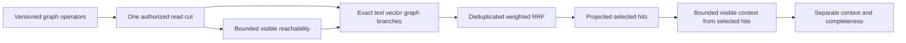

# GraphRetrieval within Search

[ADR-090](../../ADR/ADR-090-graph-search.md) implements architecture sections 26.2–26.4 for the same-partition exact branch of graph retrieval. The SQL, distributed ranking, performance and replicated-cluster qualification requirements are retained.

The independent graph branch sorts shortest hops then full EntityRef and feeds one-based ordinal ranks to weightedRrfV1. Equal-hop alpha and beta contribute 1/(60+1) and 1/(60+2); adding one-hop delta precedes two-hop gamma, giving ranks 3 and 4. Hop distance is not the final fused ordinal rank, and the SQL fixture's complete expected order is derived from its declared corpus, never from production ranking output. A graph write issued after a node loss uses one unchanged command; an uncertain outcome is never retried under a new ID.

## Versioned public contract

The graph executor adds an explicit `GraphSearchRequest` and `GraphSearchResult`; it does not
change the exact array reply of existing Search. HTTP `/search/graph`, SDK
`GraphSearchAsync` and official MCP `keyload_search_graph` invoke the same isolated
Orleans request/read grain and one canonical authorized storage read cut.

The generated v1 records, with sequential IDs starting at0, are:

- `GraphWalkSpec(Graph, Seeds, MaxDepth=3, MaxVertices=1000, MaxEdges=5000,
  Labels=null)`: immutable qualified EntityRef seeds and optional immutable
  ordinal labels. Null labels means unrestricted; empty labels means no edges.
- `GraphScope(Walk)`: mandatory reachability eligibility, including seeds.
- `GraphRetriever(Walk, Weight=1)`: one independent shortest-hop ranked branch.
- `GraphExpansion(Graph, MaxDepth=1, MaxVertices=1000, MaxEdges=5000,
  Labels=null)`: walks from the selected final hits and returns separate context.
- `GraphSearchRequest(Version, Search, Scope=null, Retriever=null,
  Expansion=null)`: version must equal1 and at least one graph operator is
  supplied. Search may omit text/vector only when Retriever is present.
- `GraphContextDocument(Document, ShortestHops)` and
  `GraphExpansionResult(Documents, Completeness=SelectedHits)` use projected
  DocumentResult and an explicit `GraphExpansionCompleteness.SelectedHits` enum.
- `GraphSearchResult(Hits, Expansion)` retains the exact RankedDocument hits;
  Expansion is null when not requested and never silently changes hit ranks.

Every new record uses `GenerateSerializer`, stable IDs and a literal purpose
alias `keyload.contract.<kebab-type-name>.v1` held in feature-owned constants.
No existing IDs/aliases are reused.

All walks are outgoing, in the Search partition and a configured graph in the
same tenant/database. Depth0..16, vertices1..10000, examined edges1..50000,
nondefault nonempty seeds no greater than MaxVertices, finite nonnegative
weight and valid identifiers are validated before reads; the serialized request
has no KeyLoad byte ceiling ([ADR-149](../../ADR/ADR-149-no-operation-limits.md)). Unknown versions fail Validation. Every operator
shares the request's cancellation and explicit expiry; its local caps never
reset the shared operation. Limit exhaustion fails explicitly,
with no truncated success or exact/completeness claim.

## Requirements and acceptance

| Requirement | Acceptance and mapped automated tests |
|---|---|
| REQ-GSEARCH-001: independent AST roles within one read cut | AC-GSEARCH-001: GraphScope, Retriever and Expansion are independently callable and composable; count read-gate entry and prove exactly one per request. `GraphSearchOperatorTests` |
| REQ-GSEARCH-002: current persisted path authorization | AC-GSEARCH-002: hidden/deleted/revoked intermediate vertices stop traversal; each seed retains existing explicit start authorization. Endpoint collection/AllowedIds filters do not prune valid other-collection intermediate vertices. Requested labels require graph label field-use authorization. `GraphSearchAuthorizationTests` |
| REQ-GSEARCH-003: deterministic deduplicated shortest-hop ranking | AC-GSEARCH-003: graph score1/(1+shortestHops), multi-seed BFS, cycles/convergent paths contribute once per full EntityRef; weightedRrfV1 text/vector/graph matches independent exhaustive small-corpus oracle, including missing/zero-weight branches and ordinal ties. `GraphSearchOracleTests` |
| REQ-GSEARCH-004: explicit bounded expansion output | AC-GSEARCH-004: only selected final hits seed expansion; context uses its own current collection/row/field policy, deduplicated shortest hops, explicit SelectedHits completeness and shared combined reply bounds. `GraphSearchExpansionTests` |
| REQ-GSEARCH-005: bounded versioned admission | AC-GSEARCH-005: null/default/cross-partition seeds, invalid labels/versions/weights, exact work/byte boundaries, cancellation and next healthy request are covered. Label identifiers use the existing nonblank UTF-8 byte bound and reject control characters; internal spaces remain valid. No edge attributes or whole intermediate JSON are retained by reachability. `GraphSearchBudgetTests`, `GraphSearchInvalidWalkShapeTests`, `GraphSearchReachabilitySortBudgetTests` |
| REQ-GSEARCH-006: public cluster and SQL parity qualification | AC-GSEARCH-006: .NET and official MCP clients agree on genuine Aspire cluster after policy/write/fault changes, and versioned SQL SEARCH compiles equivalent operators. Planned `GraphSearchClusterTests` and SQL conformance fixtures; the SQL SEARCH profile, not closed by the graph executor |

Scope intersects AllowedIds at branch output before ranking/fusion. Text corpus
statistics remain the complete authorized corpus. Traversal never applies that
endpoint predicate to intermediate vertices. Retriever produces only visible
Search.Collection endpoints, sorted by shortest hops then full EntityRef;
missing branches contribute zero and duplicate paths never amplify score.
Zero-weight branches still validate their request and execute their current
authorization and bounded read work, but contribute no candidates or score to
fusion. A zero-weight-only retriever therefore produces no hits; it does not
bypass GraphRead, seed visibility, label-use checks or shared resource bounds.
Current edge authority is persisted GraphRead; edge label policy applies when
Labels is non-null, using exactly the `/label` JSON-pointer field-use path, including empty
label arrays. Expansion excludes all selected-hit EntityRefs from its context
output; its seeds still count against traversal/work caps and shortest-hop
distances. Scope and Retriever include authorized seeds at hop0.
No hidden-traversal privilege is introduced. Missing
canonical adjacency/edge corruption propagates rather than becoming a hidden hit.

## Stages and evidence

1. The contract and ADR are frozen before coding; shared Core Query friend visibility, public transport/read-kind joins and central versioning are integrated once.
2. New Abstractions Search graph contract files, Core GraphTraversal same-cut reachability helpers with their internal DatabaseEngine bridge, the Query Search graph executor and the mapped unit tests implement the graph executor. SearchEngine's private ranking/projection/validation may be refactored into shared Search helpers and the request sizer extended generically while preserving all public allowlist behavior; there are no Core vector/lineage edits.
3. Core returns only bounded EntityRef-to-shortest-hop metadata through a narrow internal borrowed-view bridge. Query uses WithQueryView exactly once and passes that view, the freshly resolved principal and one budget to every branch; public Traverse/Search/Get are never called inside the cut and no second cut is acquired.
4. The SQL SEARCH profile adds equivalent SQL operators, public cluster cases and the remaining whole-task qualification. Cross-partition traversal is unavailable in the graph executor; distributed ranking is specified in [GlobalBranchWindows](GlobalBranchWindows.md) and adaptive ANN in [FilteredRetrieval](FilteredRetrieval.md).

There are no new dependencies or stored-format migrations in the graph executor. Rollout admits only nodes supporting the new capability before serving the endpoint; unsupported graph requests are rejected, never silently dropped. Interactive UI is N/A: this is an SDK/SQL/MCP database capability.

## Versioned SQL SEARCH profile

This is a bounded Q1.Search.v1 profile of the shared SQL language, not full SQL
conformance or a SQL client connection protocol. The dedicated typed
`SqlGraphSearchRequest(Version, QueryRequest Query)` uses IDs0/1 and alias
`keyload.contract.sql-graph-search-request`. Version must be1, Cursor must be
null and AllowFullScan must be explicitly true. The read kind,
HTTP `/query/search`, SDK `SearchSqlAsync` and official MCP
`keyload_query_search`; all return the existing GraphSearchResult. Current
application capability3 admits it. Existing scalar QueryPage is unchanged.

The complete accepted statement order is:

```text
SEARCH FROM collection
 [TEXT field MATCH string-or-@parameter [WEIGHT number]]
 [VECTOR field MATCH @parameter SPACE (id, dimension, metric, model, version)
  [WEIGHT number]]
 [SCOPE GRAPH graph SEEDS ((collection, id), ...)
  DEPTH integer VERTICES integer EDGES integer [LABELS (value, ...)]]
 [RETRIEVE GRAPH graph SEEDS ((collection, id), ...)
  DEPTH integer VERTICES integer EDGES integer [LABELS (value, ...)]
  [WEIGHT number]]
 [EXPAND GRAPH graph DEPTH integer VERTICES integer EDGES integer
  [LABELS (value, ...)]]
 [ALLOW IDS (value, ...)] [LIMIT integer] [FUSION integer]
```

Collection/field/graph/space identifiers follow current bounded SQL identifier
rules; seed IDs, label/allowed-ID values and MATCH text accept quoted strings or
named JSON string parameters. Seed collection is an identifier in the same
request partition. Vector MATCH is a named JSON array of finite float-compatible
numbers, with exact supplied space dimension and defined VectorMetric. Empty
LABELS/ALLOW IDS retain the direct API's empty-set semantics; empty/default seed
sets reject. Weights default1, limit10, fusion60; walk caps are explicit. At least
one graph operator is required; graph-only retrieval is valid. Duplicate,
reordered, unknown clauses, missing/wrong-kind parameters, nonfinite/overflow
numbers, unsupported cursor/version and trailing tokens reject Validation.
No clause can be silently ignored or manufacture a different identity scope.

Use the existing bounded tokenizer/token cursor and named constants, preserve
their whole-SQL token/depth/byte limits, and cap JSON parameters/the complete
request before building arrays. Parser output is exactly GraphSearchRequest;
the final graph-executor validation remains authoritative. Execute solely through
SearchEngine.GraphSearchAsync with the original principal and cancellation.
There is no second traversal implementation, extra store read or SQL-specific
authorization path. Manifest ReadProfiles adds `graph-search`, while its Q1
baseline and honest scalar conformance inventory remain unchanged.

AC-GSEARCH-006 maps SQL SEARCH syntax and real-store direct/SQL equivalence to new
`SqlGraphSearchParserTests`, `SqlGraphSearchParityTests` and
`SqlGraphSearchRejectionTests` in QueryExecution/Cases with Helpers fixtures.
Cover all operator combinations, multi-seed/different-collection intermediates,
empty labels/allowlist, zero weights, exact lowering and invalid parameter/budget
cases. Genuine Aspire replicated-cluster SDK/official MCP parity with policy, write and fault changes closes the criterion. Public UI N/A.

### SQL SEARCH public cluster tests

AC-GSEARCH-006 requires the Aspire replicated cluster, discovered endpoints, persisted grants and the real .NET SDK and official MCP clients (`GraphSearchClusterTests`, `SqlGraphSearchClusterTests`). They assert independent expected IDs, ranks and context on direct and SQL replies, multi-seed and other-collection intermediates, explicit denials and policy/write changes, plus a scoped node-loss case with committed-state verification and bounded cleanup.

## Three-way exact fusion qualification

This stage covers REQ-GSEARCH-003/006 and AC-GSEARCH-003/006. The existing graph executor and SQL SEARCH
lowering remain the implementation contract; no new public or stored contract
is introduced. Three-way means text, exact vectors and graph retrieval in one
authorized bounded read cut. Global multi-partition ranks are specified in GlobalBranchWindows.

Use a genuine persisted corpus with deliberately different text, cosine-vector
and shortest-hop rankings, a missing branch contribution, converging graph paths,
and an ordinal tie. Define the expected branch orders from that fixed corpus
independently of the production ranking/fusion helpers. A test-owned arithmetic
oracle computes each unique ID's `textWeight/(K+textRank) +
vectorWeight/(K+vectorRank) + graphWeight/(K+graphRank)`, using one-based ranks,
zero for absent or zero-weight branches, and ordinal ID ties. Assert exact
selected IDs and scores within a stated floating-point tolerance, including
unequal positive weights and the all-zero result. Scope and AllowedIds intersect
before branch ranks; graph traversal may still use eligible-policy intermediate
vertices outside the result collection. Current persisted row/field/graph-label
denial and revocation cannot be bypassed by a zero weight or empty allowed set.
Expansion context stays separate and contributes no fusion score.

The tests (`ThreeWayHybrid*`, unit and integration) run against real ZoneTree/Core/Query and the Aspire replicated cluster, using the actual .NET and official MCP clients for direct and SQL parity. Distributed ranking, scale, endurance and performance remain separate requirements.




## Graph write durability across node loss

REQ/AC-GSEARCH-006 under ADR-090: a graph addition (a delta document plus an edge from the second seed) is frozen as one immutable CommandRequest before one node is stopped. It is submitted once; only an actual UnknownWriteOutcome permits one bounded same-byte, same-ID receipt reconciliation and any other error fails, so no write is retried under a new GUID. A genuine administrative GetDocument read of the second seed exercises the authoritative read barrier, current persisted policy and catalog before the write. The exact two mutation receipts, nonempty partition/incarnation/position and ProcessDurable are verified, and an SDK/official MCP replay of the identical command returns a byte-identical receipt. Graph-search readers and MCP return the full literal four documents, references, revisions, JSON, redaction and weighted ranks, and a bounded canonical Traverse from the second seed returns exactly four vertices and three literal edge records. After the stopped node restarts, all nodes replay the original receipt and return those complete graph literals with no duplicate edge revision or derived document effect.
