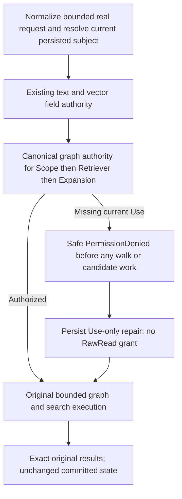

# Authorize every graph-search expression before execution

requires complete sensitive-expression lineage before candidate lookup. Existing ordinary SQL/AST predicate, ordering, typed/model join and direct graph label checks remain mandatory. This stage covers graph-search Scope, Retriever and Expansion label expressions in one current authorized cut; it does not add grammar, projection semantics or a parallel authorization provider.

REQ-GSEARCH-LINEAGE-001 / AC-GSEARCH-LINEAGE-001: reuse the existing GraphRead/current resource kind/domain/conditional label Use checks. Bind all requested graph operators after existing text/vector field authorization and before the first graph walk, ranking, candidate read or projection. Preserve original version/shape/byte validation and fresh persisted subject resolution. Labels null skips only label Use; nonnull empty labels retain the original label expression authority and empty reachability semantics. Canonical graph errors and budget/cancellation ownership remain unchanged.

REQ-GSEARCH-LINEAGE-002 / AC-GSEARCH-LINEAGE-002: genuine configured graph-search operations with a late protected Retriever or Expansion must refuse before earlier graph lookup. A genuine producer creates the original row; replacing that exact fault-owned native row establishes a deterministic native read boundary. Missing Use must return the fixed PermissionDenied without state effects. Persisting Use only (not RawRead) must expose the original native corruption control; restoring the exact original row must restore the full healthy operation. No timing assertion, fabricated read counter, mocked projection or public corruption endpoint may substitute for this boundary.

REQ-GSEARCH-LINEAGE-003 / AC-GSEARCH-LINEAGE-003: real SDK/official MCP and supported central SQL operator routes exercise independently authored full healthy results, safe full Problems, current grant withdrawal/repair, original receipt replays and complete no-effects observations. Two genuine cold cycles must attempt recovery and original operation checks, retaining primary and cleanup errors. Cursor coverage applies only to operations whose actual contract has cursors; graph-search has no invented cursor protocol.

Existing full function/group/COUNT/EXISTS/facet capability inventory remains bounded by executable current semantics; unsupported grammar is not advertised as implemented. Frontend N/A: database query operations only.

The canonical parents are [Search](../Search.md), [QueryExecution](../QueryExecution.md) and [Authorization](../Authorization.md), with the existing ADR-009/015 search and field-use contracts. The exact product change extracts the unchanged authorization prefix from `GraphSearchReachabilityReader.Read` into feature-local internal `GraphSearchFieldAuthority.Require`. The original reader calls that same helper. `GraphSearchExecutor.ExecuteInCut` invokes it for each actual Scope, Retriever and Expansion, in that order, after existing text/vector checks and before the first walk. Additional resource authorization reads charge the same existing request budget; no limit, timeout, authority cache or unmeasured performance promise is introduced.

`GraphSearchLineageWholeFlowTests.AllGraphExpressionAuthorityPrecedesEarlierNativeLookupThenUseOnlyRepairCompleteResultsReplayAndTwoCold` has four actual argument cells: late Retriever or Expansion, each with nonnull empty/nonempty labels. A genuine eight-mutation command creates three documents, one early-graph edge, two protected late-graph edges and two canonical vectors. The original complete native receipt independently fixes all eight mutation receipts, incarnation, atomic partition, actual next embedded store position and ProcessDurable. Native hidden composition references are checked for seed and original replays, and the original stored outcome bytes stay immutable.

The fault control replaces only the original first scope vertex record using a real wrong-type native serialized value. Missing Use must return the exact protected-use PermissionDenied while preserving the whole corrupted store image, position and identity. A real persisted epoch2 Use-only grant makes the same original request return Corruption at the original native lookup. Cleanup always restores the exact original bytes; its full expected store image is independently constructed by replacing only that one owned row in the actual post-policy snapshot. The genuine cleanup commit advances its native position once. It neither copies a store directory nor changes authority counters. Healthy results independently fix both full documents and RRF scores: Retriever plus vector contributions, or vector-only hits and complete selected-hit expansion context. Empty labels retain the seed-only retriever semantics or empty expansion context. Persisted withdrawal epoch3 and repair epoch4 re-exercise refusal/healthy results. Both same-root current-format cold opens are attempted and joined; full store bytes/position/identity, original receipt/outcome replay and complete healthy results are retained.

`GraphSearchLineageClusterTests.AllRequestedGraphLabelsUseFreshAuthorityBeforeEarlierLookupAndRecoverExactResultsAcrossTwoCold` keeps the same four argument cells on genuine Aspire Docker cluster, a real persisted principal/API key, the .NET SDK and official MCP client. The real absent first scope seed is a public observation boundary: without late-label Use, even that request must be PermissionDenied; with Use only it must become the exact NotFound, and the original existing-seed request must return the full independently expected healthy result. This is a supported missing-entity control, not a public corruption endpoint. All four operation routes are real: typed SDK, official MCP, and the supported central T-SQL EXEC operation through SDK and MCP. No new GRAPH_SEARCH grammar is implied by those operation envelopes. Each route has independent full safe Problem/null-or-Undefined checks and is followed unconditionally by pure complete original documents, full early/late graph records and frozen eight-entry outbox status through SDK/MCP. Original seed SDK/MCP receipt replays also each have that complete state observation. Two genuine all-node same-volume cold cycles are attempted independently with fresh owned callers and original deadline policy.

The complete public receipt checks all five CommitReceipt fields, including actual PersistedCopies, and all three CommitToken fields; the positive log position is retained as an opaque server result and other authority fields come from an independent administrator partition read. No local/query cut is ordered against it. MutationReceipt.CompositionReferences is JsonIgnored on public JSON; only native producers/store/replay can establish that hidden mutation field. Actual original source rows, persisted grants and cleanup are used throughout. No timing assertion or fabricated access counter claims to prove an early lookup boundary.

All broader predicate/alias/function/group/COUNT/EXISTS/facet/search lineage and current qualification requirements remain mandatory. This finite implementation does not claim unsupported executable SQL semantics or a new public cursor.
