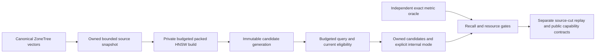

# Managed ANN candidate

Canonical slice: Search. Decision: [ADR-019](../../ADR/ADR-019-managed-ann.md); parent [Search](../Search.md). The managed ANN candidate maps REQ/AC-SEARCH-001/003/004/005/006 and has three layers: the computational kernel, the persisted native projection with its source-cut replay and publication, and the explicit public read.

The computational kernel is an independently authored immutable packed managed HNSW computational candidate. It consumes an owned bounded snapshot of actual canonical VectorRecord values and returns owned internal candidates; it is not enabled in SearchEngine, SQL, HTTP, SDK or MCP by itself. Canonical ZoneTree data, native WAL, persisted authorization, the caller's connection grain and the replicated cluster remain authoritative, and exact branch/fusion semantics are unchanged. Index files are node-local, owned by the silo-local ZoneTree owner and never move with grain activations.



## Requirements and acceptance

| Requirement | Acceptance: measurable pass/fail | Automated mapping |
|---|---|---|
| REQ-ANN-001: packed finite owned state with pre-allocation admission | AC-ANN-001: a small actual-store corpus builds within a 32 KiB index cap; copied vectors use dimension-aligned blocks of at most 64 KiB, no mandatory 256 MiB chunk; count/byte/scratch/array arithmetic is checked before allocation. Invalid options, dimensions, metric, identity, order, duplicates, revision, field/space or nonfinite input yield typed Validation. Excess positive resource limits yield BudgetExceeded. | PackedAnnValidationTests, PackedAnnReservationTests; actual ZoneTree vectors |
| REQ-ANN-002: scores preserve the existing exact metric semantics | AC-ANN-002: every returned score equals SearchEngine.Similarity in the same invocation mode for Cosine, Euclidean and DotProduct, including zero, ordinary, subnormal, large finite values and dimensions 1/4096. An invalid query is rejected even for an empty index or eligibility set. | PackedAnnMetricTests; independent public oracle |
| REQ-ANN-003: finite work, memory, deadline and cancellation without partial success | AC-ANN-003: exact/excess work and scratch boundaries, already-cancelled and genuinely in-progress cancellation/deadline, immutable concurrent queries and a healthy following call are observed. Failure returns no candidate result and cannot mutate a prior successful generation. Counters report actual work and per-call deltas. | PackedAnnBudgetTests, PackedAnnOwnershipTests; real ReadExecutionBudget and cancellation |
| REQ-ANN-004: eligibility constrains output without hiding navigation nodes | AC-ANN-004: disallowed nodes remain traversable but never appear in output. Bitmap length/outside bits are validated. Small eligible sets use exact search; insufficient admitted approximate candidates trigger a charged complete eligible exact fallback or a typed failure. The result mode is truthful. Filter selectivity/correlation and deterministic score/ordinal-ID ties are covered. | PackedAnnFilterTests; actual persisted-policy canonical corpus |
| REQ-ANN-005: real-corpus quality precedes admission | AC-ANN-005: at least 10,000 actually loaded canonical records and 100 independent queries per metric/selectivity/correlation cell are compared with the complete eligible exact Top10. Recall@10 is at least 0.95 in every cell; a failing cell blocks admission rather than being averaged away. Include all/10%/1%/0.1% eligibility and geometry-correlated eligibility, seed, loaded counts, options and actual mode. ExactSmallSet reports zero EdgeVisits; approximate and insufficient-candidate modes report positive graph traversal. | PackedAnnRecallTests; development controls, not global performance qualification |
| REQ-ANN-006: rebuilding reflects canonical mutation and owns retained bytes | AC-ANN-006: an actual vector-only update at an unchanged DocumentRevision, a document update with a stale vector, deletion and reinsertion change the rebuilt corpus appropriately. Mutating input buffers after Build cannot change a successful index; a failed rebuild leaves the prior index queryable and identical. | PackedAnnRebuildTests, PackedAnnOwnershipTests |
| REQ-ANN-007: the persisted projection has a source-cut and bounded replay/publication contract | AC-ANN-007: a pinned snapshot plus the ordered outbox tail, same-revision vector update, duplicate replay, deletion/reinsert, obsolete generations, atomic publish, corruption, locks/leases/retention and actual crash/restart boundaries are proven against real ZoneTree (sections below). | NativeAnn* unit, process-recovery and cluster suites |
| REQ-ANN-008: public approximation and freshness are explicit and authorized | AC-ANN-008: versioned exact/approximate/fallback/completeness metadata through SQL.NET and official MCP; current row/field grant and policy epoch in one read cut; node loss, catch-up and revocation on the replicated cluster; no stale or hidden candidate payload. | AnnPublic* suites and Aspire cluster tests |

AC-ANN-001–006 must pass before the kernel is described as qualified. No fabricated fixtures, fakes, assertion relaxation, skips or tolerance-based score substitution are permitted; fixtures use genuine canonical ZoneTree state and persisted policy, recall is the declared quality threshold, and score equality uses the exact public oracle in the same invocation mode.

## Kernel internal API

Namespace: KeyLoad.Query.Features.Search. These computational objects are not persisted or passed between grains; no serialization DTO or alias is introduced by the kernel.

```csharp
internal sealed record PackedAnnOptions; // init properties and defaults below
internal sealed class AnnWorkBudget {
    internal AnnWorkBudget(ReadExecutionBudget readBudget, long maxWorkUnits);
    internal long WorkUnits { get; }
    internal long DistanceEvaluations { get; }
    internal long EdgeVisits { get; }
    internal void Check();
    internal void Charge(long units);
    internal void ChargeDistance(int dimension);
    internal void ChargeEdge();
}
internal enum AnnSearchMode { ExactSmallSet, Approximate, ExactAfterInsufficientCandidates }
internal readonly record struct AnnCandidate(int SourceOrdinal, string DocumentId,
    long DocumentRevision, double Score);
internal sealed record AnnSearchResult(AnnCandidate[] Candidates, AnnSearchMode Mode,
    long WorkUnits, long DistanceEvaluations, long EdgeVisits);
internal sealed class PackedAnnIndex {
    internal static PackedAnnIndex Build(VectorSpace space, IReadOnlyList<VectorRecord> records,
        PackedAnnOptions options, AnnWorkBudget budget);
    internal VectorSpace Space { get; }
    internal int Count { get; }
    internal long RetainedBytesUpperBound { get; }
    internal long BuildScratchBytesUpperBound { get; }
    internal AnnSearchResult Search(ReadOnlyMemory<float> query, int limit,
        ReadOnlyMemory<ulong>? eligibility, AnnWorkBudget budget);
}
```

PackedAnnOptions: Connections=16 (4/8/16/32/64 only), EfConstruction=128 (Connections..4096), EfSearch=128 (1..4096), MaxLevel=16 (1..16), ExactThreshold=256 (0..4096), MaxRecords=5,000,000 (1..5,000,000), MaxIndexBytes=268,435,456 (1024..8,589,934,592), MaxScratchBytes=8,388,608 (1024..268,435,456), Seed=0x4B45594C4F414431UL. These are finite internal candidate caps, not changes to public DatabaseLimits; numeric products, array lengths and growth arithmetic are checked before allocation.

Input identities are nonempty canonical JsonData.Identifier values, unique and strictly StringComparer.Ordinal ordered. All records have one field, the full supplied VectorSpace, a positive DocumentRevision and finite vectors of its dimension 1..4096. The full space identifiers/metric/dimension and the input are validated even when empty; unordered or duplicate input is rejected rather than sorted inside an unbudgeted dictionary (the canonical collector owns its bounded charged sort). Build copies vectors into dimension-aligned blocks of at most 64 KiB, keeps only identity/revision metadata and packed primitive graph arrays and retains no caller list, DocumentRecord, borrowed view, database handle or source vector array.

Levels use deterministic SplitMix64(Seed plus sorted source ordinal) with a geometric 1/Connections promotion rate and the MaxLevel cap. HNSW insertion uses a greedy upper walk, bounded layer search, base maximum degree 2*Connections and upper maximum degree Connections; Cosine/Euclidean use diversified neighbors with a fill-from-pruned phase and DotProduct uses exact nearest-neighbor selection (below). No clock, global Random or imported source is used. Build has one private writer and publishes only on complete success; the index is immutable, supports concurrent searches (each search owns its scratch), and updates or deletes produce a newly built generation rather than mutating the old one.

AnnWorkBudget wraps the actual ReadExecutionBudget.Check, so real cancellation and elapsed deadlines propagate. Work units are one examined input component or metadata character, one traversed graph edge and one component of a distance evaluation; ChargeDistance increments DistanceEvaluations and charges dimension units before scoring, ChargeEdge increments EdgeVisits and charges one unit before examination. Counter and growth arithmetic is checked, a nonpositive maximum or negative charge is typed Validation, excess is BudgetExceeded, and Search returns per-call deltas. Search validates and privately copies the query before using the unchanged PreparedSimilarity for every score; Limit is 1..1000 and output sorts by descending score then ordinal DocumentId. Eligibility null means all nodes, otherwise exactly ceil(Count/64) ulong words with zero bits outside Count, copied and charged before traversal; navigation may traverse every node while output eligibility is always enforced. `AnnSearchResult.ScratchBytesUpperBound` (init-only) and `BuildScratchBytesUpperBound` report the admitted logical upper reservations, not measured allocation or RSS. Empty or small eligible sets use exact scoring; larger sets use ef of at least max(Limit, EfSearch) with bounded doubling up to min(Count, 4096), and too few admitted candidates lead to a fully charged exact fallback or a failure, never a partial success.

## Packing, reservations and construction work

At 5,000,000 nodes, Connections 16 and MaxLevel 16 a rectangle of upper levels would request 5,120,000,000 bytes, so the packed layout uses one upper-offset array `int[Count+1]` and exactly `Connections*sum(actualLevel[i])` upper edge slots, computed in a charged preflight before graph allocation; the base slots are exactly Count*2*Connections. Let A(width,length)=64+Align8(width*length) with checked arithmetic and a prechecked CLR array length. RetainedBytesUpperBound is exactly 512 plus A for IDs(8,N), revisions(8,N), levels(1,N), base edges(4,2MN), upper offsets(4,N+1), upper edges(4,M*sumLevel), vector-block references(8,blockCount) and every sized float block(4,blockFloatCount), plus S(text)=64+Align8(2*(text.Length+1)) for every retained DocumentId and the three VectorSpace strings; any extra retained field or array is counted explicitly. Build marks use one reusable `int[N]` epoch array, query marks one `ulong[ceil(N/64)]` bitmap with charged bounded clearing, and layer candidates use fixed-capacity arrays (build E=min(N,EfConstruction), approximate query E=min(N,4096)); intermediate probes do not accumulate result arrays. The layer arrays are four `int[E]` arrays (Nodes, best slots, best positions, worst slots) and one `double[E]` array, so BuildScratchBytesUpperBound=1024+A(4,N)+4*A(4,E)+A(8,E)+A(4,d+1)+A(8,d+1)+2*A(4,d) with d=0 for an empty source and otherwise 2*Connections. Query scratch is 1024+A(4,Dimension) plus A(8,bitmapWords) when eligibility is supplied, exact search adds A(32,K) for the owned candidate array (K=min(Limit,eligibleCount), AnnCandidate is conservatively 32 bytes), and approximate search adds A(8,ceil(N/64))+4*A(4,E)+A(8,E) retained through any exact fallback. Every positive byte cap is inclusive: a reservation equal to the cap passes and one byte below fails BudgetExceeded before the corresponding allocation; empty or sparse eligibility is not rejected for result slots that will not be allocated. Tests derive exact and excess caps from reported reservations, not from a guessed private layout, and the reservations are portable upper bounds rather than heap or RSS measurements.

The layer capacity ef bounds retained candidates, not expansions: the search continues expanding the best unprocessed retained candidate until none remains (every node is marked before scoring, so a pass expands at most Count unique nodes), bounded by the work budget, deadline and cancellation. The search keeps a fixed best-candidate heap (slot indices and inverse positions, position -1 meaning no unprocessed entry) and a fixed retained-worst heap; both counts are reset and the inverse positions initialized with charged work at each pass, a rejected incoming candidate (compared with the worst root; lower ordinal wins equal scores) mutates nothing, and an accepted one removes any unprocessed entry of the replaced slot, replaces its node and score and re-sifts. Insertion selects Connections new neighbors at every inserted layer and prunes a target only after its adjacency exceeds its per-layer maximum: a reciprocal edge that fits is inserted in bounded sorted order without reselecting existing edges, and on overflow the diversified selection runs over the complete old-neighbors-plus-new-source set. Because input ordering is validated strictly, source-ordinal comparison gives the same ID tie and adjacency order, and builds insert strictly ascending ordinals with one private writer, so before insertion no prior node at that layer has an edge to the new source and the impossible membership scan is omitted (REQ-ANN-018 / AC-ANN-018: complete successful adjacency is checked for valid identities, unique neighbors, degree bounds and deterministic ordering on small and 10,000-record DotProduct corpora, with the same graph contents, scores, distance and edge counts as before; the successful-control observation hashes the native state with a fixed SHA-256 framing outside the product budget).

DotProduct is a similarity, not a metric distance, so its graph uses the SELECT-NEIGHBORS-SIMPLE variant: the highest exact-score candidates (lower ordinal wins ties) for both new edges and degree-limited reciprocal overflow, from the already ranked, unique, non-self candidate arrays followed by the ordinal adjacency sort, with no diversity distance evaluations. Cosine and Euclidean keep diversification; the five independent DotProduct cells must still reach recall of at least 0.95. Copied packed vectors are finite-checked once (the block constructor is private and `Copy` is the only factory), after which internal `CreatePacked`/`ScorePacked` skip repeated finite validation but keep the identical metric formulas and dimension/ordinal/metric checks (REQ-ANN-009 / AC-ANN-009: packed scores equal the untrusted public oracle for all three metrics, including zero, subnormal and large finite values and dimensions 1/4096, and mutating the original vectors after `Copy` cannot change them). REQ-ANN-010 / AC-ANN-010: a private-constructor readonly `PreparedPackedSimilarity` value (Create(PackedAnnVectors, ordinal, metric), Score(PackedAnnVectors, ordinal)) retains only the owned query slice, metric and one query norm, shares one feature-local implementation of the ordered metric reductions with `PreparedSimilarity`, equals `SearchEngine.Similarity` exactly in the same mode, and a warmed synchronous loop of construction and scoring allocates zero bytes on the measuring thread (an allocation oracle run independently of concurrent cases, not a latency claim). REQ-ANN-011 / AC-ANN-011: construction traversal uses the value directly through the internal `IPackedAnnSimilarity` contract with constrained generic calls (no boxing, delegate or second traversal), and the untrusted-query class and the owned value return identical greedy nodes, ordered candidate ordinals, exact scores and charged counters on the same graph.

REQ-ANN-013 / AC-ANN-013: the six heavyweight 10,000-row packed ANN flows use native unkeyed `[NotInParallel]` so each runs alone in its TUnit process (keyed admission excludes only tests sharing its key), with all cases, corpora, 100-query cells, options, 30-second deadlines, work/memory bounds and assertions unchanged; this does not serialize the assembly or change explicit concurrency tests. REQ-ANN-014 / AC-ANN-014: the seven synchronous 10,000-row, 16-component packed builds emit a bounded test-scoped observation after the single Build call settles (also for a failed build): fixed scenario and phase, declared record count, dimension, metric and options, a safe outcome, the actual work, distance and edge counters, Stopwatch ticks and current-thread allocated bytes measured around the call only, never vector or document values, IDs, principals, paths or exception text. These are development diagnostics, not performance qualification. REQ-ANN-015 / AC-ANN-015: the owned contiguous neighborhood count is packed into the first existing int slot (ordinal+1 in bits 0..22, count in bits 23..30; empty is zero; the admitted 5,000,000 records and base degree 128 fit) and read with one charged lookup, preserving every ordered neighbor, selection rule, score, edge examination and reservation. REQ-ANN-016 / AC-ANN-016 and REQ-ANN-017 / AC-ANN-017: where `AnnWorkBudget.Check()` is immediately followed by `Charge(...)` (which performs the same deadline and cancellation check) the explicit `Check()` is removed, including the four heap sift loops and `PackedAnnLayerSearch.Greedy`, but never on paths that can exit without a charge (for example the `SearchLayer` outer loop, where `PopBest` can return an empty sentinel); results, counters, caps, cancellation and deadline behavior are unchanged for identical inputs in normal and scalar-tail modes, and no speedup is claimed without same-source before/after data.

The deadline regression executes repeated real wide searches (ef=4096) against one shared ReadExecutionBudget and AnnWorkBudget with a one-second `TimeProvider.System` deadline on the actual persisted 10,000-record corpus: immediately before each invocation the cumulative EdgeVisits is captured, and the invocation interrupted by the deadline must add positive edge visits and return no result; prior completed calls cannot substitute. A real in-progress cancellation case with a genuine CancellationTokenSource observes positive EdgeVisits before cancelling from a separately scheduled bounded observer; a TimeProvider that changes time or cancels on its own timestamp call is a fake and prohibited. The healthy index is built with its ordinary independent budget and the previously completed index stays usable.

## Native projection boundary

REQ-PROJECTION-PREFIX-001 / AC-PROJECTION-PREFIX-001: the optional `ReadProjectionBatchRequest` ThroughSequence (native Id3, JSON omits null, null keeps latest-head) limits the administrative signed projection batch to the exact retained source prefix U. Fresh persisted ClusterAdministrator and the actual current consumer / released-generation checks precede U validation, and checkpoint <= U <= retained head is required (an empty U=checkpoint batch is valid); an out-of-range U is TokenInvalidated with the detail `The projection upper sequence is outside the current consumer checkpoint and retained head.` and no effect. The returned and signed ThroughSequence never exceed U, HasMore refers to the range through U, and Limit/MaxBytes/ordering/checksum/signature/expiry/replay/receipt semantics are unchanged. Tests use the actual persisted consumer pin and native canonical vectors: capture the seed at U, append a later vector, roundtrip the request, commit the signed empty-effects checkpoint with same-ID full receipt replay, read the next latest-head page, and cover inclusive empty U and invalid low/high U with no effect followed by a healthy read; revoked, non-administrator and obsolete consumers fail under the original persisted checks.

The native snapshot is one bounded private `index.bin` of little-endian length-framed generated Orleans header and node chunks (each at most 65,536 encoded bytes; aliases packed-ann-header.v1, packed-ann-policy.v1 and packed-ann-node.v1 with stable Id0..7, Id0..12 and Id0..5). Exact vector float bits, ordered neighbors for every level, IDs, revisions, levels and entry point are restored into the actual packed arrays without the builder; native syntax inspection precedes the typed decode, the checked admission formulas recompute the restored reservations (file-controlled RetainedBytes/BuildScratchBytes must equal them and never authorize allocations), and typed `PackedAnnStorageOptions` admit file bytes and the combined peak including per-chunk transients. `PackedAnnNativeStorageTests` cover Save, Load and resave with exact payload/digest equality, independent literal DotProduct IDs/scores/revisions, checksum/truncation/profile negatives that cannot replace the original, exact file-bound and one-byte-below admission, original-token cancellation and a healthy restore; the codec's Save only flushes the borrowed stream, so the publication owner additionally calls Flush(true) and orders manifest and pointer.

REQ/AC-ANN-GEN-003/004/006 and AC-ANN-007: the administrative maintenance operation is a parent operation, not a Core atomic operation and owns no durable receipt itself. It runs on the caller's connection grain over the native CQRS stream; a fresh persisted ClusterAdministrator is mandatory for provision, capture, advance, publication and terminal metadata, VectorSearch is unchanged and approximate public search stays disabled until AC-ANN-008. The request carries a stable CommandId, the exact Partition/Collection/Field/VectorSpace, an explicitly provisioned IndexGeneration and the exact NodeId, store incarnation and partition identity; SDK, HTTP and the official MCP use the same descriptor through bounded authorized discovery, and the reply holds only bounded generation/cut/digest/status metadata and the canonical child receipts (never seeds or credentials) with a closed phase enum. Stages: configure the existing consumer generation (stable child CommandId) and observe its pin; one fresh signed capture capability; release the canonical raw view after retaining the bounded immutable seed; load or construct the arrays and stage a versioned file; read signed batches through the fixed canonical U using ThroughSequence; apply T..U to a bounded immutable corpus; verify exact corpus and scope against a fresh seed at U; save and Flush(true) the staged files; atomically publish the manifest; commit the admitted last signed checkpoint through the original connection grain. Every child is a distinct signed subject-only operation; the node, consumer generation and incarnation fences are checked before each owner access, and a wrong-node execution fails OwnershipLost without translating identity. Configure pins before capture, there is no direct consumer commit, captured state stays node-local and serialized data is disposable acceleration.

A released consumer invalidates a previously successful projection result, an empty Through==After commit creates no ProjectionReceipt (so expiry cannot be bypassed), and the active generation retains its pin; a completed nonempty checkpoint recovers its original canonical receipt while the generation is active, a zero-prefix restart obtains a fresh authorized signed empty page, and supersession or release fences the old generation. Cancellation or interruption of the parent remains UnknownWriteOutcome after a canonical child may have committed, and receipt reconciliation plus manifest validation decide the continuation; there is no token reset, retry or fallback rebuild under Load. Owner lifetime: an exclusive private root lock, one bounded stage writer, immutable published generations, leases that pin exact generation arrays and files, denial of obsolete publication, deletion of obsolete files only after the final reader release, and joined cancellation that abandons only unpublished files with aggregated primary and cleanup failures. The checksum is validated before decode and after load, and combined decoded/restored reservations are bounded.

Dependency invalidation and rebuild: exact-through replay consumes same-partition native putDocument, patchDocument, deleteDocument, putVector and applyVectorProjection entries (including the nested Target) with the consumer Resources empty. Pinned capture records a bounded native identity of the resource policy and configuration inside the same cut and checks it under fresh authorization; a configuration transition without outbox history invalidates the generation. Replay never imports fresh vector values as deltas; it may drop rows excluded by the fresh authorized cut and then verifies the complete replay corpus bytes and digest against U, and any remaining difference or unavailable dependency history fails HistoryUnavailable with `The native ANN dependency history is unavailable; explicitly rebuild the generation.` (an observed mismatch permanently unpublishes that disposable generation in the owner receipt while pinned readers keep their immutable generation; restoring the old policy cannot reactivate it and cold restore selects only an enrolled published pointer). Only an explicit Build can provision and publish a fresh generation, after seed and replay verification; Restore loads and applies deltas and never falls back to Build. The manifest retains the exact original `CommitProjectionBatchRequest` checkpoint intent (empty effects), reconciled cold through the existing signed child with the genuine persisted receipt (for Through==After a fresh signed empty read and child identity are used; signed bytes are private file metadata). Before each nonempty page checkpoint the owner persists a bounded pending replay record (the immutable records after that page, the admitted upper U, the page Through P, the corpus digest and the original intent); no ACK precedes its durable record, resume first reconciles the original checkpoint receipt and only then continues P..U, a malformed pending record fails closed, and publication happens only after the replay arrays match the real admitted upper corpus.

A retained replay keeps the same original ReadExecutionBudget start, counters, grants and token (REQ-ANN-GEN-007 / AC-ANN-GEN-007): each later signed child adds its current token through a scope around the synchronous ApplyPage, Pending and Finish loops, released after the original work joined and never resetting the budget; nested admission fails closed (the shared `ReadExecutionBudget.EnterStageCancellation`). REQ-ANN-GEN-008 / AC-ANN-GEN-008: the node-local maintenance service owns a bounded admission lease for every capability including Begin capture and Release authority capture, with `MaximumRequestProducers` as the maximum active operations; Dispose closes admission, joins admitted operations, then the generation worker, readers and root before canonical owners are disposed. An internal readonly maintenance observation returns only the active session ID and the retained `AnnSeedWork.Units` counter, adding no callback or public schema (REQ-ANN-GEN-009 / AC-ANN-GEN-009), and a physical write observation counts completed frame-write bytes (after the successful synchronous header and payload writes, not durability) with Volatile-published holders and Interlocked counters, so the owning TimeProvider can cancel the original child during real partial-file writes. Typed `NativeAnnSeedOptionsFactory` and `NativeAnnStorageOptionsFactory` derive downward from the central options and the actual remaining resident and disk reservations without reading environment or configuration or raising quotas. Simultaneous maintenance memory (REQ/AC-ANN-GEN-003/009): a node owner accounts one active maintenance session's retained memory with published/retired indexes and all public read frames under the unchanged MaximumResidentBytes: before each capture, load or construction the original worker expands the session reservation under the owner gate to the remaining capacity, allocation runs outside the gate, public reads subtract the live reservation, the reservation shrinks to the modeled retained bytes after settlement and transfers to the published slot under the gate, and a public read attempted while the reservation is live returns ResourceExhausted with no partial page and an unchanged store and files, followed by a healthy page after contraction. A filtered page with no entries is not terminal: a bounded scan may examine excluded mutations and advance the signed ThroughSequence, so the helper executes ApplyPage, StagePage and checkpoint for every advancing prefix, and only ThroughSequence equal to the consumer checkpoint with no entries and no more range is the empty terminal admission.

REQ-ANN-CQRS-001/002 / AC-ANN-CQRS-001/002 (the ANN progress grammar, ADR-082): only a verified signed `MaintainAnnIndex` Build or Restore request enables the ANN profile (after unchanged payload, administrator, CommandId, NodeId and mode validation; the consumer resolves the original typed request lazily on the first Progress); Release, malformed payloads, early Failed and unrelated operations keep their short stream. A successful stream traverses Configure, Capture, zero or more Replay phases, Verify, NativeIndex, Publish, Checkpoint and Completed (emitted only after the original checkpoint settles) followed by one complete result; every frame is validated for request GUID, sequence, exact phase, the sole typed progress field, event type, bounded static message and absence of final, event ID or tail payload; wrong identity or order, mixed fields, a missing or extra Completed and frames after Final are rejected with their original errors, and every progress frame consumes the unchanged MaximumStartedBytes, MaximumTotalFrames and MaximumAggregateBytes with joined producer settlement. An initial reservation refusal: the producer validates a foreign reserved request through the Core reservation validator with the deterministic configure GUID before sending a different configure child, so RecoveryRequired stays exact, and the existing refusal also verifies that the native journal LastIndex and CommittedIndex are unchanged.

## Public read

REQ-ANN-008 / AC-ANN-008: the additive vector-only `ApproximateSearchRequest` v1 carries RequestedMode=Approximate, Consumer and IndexGeneration, and `AnnSearchPage` v1 reports the requested and actual Mode, CompleteTopK and the actual authorized Position even for empty pages. The default-off `QueryExecutionOptions.EnableApproximateSearch` is a qualification rollout gate, not authority. The native query grain, fresh majority read barrier and persisted row and field admission precede generation lookup; exact Search is unchanged, a read never exposes a corpus count or digest, grants a consumer or admin capability, loads, rebuilds or provisions, and missing, stale or corrupt state fails closed (only actually charged insufficient-candidate exact work reports ExactFallback). The SDK `ApproximateSearchAsync`, HTTP `/v1/search/ann` and the discovered official MCP and shared SQL CALL `keyload_search_ann_read` share one canonical typed descriptor and executor with new generated aliases and field IDs; initial discovery is unchanged. Each public read frame reserves both capture peaks, the ordinal bitmap, the configured packed scratch and the complete projected result retention before allocation, counts all simultaneous index and frame reservations, and transfers to an original pinned lease that directly disposes both its frame and its pinned index under an idempotent lifetime gate (constructor failures dispose the partially initialized lifetime; the page is an `ImmutableArray<RankedDocument>` transferred without a mutable alias). Required actual flows: provisioned exact, approximate, fallback and zero-eligible modes; persisted ordinary row and field caller admission (a caller with no grant is rejected before generation lookup); disabled, missing, stale and budget denial without partial results or provisioning; cancellation and elapsed budget after native read work; concurrent pinned lease resident admission and shutdown joins; physical partial-write cancellation before publication; a stale generation after a committed vector change is HistoryUnavailable with no page and unchanged bytes, files and cut until an explicit Begin, Load, ApplyPage, StagePage, canonical ACK/replay, Verify and Publish restore returns a complete literal page; and SDK, official MCP and both CALL routes on the replicated cluster. A spent parent's elapsed budget cannot become healthy: repeating Verify returns the same BudgetExceeded detail with no page, and a new Restore parent with its own budget retains the prior digests. Public admission cancellation (`AnnPublicCancellationScenario`) arms the signed v2 AuthorizationReload observation immediately before the reload for a newly persisted identity and cancels the original SDK or MCP token only after that observation (SDK cancellation is Cancelled with no page, never UnknownWriteOutcome); it proves pre-reload read admission settlement only, and the native observed-work and partial-write cases prove execution cancellation. The persisted ordinary caller advances strictly in epochs (seed caller epoch 1, public grant epoch 2, rival row owner epoch 3).

The ANN fixtures submit original commands through the real ordered apply path of the node-local owner and wait for the applied position before replay (no manual AppliedBytes, no synthetic no-op authority); a known command ID binds its original retained entry, and an entry unsettled by a restart or cancelled wait is published and joined at its original index and resolved without a second append. The lineage replay (`NativeAnnSourceLineageReplayTests`) checks all IDs, fields, the complete vector space, revisions, values and the corpus digest at the initial (3), source-patch (hidden 2) and reprojected (3) cuts, then loads the published owner through a fresh persisted `CapturePinned`, holds the real admitted reader through search and joins its release, and repeats this twice after reopening the same canonical files; the DependencySha256 of the explicit healthy rebuild changes and SchemaVersion advances while the vector corpus digest equals the independent preimage of the three literal records. The damaged-publication test captures the bounded native `.bin` inventory (16 files, 2 MiB) before the Restore and compares it after the refusal and owner shutdown. A reader admitted before a Release keeps executing against its original three records after the generation and consumer are released (native files stay until it disposes, new waits are HistoryUnavailable). The public cold test restarts all copies twice on the same volumes, reconciles the same seed receipt through the SDK and MCP, denies VectorSearch to a persisted reader through ConfigurePrincipal and restores it at a later epoch, and finally releases the generation, rejects the old Restore with Conflict and builds a fresh consumer. Delete and reinsert stress (`PackedAnnDeleteReinsertStressTests`): 64 canonical vectors of dimension 8 across 16 delete/reinsert cycles per metric, with advancing revisions and positions, deleted documents excluded from the corpus, every generation's candidates exactly equal to the independent Similarity oracle, prior immutable snapshots unchanged, a duplicate-input rebuild failing as Validation without canonical mutation or loss of the previous index, and a final native Save, reopen and Load without Build fallback.

Provider and licence audit: the provider is the KeyLoad-owned `PackedAnnIndex`/builder/packed graph/vectors/search/storage codec under ManagedCode's Elastic License 2.0 with the HNSW paper as the algorithm reference; no Hnsw.Net, USearch or other external ANN package is imported. The connection-owned child execution of the ANN, text and online-text parents is specified in [NativeFullTextProjection](NativeFullTextProjection.md#maintenance-results-through-the-public-routes).
