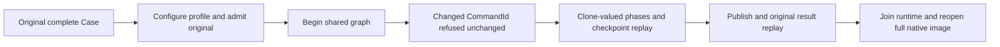

# Active native ANN session value identity

Canonical: [Search](../Search.md), [Managed ANN](ManagedAnn.md), [ADR-009](../../ADR/ADR-009-search-provider-boundaries.md), [ADR-019](../../ADR/ADR-019-managed-ann.md), [ADR-117](../../ADR/ADR-117-native-tunit-ci-entry.md).

REQ-ANN-ACTIVE-ID-001: Active maintenance uses the same complete decoded request identity as original-operation admission/replay. CLR reference-sharing differences must not change authorization or identity. Session GUID and principal remain exact; changed CommandId must fail OwnershipLost with the existing owned detail before stage work.

AC-ANN-ACTIVE-ID-001: Preserve the complete original persisted ordinary-principal refusal/admin lifecycle Case, append a real profile-based generation over the original three vectors. Begin with shared Space/profile.Space; continue with a value-equal separately cloned profile.Space whose real native bytes differ. Exercise actual bounded Apply/Stage/Commit+same-ID replay/Verify/Publish, full original result settlement/replay, count three and exact checkpoint upper. Changed CommandId Verify must preserve complete canonical bytes/native position/full bounded native file inventory. Join the actual owner/runtime before reopening the actual native index and asserting every original literal vector record and native lifetime oracle.

The request audit covers CommandId, Consumer, Collection, Field, Space, IndexGeneration, NodeId, Mode, MaintenanceProfile and all four Placement fields including ordered voters. VectorSpace and profile are immutable value records. The existing identity helper measures both requests; no serializer, wire, persistence, provider or format changes are introduced.

This fixture configures a genuine profile consumer without an initial enrollment reservation. Core CreateAnnInitialSettlementIntent returns null for that supported branch; native original settlement/replay still uses the complete actual parent result and actual canonical checkpoint result. Canonical Store.Position is used only for immediate unchanged-state equality; it is never compared to logical receipt position.

N/A: public transport/cursor/new UI/new persistence schema; this native session regression does not replace existing SDK/MCP RF3 projection tests. No added timeout, retry, page/file/candidate cap or scalar mode. Existing cancellation token remains unchanged. SourceN only: compiler/native admission/runtime/Linux RF3/deadline/performance and whole KL031 remain OPEN. Native index-owner reopen is not a canonical database cold restart or RF3 failover.

REQ-ANN-ACTIVE-ID-002: After complete original-result settlement, await the same session AbortAsync before starting original-operation replay, matching AnnMaintenanceExecution successful parent cleanup. Assert complete canonical snapshot and unchanged native store position immediately after session cleanup and again after replay; retain the complete original result equality and final index-owner reopen. Reservation exclusivity and all limits remain unchanged.

R97 observed ResourceExhausted was the fixture replay attempting a second maintenance reservation while its first Begin session remained active. SettleOriginalResultAsync reuses that active reservation; it does not close the session. This source repair restores the actual successful parent lifecycle, without changing product admission or claiming the rerun passes.
