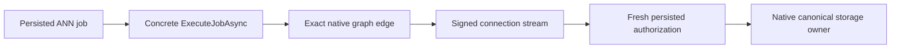

# Native ANN durable-job graph admission

REQ-KL097-JOB-GRAPH-001 requires the existing concrete AnnProjectionCoordinatorGrain.ExecuteJobAsync caller to reach IConnectionGrain.ExecuteStreamAsync through the native default-deny graph. IAnnProjectionCoordinatorGrain.ScheduleAsync is a separate scheduling entry and cannot identify the actual durable-job execution caller.

AC-KL097-JOB-GRAPH-001 requires a genuine hosted persisted configure, durable intent, native scheduled job, signed connection command, canonical vector build/publication and following authorized search. Denied unrelated callers, current policy revocation, cancellation, original replay and following healthy execution must retain complete independent state and cleanup checks. Its whole-job automated RF3 flow is part of the pending native owner/publication implementation; existing one-silo CQRS Build/Restore tests are supporting operations only. No execution or acceptance is claimed from registration or compilation.

The source correction adds only the concrete ExecuteJobAsync-to-ExecuteStreamAsync transition. Existing client, grain-service, connection, command-partition and private-probe edges are retained. The graph admission does not supply database authority: signed server identity, fresh persisted authorization, bounded work, node-local storage and RF3 acknowledgements remain mandatory.

Canonical source map: src/KeyLoad.Server/ClusterRouting/Hosting/ConnectionGrainGraphRegistration.cs owns registration; the Search coordinator owns durable execution and its existing caller context. The server, Orleans, integration tests and this Search specification retain their original feature ownership. Frontend and additional public contracts are N/A for this internal graph edge.

Stage62 joins this source-backed prerequisite. Genuine durable-job RF3 execution, remote publication ownership, current Linux, resource and fault gates remain open. This correction is not attributed as the cause of an earlier runtime failure without matching original evidence.
