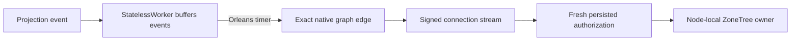

# Native ANN projection worker graph admission

REQ-ANN-JOB-GRAPH-001: ANN projection work is performed by Orleans `[StatelessWorker]` grains that accept projection events, buffer them in memory and, on an Orleans timer (the interval is a typed option), submit the batch through the signed connection stream to the node-local ZoneTree owner. No worker checks leadership. The worker's call reaches `IConnectionGrain.ExecuteStreamAsync` through the native default-deny grain graph; a scheduling entry cannot identify the actual execution caller.

AC-ANN-JOB-GRAPH-001 requires a genuine hosted persisted configure, projection event, timer flush, signed connection command, canonical vector build/publication and a following authorized search. Denied unrelated callers, current policy revocation, cancellation, original replay and a following healthy execution retain complete independent state and cleanup checks.

The graph admission adds only the concrete worker-to-connection transition; the existing client, grain-service, connection, command-partition and private-probe edges are retained. It supplies no database authority: signed server identity, fresh persisted authorization, bounded work, node-local storage and majority acknowledgements remain mandatory. Frontend and additional public contracts are N/A for this internal graph edge.

