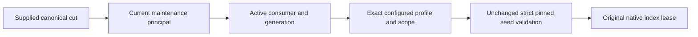

# Native ANN public maintenance profile

Supplement to [Search](../Search.md), KL030/KL031/KL059.

## Confirmed defect and requirements

The original public acquisition reconstructs a Restore request from its manifest with a null MaintenanceProfile. The unchanged strict canonical pin validator rejects a genuine nonnull configured profile. The publication format has no profile field and remains unchanged.

| Requirement | Acceptance | Genuine regression |
|---|---|---|
| REQ-ANN-PUBLIC-PROFILE-001: restore the configured profile from the supplied canonical read cut, with current persisted maintenance principal and active consumer/generation. Charge metadata reads to the original caller budget. | AC-ANN-PUBLIC-PROFILE-001: actual native Build/public Search/Wait succeed for a configured profile and the current optional-profile contract; complete page and token match independent original oracles. | NativeAnnPublicProfileTests bool variants using ReplicaAppliedPositionWaitFixture, actual native log/materializer and maintenance owner. |
| REQ-ANN-PUBLIC-PROFILE-002: nonnull profile collection, field and complete VectorSpace must equal the selected manifest. Keep strict pin authority and consumer definition validation. | AC-ANN-PUBLIC-PROFILE-002: actual changed definition is refused; wrong generation and persisted no-grant callers expose no partial page; healthy original generation remains usable. | NativeAnnPublicProfileTests identity/auth refusal flow; existing pin-validation and persisted-caller suites remain mandatory. |
| REQ-ANN-PUBLIC-PROFILE-003: preserve public/native bytes, reservation ownership, SIMD and joined cleanup. | AC-ANN-PUBLIC-PROFILE-003: reads preserve complete canonical rows and position; original owners aggregate body and cleanup failures. No manifest/alias/Id change or rebuild fallback. | Complete bounded state image and position checks after Search/Wait/refusals. |

## Slice and gates

Server: Search/Execution/NativeAnnPublicAcquisition.cs and Search/Lifecycle/NativeAnnPublicReadLease.cs. Unit: Search/Cases/NativeAnnPublicProfileTests.cs and Search/Scenarios/Ann/Search/NativeAnnPublicProfileFlow.cs. Existing Search fixtures and assertions remain authoritative. The complete source is joined; current-source compiler, public SDK/MCP and Docker/Aspire RF3, recovery, cancellation/resource and Linux exact-source execution gates remain OPEN. Source closure is not a runtime receipt or performance measurement. No Core policy, snapshot, manifest, schema, authorization or live-query implementation is replaced.
