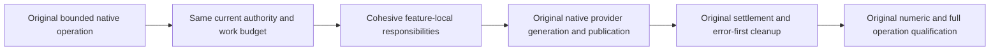

# Native maintenance responsibility extraction

Canonical slice: Search. Preserve [Search](../Search.md) authorization, retained native text/ANN generations, full original results, replay, release and recovery contracts and [CodeQuality](../CodeQuality.md) REQ-CQ-006/AC-CQ-008 plus REQ-CQ-MULTILINE-BLOCKS-001/AC001..003.

REQ-SEARCH-NUMERIC-ROLE-001 / AC-SEARCH-NUMERIC-ROLE-001: maintain method64/type200/file400/nesting3 on the complete aggregate native maintenance types using cohesive responsibilities and multiline executable blocks. No suppression, limit increase, additional partial class or compact-block compression. Canonical formatter/verify and complete analyzer-enabled Release compilation are the automated quality mapping.

REQ-SEARCH-NUMERIC-ROLE-002 / AC-SEARCH-NUMERIC-ROLE-002: preserve every original search/text/ANN operation, loop/sample/source order, current authorization/policy/read-cut validation, work/byte/cancellation/expiry budget, signed reply and cryptographic zeroing, generation/native provider/storage access, result/replay/refusal and catalog/publication identity. Keep original mutable fields borrowed by reference where callbacks may reenter; do not capture earlier scalar snapshots across callbacks. Helpers may not own new locks, clocks, capacities, cached authority, retries, providers, persistence formats or fallback paths.

REQ-SEARCH-NUMERIC-ROLE-003 / AC-SEARCH-NUMERIC-ROLE-003: preserve original registration/admission, producer/consumer settlement, pinned-generation retirement, reservations and cleanup/error-first ordering; source extraction and formatting do not qualify provider behavior, Linux/RF3/backup/fault/runtime or performance. Existing complete native text/ANN publication/update/delete/authorization/refusal/replay/release and same-root cold operation cases remain unchanged and mandatory. No Test/Args/UID/corpus, deadline or outcome normalization.

Scope: actual assigned Server/Features/Search numeric diagnostic owners only. Canonical product and helper paths remain in Search responsibility folders. UI, new public API/dependencies, topology/format/migration and speed claims: N/A. Main owns combined build/format/runtime/Linux and Git; source-level conservation is separate from those gates.
