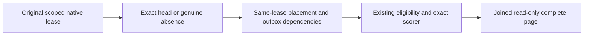

# Native text captured BM25 lookup closure

REQ-FTS-BM25-CUT-001 maps to REQ/AC-FTS-002/004/005 and REQ/AC-BM25-CURRENT-004: optional BM25 reuse reads the exact subject/collection/field/tokenizer head through the SAME original native scoped read lease. Capture records its genuine absence; present heads also capture the native catalog, atomic placement, owner directory, published placement and outbox-head keys required by existing fresh eligibility checks. Retained scope and values use the original grant; no second view, fallback, historical decoder or scorer is introduced.

AC-FTS-BM25-CUT-001: NativeTextBm25CapturedClosureTests.AbsentAndPublishedCorpusHeadsPreserveCompleteCapturedPagesAndOriginalReceipt uses the genuine NativeTextProjection, NativeTextCapturedReadFactory and SearchCapturedExecution. A genuine native-admission owner first reads without a head, publishes a real captured phase, reads with the head, replays its full receipt/entry and cold reopens the same owner. Independent full native RankedDocument[] literals include the exact partition/collection/id, revision1, full JSON, Redacted=false, empty RedactedFields, score1/61 and null Explanation. Complete literal pages and full canonical image/position/applied/journal CUT are unchanged by reads/replay. This is a native kernel control; the unchanged NativeTextProtectedPublicColdTests full SDK/MCP warm/two-cold flow remains the public regression and Linux RF3 gate.

The original R33 public failure was HistoryUnavailable at the first warm Search before either cold cycle. Unit independently failed a receipt container-shape oracle. Neither original is promoted to a pass by this proposal. Compilation, current source-bound execution, Linux RF3, cancellation and adverse cleanup remain OPEN.

## R34 captured resource-authority closure correction

REQ-FTS-BM25-CUT-001 also requires the exact native Resource authority lookup closure before optional head absence can return. Existing Bm25CorpusReuse.Rank calls Resource unconditionally: its unchanged target-stage fence and local catalog/placement/directory checks must read the SAME original captured lease for absent and present heads. Capture the exact partition target-stage, catalog, atomic row/directory, physical directory and published-placement keys before recording optional head absence. Only the outbox eligibility lookup remains conditional on a present head. No fence, placement, policy, budget, decoder, scorer or terminal check is bypassed.

AC-FTS-BM25-CUT-001 retains the complete original no-argument absent/present/full receipt/selected entry/cold regression and independent full RankedDocument page. R34 original UID eb715d1c-993a-6dbc-c4cf-d3536630ebd4 failed on its first absent-head read at PartitionMoveTargetStorage.Read through Resource; the captured target-stage scope was missing. Original failure remains retained; this N-only correction establishes source intent, not a repaired runtime result. The unchanged public warm/two-cold SDK/MCP case remains the public gate.
