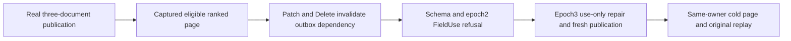

# Captured native text BM25 eligibility after canonical changes

REQ-FTS-BM25-ELIGIBILITY-001 maps REQ/AC-BM25-CURRENT-004 and REQ/AC-FTS-002/004/005: the actual captured native text branch must produce independently exact complete multi-document ranked pages both with an eligible subject-scoped current head and after canonical outbox, schema and subject-policy changes make that retained head ineligible. Current persisted FieldUse remains mandatory. The existing exact scorer and same original captured read lease remain authoritative; normal queries perform no writes.

AC-FTS-BM25-ELIGIBILITY-001 maps NativeTextBm25EligibilityTests.MultiDocumentCapturedPagesInvalidateRetainedHeadsAfterOutboxSchemaAndPolicyChanges: genuine native-admission recovery owner, three canonical documents and actual native phase publication; exact second/first rank order with full fields; genuine Patch reverses rank order and Delete removes a nonmatching corpus row; both reads require the old head to be ineligible and return independent full first/second literals. Original mutation and publication results/selected entries replay without canonical or journal CUT changes. Persisted schema FieldUse and policy epoch2 deny the same real captured query; higher epoch3 use-only repair yields exact redacted JSON and paths, never revives the old subject receipt, then a real fresh publication admits the current two-document head and repeats the exact page/replay. Same-owner cold reopen retains the exact eligible head and complete page.

This is distinct from existing one-document cold invalidation and two-document canonical SearchEngine cases: it invokes NativeTextProjection, NativeTextCapturedReadFactory and production SearchCapturedExecution. Complete canonical native rows, identity, position, applied and native journal LastIndex/CommittedIndex cut are compared; selected complete entries are not all raw journal records. No public/cluster, speed or Linux qualification follows from this native control.

REQ-FTS-BM25-PAGE-FAILURE-EVIDENCE-001 / AC-FTS-BM25-PAGE-FAILURE-EVIDENCE-001 preserve the original complete native byte-equality predicate and independently literal complete RankedDocument pages, original receipt/entry/canonical/journal-cut and cold continuation. On failed equality the existing whole case retains only closed field-equality booleans (reference, revision, JSON, redaction and omitted fields, exact score bits, explanation), bounded expected/actual counts and encoded lengths, and first differing byte offset. Never print document JSON, identities, byte payloads, provider internals or credentials. This diagnostic successor does not change product serialization, expected values, case identities, shared byte validation or qualification.
