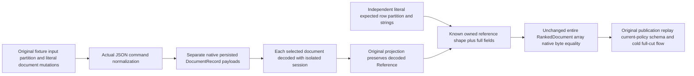

# Native BM25 independently owned expected row wire graph

Existing [captured closure](NativeTextBm25CapturedClosure.md) REQ/AC-FTS-BM25-CUT-001 and REQ/AC-FTS-BM25-PAGE-FAILURE-EVIDENCE-001 plus [eligibility](NativeTextBm25Eligibility.md) complete literal page, current authority, retained native head/phase/receipt/entry, strict cutoff, no-effects cut and cold contracts remain unchanged. This acceptance correction adopts no library, format, codec, alias/Id or provider change.

REQ-FTS-BM25-ROW-WIRE-001: independently literal expected documents must reproduce per-row owned reference/value construction of the original native selected-document read. TestDatabase's frozen input partition has transaction domain orders, while collection is also orders. Those input literals are interned/shared. Its original committed document operation normalizes JSON, stores each DocumentRecord separately, then each selected read independently decodes one DocumentRecord in a reset native session. Project preserves decoded record.Reference and projects its JSON. Whole array native encoding tracks reference identity; neither cross-row reuse of the original fixture PartitionRef nor sharing the equal orders domain/collection strings is an archive/read guarantee. Build expected records only from original fixture INPUT partition and frozen id/JSON/revision/redaction/score literals, with separately owned partition and nonempty string fields per row. Never mutate, intern, normalize or individually reencode actual output records.

AC-FTS-BM25-ROW-WIRE-001 maps BOTH original NativeTextBm25CapturedClosureTests.AbsentAndPublishedCorpusHeadsPreserveCompleteCapturedPagesAndOriginalReceipt and NativeTextBm25EligibilityTests.MultiDocumentCapturedPagesInvalidateRetainedHeadsAfterOutboxSchemaAndPolicyChanges. Retain entire ordered RankedDocument[] native-byte equality, complete literal reference/revision/JSON/redaction/omitted-fields/exact score bits/explanation, default immutable-array shape, full retained phases/receipts/entries, privacy/current-policy/schema/outbox checks, actual native captured lease/provider disposal, full source image/applied/journal no-effects and original same-owner cold flows. Explicitly require expected AND actual domain/collection string ownership to be separate and adjacent row partitions to be independently owned before unchanged whole-array byte checks. Separate expected constructor preserves every omitted-field array argument, scores1/61 and1/62, null Explanation, and all original mutation/redaction ordering. No new cases/UIDs or weaker subset equality.

R37 actual original TRX3b59f4eb2320d5ea9485f37b03b633b7e006b99d9276b7dd7cf5a2b055c5fd1c records Captured148/154 at96 and Eligibility214/259 at160, all seven field dimensions true, selectedAliases false, immutable-array default and runtime types true. Those flags establish a selected reference-pattern difference, not the exact first differing codec field. Native source proves the fixture reuses its original input partition/literals whereas ProjectSelected reads and preserves independently decoded persisted references; this repairs that test expected construction. Full revised whole-case execution remains mandatory; source is not runtime PASS or an Orleans defect. No RF3/Linux/endurance/performance claim follows.

Canonical roles: new Unit Search/Assertions/FullText/Ranking/NativeTextBm25ExpectedRows.cs builds pure independent expected DocumentResult and explicit known ownership preconditions; existing Helpers/NativeTextBm25CapturedClosureTrial.cs and Assertions/NativeTextBm25EligibilityPages.cs consume it at original expected sites only. Every owning original workload/captured lease/scorer/cut/receipt/failure-ledger body remains in its original owner. Compiler/current-image original execution/Linux qualification OPEN. Rollback removes the helper/subdocument and restores only the two expected construction sites and prechecks.
