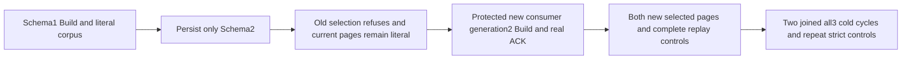

# Fresh maintained native generation after schema-only invalidation

REQ-FTS-SCHEMA-NEW-GENERATION-001 refines REQ/AC-FTS-002/004/005, INCREMENTAL-001/004 and INC-014: after a legitimate schema-only resource mutation, the old exact consumer/generation remains incompatible. The existing maintenance contract admits Build only through the real protected parent, including its independently authorized ConfigureProjectionConsumer child, fresh capture, native publication and canonical ACK. Repair uses a NEW canonical consumer identity and positive generation; it must not reset an old consumer or silently turn Restore into rebuild.

AC-FTS-SCHEMA-NEW-GENERATION-001 maps NativeTextFreshSchemaGenerationPublicTests.NewConsumerBuildAfterSchemaChangeKeepsOldSelectionFencedAndFullLiteralPagesAcrossTwoColdCycles. Configure/publish two literal bilingual documents and original schema1 Build through the existing genuine SDK. Persist only SchemaVersion2 with corpus/grants unchanged; current Wait/unselected literal pages settle before the full public outbox baseline. Both old selected clients refuse HistoryUnavailable, bracketed by complete literal current pages. A real official MCP Build with a new consumer and generation2 succeeds; its current schema2/resource digest and all nine source-cut fields are independently checked against the original authority/corpus and surrounding real NodeStatus. Both clients' new selected pages equal the complete independent literal pages.

AC-FTS-SCHEMA-NEW-GENERATION-002: every same-ID fresh Build replay through SDK and official MCP preserves the COMPLETE stable original result/checkpoint receipt; Source alone is a fresh observation and all nine fields are checked by the existing original source-cut assertions, never returned/restamped as cached authority. After each replay, both literal selected pages and complete public OutboxStatus remain unchanged. Original document receipt replay and old-selection refusal remain separate strict controls. No returned page supplies its own expected ID/JSON/revision/rank.

AC-FTS-SCHEMA-NEW-GENERATION-003: close real caller owners before TWO original all-three-owner Kill/BeginRestart/Restart cycles. Same actual node/incarnation and nondecreasing applied/read-generation survive. Fresh callers repeat schema2 Wait, new selection full pages, old selection refusal, original document receipts, exact stable fresh Build replay and current source-cut/outbox checks. Preserve linked original caller deadline/execution cancellation and initiating plus cleanup ledger. No raw canonical/journal, power-loss, speed or current runtime qualification is claimed.

Canonical slice: new IntegrationTests Features/Search Case/Helpers/Assertions and this Search subdoc. Exact dependency NativeTextSelectedSchemaPublic R3 owns its unchanged seed/state/full literal pages/refusal/document replay helpers; this packet does not modify it. Current NativeTextSelectedGenerationFlow and NativeTextMaintenanceRf3Flow cover update/delete and Restore, not resource-schema-only invalidation followed by a NEW consumer Build. NativeTextIncrementalBegin.Create is selected only when the exact requested enrollment is absent; existing RequireAdmittedUpper and retained-session schema guards remain strict. No source-confirmed product defect is claimed. Compiler, actual census/UID, Linux RF3 execution, cancellation and adverse cleanup are OPEN.
