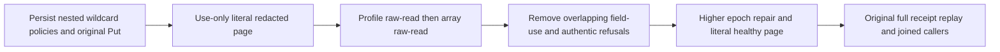

# Public nested wildcard protected full-text projection

REQ-FTS-NESTED-001 / AC-FTS-NESTED-001 refine REQ/AC-SEARCH-003 and REQ/AC-FTS-002: an actual nested scalar text query `/profile/secret` overlaps persisted `/profile/*`; a separate `/items/*/secret` policy removes each array-element secret while preserving every literal label, element order and the remaining object. Query through original SDK and official MCP on the SAME persisted reader sessions must return independently complete JSON/redaction paths/reference/revision/rank.

REQ-FTS-NESTED-002 / AC-FTS-NESTED-002: epoch1 has only profile field-use, epoch2 adds only profile raw-read, epoch3 additionally grants array raw-read. Independently expect profile empty plus label-only array; full profile plus label-only array; then exact original whole JSON. RawRead never authorizes FieldUse: epoch4 removes profile use while retaining both raw-read grants, giving exact PermissionDenied/null SDK body and authentic dispatched MCP failure twice; administrator full healthy page and post-policy public outbox baseline follow each refused pair. Epoch5 restores original scope with all three exact field grants and literal healthy page.

REQ-FTS-NESTED-003 / AC-FTS-NESTED-003: original administrator Put full CommitReceipt replays through BOTH clients at each healthy stage, bracketed by exact current reader page before and after each replay and exact current public outbox equality. Same command ID and ordered original mutation receipt remain exact. This is public read/outbox evidence, not full canonical/journal no-effects proof or projection reuse instrumentation.

All three AC map to NativeTextNestedWildcardPublicTests.NestedWildcardRawReadAndFieldUseEpochsPreserveLiteralPublicPagesAndOriginalReceipt, one Test/no Arguments. Cases/NativeTextNestedWildcardPublicTests, Helpers/NativeTextNestedWildcardPublicScenario and Trial, Assertions/NativeTextNestedWildcardPublicAssertions are feature-local Search roles. Existing dedicated ClusterFixture/RequestCqrsRf3Callers.RunOwnedAsync and McpCallerDeadline own genuine RF3 topology/session/deadline/ordered cleanup. No product/schema/serializer/provider/transport/configuration changes; no new policy semantics. Existing SecurityAndQueryTests nested wildcard SQL/Get case is a native kernel control; top-level NativeTextRf3Tests and simple RawRead/FieldUse/RowOwner/cold/rebuild proposals do not cover this public nested wildcard FTS schedule. No cold/rebuild claim here. Source Y/compiler/current census/exact-source Linux RF3/runtime qualification remain OPEN.

