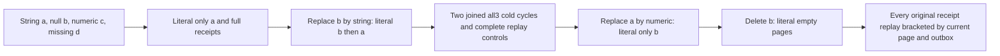

# Native text non-string field transitions through public cluster callers

REQ-FTS-NONSTRING-PUBLIC-001 refines NativeFullTextProjection REQ/AC-FTS-001/002/004/005. Canonical corpus records remain authoritative, but a selected text field contributes tokens only when its scalar JSON value is a string. Actual null, numeric and absent fields must not synthesize tokens from other properties. A real same-ID original write receipt replay cannot restore previous candidate membership.

AC-FTS-NONSTRING-PUBLIC-001 maps NativeTextNonStringTransitionsPublicTests.NullNumericMissingFieldsAndStringTransitionsPreserveLiteralPagesOriginalReceiptsAndTwoColdCycles (no Args). Configure a real collection then acknowledge four literal documents: a text string, b null, c numeric42, d absent text with an unrelated needle property. Both SDK and official MCP must return only a, with a COMPLETE independent RankedDocument oracle. Replace b with literal repeated needle at revision2; require independently ordered b then a, exact JSON/references/revisions/redaction/omitted fields, scores1/61 and1/62, null explanation. No returned result supplies expected order/content.

AC-FTS-NONSTRING-PUBLIC-002: after each real commit join both actual WaitForIndex calls, retain full original required-copy acknowledgementnowledged receipt and literal mutation array, then capture complete public outbox. After EACH original successful receipt replay through EACH SDK/MCP client, require the complete current independent page and unchanged public outbox. This includes replaying obsolete a/b original puts after their current field shape changed or was deleted. No raw canonical/native-journal no-effects claim is made.

AC-FTS-NONSTRING-PUBLIC-003: close original callers before TWO genuine all-three Kill/BeginRestart/Restart cycles with b string and a string. Fresh callers preserve actual node/incarnation/nondecreasing applied/read-generation, full literal page/all original receipts/outbox. Then acknowledge a numeric0 revision2 and require only b; finally delete b expectedrevision2 and require independent empty pages. Original complete receipts remain replayable while the current membership stays unchanged. Preserve original linked execution/deadline and body/cleanup ledger.

Canonical Search slice: new IntegrationTests Cases/Helpers/Assertions and this subdoc. Existing static NativeTextProjectionParityTests covers missing/empty strings and scan/native parity; inspected NativeTextClusterTests covers different string values/delete. This separate operation flow covers changing JSON scalar type, including null/numeric/missing fields and independently full public pages across cold/replay. No product defect, provider/serializer/scorer change, maintained-generation Build/Restore, protected-policy, performance or power-loss claim.

WaitForIndexResult has exactly three native fields, not nine: AppliedToken, SchemaVersion and PolicyEpoch. Both clients require literal schema1, positive freshly authorized policy epoch and full token partition/incarnation/ownership-epoch binding plus position at least the original receipt. No independently known literal root policy epoch or exact nine-field text source cut is invented. Native Delete returns checked previous revision+1, so deleting b expectedrevision2 independently requires mutation revision3.
