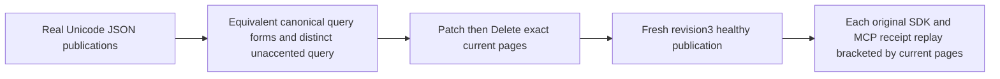

# Public native text canonical normalization

REQ-FTS-NORMALIZATION-PUBLIC-001 refines REQ/AC-FTS-001: original SDK and official MCP search use the selected native text index with the existing canonical NFKC and invariant Rune lower-case tokenizer. Compatibility-width, canonically composed/decomposed accent and repeated query forms must yield independently exact complete ranked pages. Accent-insensitive matching is not promised: unaccented cafe is a different token. The original user JSON remains byte-for-byte unchanged by normalization.

AC-FTS-NORMALIZATION-PUBLIC-001 maps NativeTextNormalizationPublicTests.CanonicalUnicodeAndRepeatedQueryTermsPreserveLiteralPublicPagesAfterMutationAndOriginalReplay, one no-argument real keyed ClusterFixture case. An actual persisted administrator uses the original RunOwned SDK/official MCP clients. Genuine seed publications contain composed café, compatibility-width ＣＡＦÉ and independent unaccented cafe JSON. Three independently specified query forms yield exact a/b ordinal ties with full original reference, revision, JSON, redaction fields and RRF score. Exact unaccented query yields only c, preventing normalization overreach. Actual Patch removes a from accent hits, Delete removes b, and fresh revision3 a repairs a literal healthy normalized hit. Original four complete receipts replay through BOTH clients; immediately after EACH replay, final current pages and full public OutboxStatus are checked before the next replay. Real WaitForIndex consumes the original latest command token. Caller deadline/cancellation and cleanup remain owned by the original fixture and RunOwned scopes.

NativeTextProjectionParityTests already covers native Unicode/scorer parity against a canonical self-oracle, and existing bilingual public flows cover English/Ukrainian mutation. This case adds independent full public normalization literals; it does not replace those cases, policy tests, cold/rebuild or resource qualification. No raw canonical/journal no-effects, hidden provider instrumentation, speed, new scorer/tokenizer, public schema or cold qualification is claimed.

