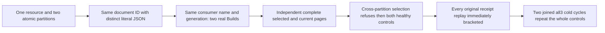

# Maintained text generation isolation across atomic partitions

REQ-FTS-PARTITION-GENERATION-001 refines REQ/AC-FTS-002 and REQ/AC-FTS-INCREMENTAL-002: the complete logical consumer identity includes its atomic partition. Two real partitions in the SAME database/resource may use the SAME consumer name and generation without sharing canonical document references, outbox or maintained enrollment. No physical placement, generation leaf, provider or schema workaround is introduced.

AC-FTS-PARTITION-GENERATION-001 maps NativeTextPartitionGenerationPublicTests.SameNamedGenerationsRetainIndependentLiteralPagesAndOriginalReceiptsAcrossTwoColdCycles, no Args. Configure one real collection; commit the same document ID at revision1 in two distinct partition keys with independently literal left/right JSON. Issue actual SDK and official MCP Build requests with the same consumer name/generation, independently observed native owner and placement. Require Completed, one tracked record, checkpoint/source tail1, checkpoint command ID authentically observed nonempty, literal partition identity and positive position, quorum durability, and token incarnation/ownership epoch equal to the independently ReadAtomicPartitionPlacement-derived original request.Placement; source incarnation must equal that same original placement. Require an independently configured resource digest. Selected and unselected SDK/MCP searches must equal each partition's FULL independently constructed RankedDocument array: exact reference, revision1, JSON, no redaction/omitted fields, score1/61, null explanation.

AC-FTS-PARTITION-GENERATION-002: substituting the OTHER partition's full consumer selection refuses Validation through EACH actual public client. Immediately after each refusal, both partitions' complete selected/unselected literal pages and complete public OutboxStatus are unchanged. This is request-shape scope refusal, not a claim that a wrong provider was invoked, nor a raw canonical/journal no-effects proof.

AC-FTS-PARTITION-GENERATION-003: replay each actual original document command and maintenance request through EACH public client. Full document receipt and stable maintenance result/checkpoint remain exact; maintenance Source is independently validated using the existing fresh nine-field source observation contract. After EACH replay observe BOTH complete literal pages and public outboxes before any later receipt can conceal a regression. Close original caller owners before TWO actual all-three Kill/BeginRestart/Restart cycles; reopen genuine SDK/MCP callers and repeat scope refusal, full original replay, pages/outboxes with exact node/incarnation and nondecreasing applied/read generation.

Canonical Search slice: new IntegrationTests Cases/Models/Helpers/Assertions and this subdoc. Scoped source audit inspected NativeTextMaintenanceRf3Flow (one partition), NativeTextProjectionScopeTests (schema scope control), NativeTextIncrementalBegin/Create and EnrollmentFiles.Find (complete Consumer identity), and SearchRequestValidation (cross-partition selection Validation). This is a distinct public whole-flow coverage proposal, not a universal inventory census or a confirmed product defect. Existing resource bounds, native ZoneTree.FullTextSearch, signed maintenance, persisted administrator, official MCP schemas and original RunOwned/deadline/cleanup ownership remain unchanged. Compiler, official census UID, runtime, Linux RF3 and adverse-cleanup qualification remain OPEN; source Y is not authorized by this preview.

The independently required checkpoint mutation oracle is an initialized EMPTY MutationReceipt array, not a guessed checkpoint/consumer mutation. Actual NativeTextIncrementalPagePreparation.Prepare rejects default/nonempty command.Effects; DatabaseEngine.CommitProjectionBatch constructs its receipt from ApplyMutations of those empty effects and advances the consumer checkpoint separately; NativeTextIncrementalCheckpointSettlement.Complete independently rejects default/nonempty receipt.Mutations. Assert literal checkpoint1, initialized empty receipt mutations, and the complete placement-bound token fields above. Consumer identity is validated separately against the complete original request.Consumer. The authentic child command ID is observed nonempty, never synthesized. Full original stable receipt replay remains unchanged.
