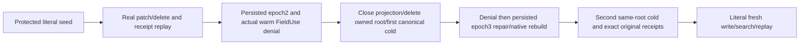

# Protected native text rebuild across two canonical cold owners

REQ-FTS-PROTECTED-COLD-001 maps existing REQ/AC-FTS-002/004 and ADR-078: two genuine canonical protected-field documents are queried through the actual selected NativeTextProjection, then an acknowledged Patch changes Ukrainian tokens and an acknowledged Delete removes English tokens. New helper operations use the actual CreateNativeOperation factory over generated native binary request bytes, the actual evaluation clock and persisted root identity; original signed operations are retained for the original ApplyEmbedded replay path. Full original receipts and same-ID replay remain exact; no old or deleted postings may supply results.

AC-FTS-PROTECTED-COLD-001 maps NativeTextProtectedRebuildColdTests.ProtectedMutationAndFieldUseRevocationSurviveRemovedProjectionAndTwoSameOwnerColdOpens. Require full independent redacted documents, exact reference/revision/rank1/61, old-term/deleted exclusion; compare all canonical raw key/value rows plus native physical position before/after every read/refusal/replay.

REQ-FTS-PROTECTED-COLD-002: close actual native projection before deleting ONLY its fixture-owned disposable root, then close canonical ZoneTree and reopen SAME root with existing configured factory. Current persisted FieldUse grant removal at literal policy epoch2 denies through the actual asynchronous search before the first cold open, and again after it, with PermissionDenied without canonical effects. Acknowledged higher epoch3 repair permits genuine native reconstruction and literal healthy results. No provider, serializer, fallback, role/context or policy bypass is introduced.

AC-FTS-PROTECTED-COLD-002: require exact native serialized equality of all nine actual StoreIdentity fields (including signing material, durability, dispatch state, reader contract and read generation) across these ordinary same-root opens; actual ZoneTreeIdentityFile.Open returns the unchanged existing identity and journal replay does not change it. Comparison does not emit identity/signing bytes; first cold denies before repair, second cold retains epoch3 image/physical cut and all original receipts. Complete expected image is captured AFTER actual acknowledged document/policy changes, not mislabeled as pre-effect no-effects. After second cold, a fresh original root command writes a literal healthy third document and exact original receipt replay is unchanged.

REQ-FTS-PROTECTED-COLD-003 / AC-FTS-PROTECTED-COLD-003: actual projection/canonical owners and original TestDatabase join through ordered ServerFailureObserver body/disposal ledger; failed cold constructor ownership stays visible. Full canonical scan reuses original bounded QueueWholeFlowStorage.Bytes with explicit HasMore rejection. No replica journal, process-kill, ACK, RF3/SDK/MCP/Linux/performance qualification follows from same-root kernel opens.

Canonical slice map: Unit Search Cases/NativeTextProtectedRebuildColdTests; Helpers/Owner,Seed,Trial; Assertions/NativeTextProtectedRebuildColdAssertions. Product implementation unchanged. Server/SDK/MCP/frontend N/A to this supplementary native kernel regression; original RF3/process/whole product gates remain mandatory. Regression source is implemented; compiler/runtime/current-image/Linux gates remain OPEN pending recorded execution.

Receipt oracle container contract: the actual `CommitReceipt.Mutations` is `ImmutableArray<MutationReceipt>` and independent literal expected mutations are an array. Compare native serialization of the actual collection converted to an array against the original expected array, preserving every ordered mutation record and native field. Serializing unequal container types is not a valid record equality oracle. R33 failed at the first warm seed receipt predicate before the subsequent search/cold flow; this repair is source-only until the complete original case is rerun with the current bound image.
