# NativeTextProviderAudit within Search (KL-028)

Status: additive SourceN contract and acceptance implementation; current compiler/runtime/Linux qualification is pending. Parent [Search](../Search.md), [NativeFullTextProjection](NativeFullTextProjection.md), ADR-071 and ADR-078 remain authoritative. This contract changes no public API, serializer alias/field ID, package, storage format, tokenizer, scorer, provider, transport or routing.

The selected current dependency pair is ZoneTree2.0.1 and ZoneTree.FullTextSearch1.0.9. The cached published FTS archive SHA256 is `7ea1fbb7aba0ad00391d78d2f414166b500335f5b1affe43c305d861b55719ff`; its nuspec identifies release source `c0993e2c65186708f3b087741082545bf49224fd`, MIT and ZoneTree>=1.8.7. This is a local package/source identity observation, not fresh feed, signature, publication or runtime proof. Historical1.9.8/scalar/two-node prose does not define the current qualification profile. The normal product keeps mandatory supported SIMD and native one/three-node qualification; no disabled-SIMD mode or new competitor evaluation is introduced.

## Selected capability and API boundary

| Capability | Actual current API/ownership | Complete evidence boundary |
|---|---|---|
| Native postings | NativeTextIndex.Open uses IndexOfTokenRecordPreviousToken<ulong,ulong>, primary tree only, actual native synchronous WAL and explicit maintainer/cache options. NativeTextCandidateReader consumes the actual native iterator. | Existing native parity/collision and candidate-bound suites; this corpus uses the same real index. No separate provider or canonical storage replacement. |
| Unicode/analyzers | KeyLoad SearchTerms and TextProjectionProtocol freeze NFKC/Rune/lower tokenization and SHA256 little-endian token hashing before native postings. | Existing Ukrainian/English, normalization, supplementary, digit, short/repeated/empty and collision cases remain required. No selectable stemming, phrase, native grammar or analyzer-equivalence promise. |
| Ranking | KeyLoad TextRanker supplies exact canonical lexical corpus statistics/BM25 and SearchEngine fuses branch ranks. Native postings provide candidates. | Existing independent score/tie/branch/RRF oracles plus new full single-branch literal1/61 results. Native postings API is not advertised as native BM25. |
| Delete/replay | Canonical authorized update/delete and immutable outcomes remain authority; current-cut generation replacement supplies native candidate freshness. | New genuine update/delete/full receipt/history/two-cold continuation plus existing real incremental/process/public cases. Native primary posting operations are not an atomic canonical commit or RF3 receipt. |
| Format and repair | Current native generated envelope/checksum and explicit owner/scope/tokenizer/hash/record/file manifest validation precede retirement. | Eight new checksum-valid semantic fault lifecycles restore exact owned original bytes. No schema migration, Lucene format compatibility or guessed reconstruction. |
| Cancellation/resources | Existing shared read budgets, candidate bounds, native owner/lease limits and joined settlement govern work; the adapter does not accept the library's partial-return search as complete success. | Existing NativeTextAsyncAdmission/Lease/Settlement/Bounds/Filesystem cases remain required. New complete native inventory has explicit finite entries/bytes and no link traversal. |
| Physical ownership/public operation | Node-local PartitionHost owns native handles; existing connection-owned Orleans execution and fresh persisted policy own public reads/maintenance. | Existing actual process cuts and Aspire/Docker RF3 .NET/official MCP cases are separate mandatory evidence. No public raw-storage fault tool or fake transport is introduced. |

| Requirement | Acceptance |
|---|---|
| REQ-FTS-AUDIT-001: selected native postings remain derived state under canonical authority | AC-FTS-AUDIT-001: reuse actual NativeTextProtectedRebuildColdOwner/NativeTextProjection, real ZoneTree and original SearchEngine; literal English/Ukrainian/control documents, exact full documents/revisions/redaction/scores and update/delete receipt oracles pass before and after replacement. Existing Unicode/NFKC/supplementary/digits/short/repeated/collision/parity suites remain required. |
| REQ-FTS-AUDIT-002: checksum validity does not replace manifest semantic validation | AC-FTS-AUDIT-002: each of eight genuine same-root cold lifecycles recomputes the existing native envelope checksum after changing exactly one actual invariant: tokenizer, hash, format, scope position, contiguous record ID, unique reference, record partition or native file digest. The real lazy native owner constructor must refuse Corruption with its current safe detail, without removing/rewriting the corrupt manifest, any other native file, canonical row or original history. No partial successful query is accepted. |
| REQ-FTS-AUDIT-003: exact repair preserves immutable canonical history | AC-FTS-AUDIT-003: restore only the exact test-owned original manifest bytes, then native reconstruction returns literal updated Ukrainian/control records and absence of the deleted English record. Original full results and ordered private CompositionReferences plus first genuine outcome/locator bytes survive actual Apply/Resolve replay, a healthy new producer and two canonical/native same-root cold opens. |
| REQ-FTS-AUDIT-004: ownership, resource and qualification boundaries stay real | AC-FTS-AUDIT-004: canonical absolute/existing/nonempty root is checked before existing cold owner reopen; original complete nine-field identity, raw canonical bytes and commit position are retained. Native file inventory is bounded, ordered and byte exact; no symlink following or broad cleanup. Existing owner/observer joins every original operation and cleanup failure. Source review and prepared preflight are not compiler, process-kill, RF3, signature, endurance, performance or Linux evidence. |

The eight cases share one complete actual operation flow. Initial canonical resource/producer commands retain their original native operations and full outcomes. The resource configuration uses its actual GlobalOutcome and has no partition-scoped locator; partition producer outcomes retain the exact native scoped locator value. Independent preapply tokens bind actual physical placement and next native store position. Query expected documents come from literal fixture data, never from observed result rows. Updating Ukrainian and deleting English produce actual immutable command receipts before their original exact replay. A native query publishes the actual current selected generation. Closing that projection and canonical owner through the existing owner leaves its actual generation on disk; mutation occurs only after those handles close. Existing generation validation runs before restart retirement. A refusal must preserve the complete damaged native file inventory and canonical image. Exact original row repair uses no synthesized record, guessed offset, counter reset, changed deadline or substitute provider.

```mermaid
flowchart LR
    Source[Actual canonical producer] --> Query[Selected native bilingual query]
    Query --> Change[Actual update and delete]
    Change --> Close[Close original handles]
    Close --> Damage[Checksum-valid semantic damage]
    Damage --> Refuse[Cold fail-closed admission]
    Refuse --> Restore[Exact original manifest bytes]
    Restore --> Healthy[Literal results and healthy producer]
    Healthy --> Cold[Two same-root cold history proofs]
```

Ownership: NEW Unit/Search Cases/NativeTextProviderAuditTests; Contracts/NativeTextProviderAuditProtocol and NativeTextProviderAuditDamage; Models/NativeTextProviderAuditState and NativeTextProviderAuditHistory; Helpers/NativeTextProviderAuditFlow, NativeTextProviderAuditProducer and NativeTextProviderAuditCold; Assertions/NativeTextProviderAuditResults, NativeTextProviderAuditHistoryAssertions and NativeTextProviderAuditImages; Serialization/NativeTextProviderAuditManifestDamage. No existing product/helper body is changed. UI/client-schema N/A because current Search operations and public output are unchanged.

Preserved mapped Unit: NativeTextBilingualLifecycleTests, NativeTextProjectionParityTests, NativeTextProjectionAuthorityTests, NativeTextProjectionBoundsTests, NativeTextProjectionRestartTests, NativeTextAsyncAdmissionTests, NativeTextProjectionLeaseTests, NativeTextProjectionSettlementTests, NativeTextProjectionOwnershipTests, NativeTextProjectionFilesystemBoundsTests and current selected/online/incremental suites. Process: NativeTextProjectionProcessRecoveryTests, NativeTextOnlineProcessRecoveryTests and NativeTextIncrementalProcessRecoveryTests retain real fault cuts and original cleanup. Public: existing NativeText* RF3 SDK/official MCP cases remain required through actual fixture-owned Aspire/Docker RF3 and fresh persisted authorization. No native storage diagnostic API is added to public clients. The new metadata cases supplement that whole-task corpus; they cannot alone close KL-028.

Main owns guarded adoption, current native compiled discovery, full solution/analyzer checks, actual Unit/process/RF3 execution and delivered-source Linux evidence. Any confirmed upstream defect will follow the root public issue policy with original bounded evidence; these fault injections are expected corruption controls, not an upstream defect claim. Rollback removes only these additive tests/childspec; canonical records, native formats and retained original failures remain unchanged.
