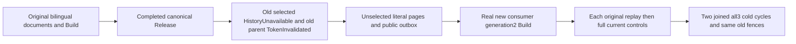

# Released maintained text generation and genuine repair

REQ-FTS-RELEASE-REPAIR-001 / AC-FTS-RELEASE-REPAIR-001 refine NativeFullTextProjection REQ/AC-FTS-002/004/005 and ADR-078: a genuine completed Release removes the original selected generation, not canonical documents. Both selected SDK/MCP queries must refuse HistoryUnavailable, while unselected complete bilingual literal pages remain exact. The old Build/Restore parent is TokenInvalidated. Each refusal is immediately bracketed by full current pages and the complete post-release public OutboxStatus.

REQ-FTS-RELEASE-REPAIR-002 / AC-FTS-RELEASE-REPAIR-002: repair uses a NEW consumer and generation2 through actual protected Build, never reenables the released consumer. Full completed Release result independently equals original canonical consumer with ONLY Released=true, exact original command/consumer/generation, Completed phase, zero records and null source/digest/checkpoint/prefix. Fresh Build result/checkpoint authority, complete original document receipt and each stable maintenance replay are retained; after EACH SDK/MCP response compare current full literal selected/unselected pages, old-selection refusal and public outbox.

REQ-FTS-RELEASE-REPAIR-003 / AC-FTS-RELEASE-REPAIR-003: close genuine RunOwned callers before two all-three Kill/BeginRestart/Restart waves; repeat old fences, complete original Release/document/fresh Build results and full literal controls. This is public logical evidence, not raw storage/journal no-effects, power-loss, provider throughput or runtime qualification.

All criteria map NativeTextReleasedRepairPublicTests.ReleasedSelectionStaysFencedWhileNewConsumerRestoresLiteralPagesAndOriginalResultsAcrossTwoColdCycles, one noArgs case. Existing NativeTextMaintenanceRf3Release covers completed Release/replay plus old Restore refusal and canonical pages, but no selected-query refusal followed by NEW consumer repair and two subsequent cold continuations. Inventory is bounded to inspected original flows and delivered public subdocs, not global absence proof. Canonical Search Cases/Models/Helpers/Assertions and this subdoc; product/public API/format/provider/clock changes N/A.

Source N only. Compiler, UID census, exact-source Linux RF3 and cleanup/cancellation qualification OPEN. No product defect asserted.
