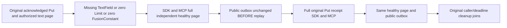

# Native text request refusals preserve the original healthy public operation

REQ-FTS-TEXT-REFUSAL-PUBLIC-001 refines NativeFullTextProjection REQ/AC-FTS-003/007. Actual SearchRequestValidation rejects a text branch whose TextField is null, Limit0 and FusionConstant0. Text is free-token input; this does not invent a syntax parser or invalid query-language promise. Use a genuine original acknowledged root Put and persisted restricted reader with current text-use rights, retaining exact full CommandRequest/CommitReceipt before the refusal sequence.

AC-FTS-TEXT-REFUSAL-PUBLIC-001 maps NativeTextRequestRefusalPublicTests.InvalidTextBranchAndZeroResultFusionLimitsPreserveLiteralHealthyPagesAndOriginalReceipts (one Test/no Arguments). Each actual malformed SearchRequest through SDK and official MCP returns Validation, null SDK result and authentic dispatched MCP error. Then the same reader sessions produce the full independent literal reference/revision1/owner-only JSON/three ordered redactions/rank1/61 page BEFORE original Put replay; full original receipt replay through both clients follows, and the same literal page must still hold. No later write is allowed to conceal changed current results.

REQ-FTS-TEXT-REFUSAL-PUBLIC-002 / AC-FTS-TEXT-REFUSAL-PUBLIC-002: compare complete public OutboxStatus to the POST-publication baseline after every refusal and before original receipt replay, and after every replay. SDK and MCP values stay equal. This is public logical observation, not an atomic cross-call canonical/journal cut, internal projection-byte proof or no-new-log-entry claim. Native RF3 receipt replay can advance native journals without changing the retained receipt/public model.

REQ-FTS-TEXT-REFUSAL-PUBLIC-003 / AC-FTS-TEXT-REFUSAL-PUBLIC-003: original dedicated keyed ClusterFixture and nested RunOwnedAsync, server-authenticated persisted reader, original deadline/body/disposal ledger. No provider, projection reset, copied fixture, fake clock, transport, policy change or replacement query. Existing FilteredSearchRf3Tests.AcFilter003 already covers oversized allowlists, VECTOR Limit1001 and cancellation; preserve it. Reviewed NativeTextRf3Tests/Async cover normal text and authority, not these text-shape/zero controls bracketed by a full original receipt.

Canonical Search map: Integration Cases/NativeTextRequestRefusalPublicTests, Helpers/NativeTextRequestRefusalPublicTrial, Assertions/NativeTextRequestRefusalPublicAssertions. New sourceN only; native new-type/creation checks held while Main native Building. SourceY/compiler/census/LinuxRF3 runtime OPEN. No internal projection/cold/policy/cancellation/throughput or fault acceptance inferred.
