# Selected native text explanations through maintenance and cold restart

REQ-FTS-SELECTED-EXPLAIN-001 refines REQ/AC-SEARCH-EXPLAIN-001/002/003 and REQ/AC-FTS-002/004/005: the actual maintained native text selection must preserve opt-in typed explanations and default absent explanations across canonical deletion, legitimate Restore, original command replay and same-owner cold restart. No new scorer, generation, schema, result protocol or public API is introduced.

AC-FTS-SELECTED-EXPLAIN-001 maps NativeTextSelectedExplainPublicTests.SelectedTextContributionsRemainLiteralAcrossDeletionRestoreReplayAndTwoColdCycles, no Args. A dedicated original Aspire ClusterFixture publishes a={"text":"needle"} and b={"text":"needle needle needle"}, revision1 each. Actual official MCP Build initializes consumer/generation1. SDK and official MCP selected searches use weight2 and fusion constant10. Full independent pages rank b before a with scores2/11 and2/12 and typed Text contributions native ranks1/2, weight2, identical contributions and fusion constant10. Explain=false gives the same entire documents, order and scores with null explanations. Neither expected pages nor contributions are derived from returned output.

AC-FTS-SELECTED-EXPLAIN-002: full original Build replay through each client preserves the entire stable result/checkpoint receipt and verifies Source separately as its fresh nine-field observation; after EACH replay full pages and public outbox are unchanged. Before EACH first document Commit, independently read the complete current placement through the actual administrative SDK and official MCP and require full equality. Bind the ensuing complete document receipt token incarnation and ownership epoch to that pre-Commit tuple, with exact atomic partition, positive admitted position, quorum durability and independent complete mutation array; never derive expected owner from the returned receipt or physical node status. A real delete of b, expectedrevision1, returns independent deleteDocument revision2. Join actual WaitForIndex. The stale selected query refuses HistoryUnavailable through EACH client, followed immediately by the unselected full a-only page and post-delete public outbox. Actual same-consumer/generation Restore succeeds at sequence3. Its native map retains two records including b's tombstone; selected queries now expose only a with rank1, score2/11 and the independent typed contribution. First Build/Restore checkpoints have initialized empty mutation arrays, authentic nonempty child IDs, exact partition/incarnation/ownership epoch from independently read placement, positive position and quorum durability. Source schema1, policy, resource digest and tail are independently checked.

Restore legitimately advances the persisted consumer checkpoint; capture a new complete public outbox baseline AFTER that successful Restore. The earlier stale-query refusal baseline is captured after Delete and before Restore. Replay/refusal comparisons always use the baseline after the last admitted operation, never a pre-maintenance consumer snapshot.

AC-FTS-SELECTED-EXPLAIN-003: the old Build request refuses HistoryUnavailable after Restore; immediately bracket each refusal with full current selected true/false explanation pages and complete public outbox. Replay each original document and delete command through EACH client and immediately repeat those controls. Replay the full original Restore stable receipt through each client and separately check fresh Source. The selected consumer/generation is legitimately refreshed by Restore; this scope does not claim that its identical selection descriptor is forever invalid.

AC-FTS-SELECTED-EXPLAIN-004: close each RunOwned caller scope before TWO genuine all-three Kill/BeginRestart/Restart cycles. Fresh callers repeat all current pages, full original document/delete/Restore replays and old Build refusal brackets. Bind same node/incarnation and nondecreasing applied/read generation. Preserve linked execution/deadline cancellation and ordered body/cleanup failure ledger. Public outbox equality is not a full canonical or raw journal no-effects proof. Linux RF3/compiler/current census, cancellation/adverse cleanup and runtime qualification remain OPEN.

```mermaid
flowchart LR
 A[Two real documents and actual Build] --> B[Literal full pages with typed Explain or null]
 B --> C[Full Build replay and current controls]
 C --> D[Delete b and join actual index wait]
 D --> E[Stale selection refusal and unselected a control]
 E --> F[Same generation Restore and checkpoint3]
 F --> G[Full original replays and old Build refusal brackets]
 G --> H[Two joined all3 cold cycles and repeat full controls]
```

Canonical Search slice: Cases, Models, Helpers and Assertions below tests/KeyLoad.IntegrationTests/Search plus this subdoc. Existing HybridExplainRf3Assertions qualifies an unselected multi-branch weighted explanation; NativeTextSelectedRf3Assertions leaves Explain at default false. This case combines the existing maintained selection lifecycle with independently typed explanation pages. Source-defined N acceptance only; it does not diagnose the separate BM25 byte-mismatch failures or establish performance, power-loss or production readiness.
