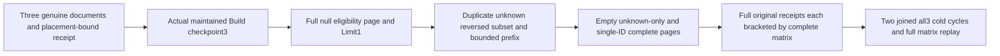

# Maintained native text output eligibility and bounded rank prefix

REQ-FTS-SELECTED-FILTER-001 refines canonical FilteredRetrieval REQ/AC-FILTER-001/003 and the F1 part of REQ/AC-FILTER-005, plus REQ/AC-FTS-002/004/005. AllowedIds is an output eligibility constraint, not a new lexical-statistics corpus. The actual maintained TextIndex selection ranks the authorized complete corpus, applies ordinal eligibility before branch ranks/fusion, and only then applies Limit. No scorer, provider, generation schema, query cursor or public protocol is added.

AC-FTS-SELECTED-FILTER-001 maps NativeTextSelectedFilterPublicTests.MaintainedAllowlistReindexesBoundedLiteralPrefixesAndRetainsOriginalReceiptsAcrossTwoColdCycles, one no-argument case. Genuine original Aspire ClusterFixture/admin SDK and official MCP publish a={"text":"needle"}, b={"text":"needle needle needle"}, c={"text":"needle needle"}, revision1 each. Actual official MCP Build consumer/generation1. Independently full RankedDocument pages are b,c,a scores1/61,1/62,1/63 with exact partition/collection/revision/JSON/redaction/empty omitted fields and null explanations. Limit1 is b only. Allowlist [a,c,unknown,a] yields c,a with RECOMPUTED ranks1/61,1/62; its Limit1 is c. Reversed input [c,a] yields the same full page. Only a yields a score1/61. Empty and unknown-only arrays yield independent complete empty arrays, not unknown-ID diagnostics. Every request is consumed through both real public clients and its complete public outbox baseline is preserved.

AC-FTS-SELECTED-FILTER-002: independently compare actual administrative SDK/official MCP placement BEFORE first document Commit. Bind full document receipt command/partition/incarnation/ownership epoch/positive position/quorum durability and complete three putDocument revision1 mutation records. The authentic first Build result has checkpoint3, tracked3, schema1/tail3/resource digest, initialized empty checkpoint mutations and placement-bound quorum token; authentic child ID is nonempty, never guessed. Full original document and Build receipts replay through EACH client; immediately after EACH replay repeat the entire filtered/unfiltered/full-prefix/empty matrix and complete current outbox. Stable maintenance result and original full checkpoint are exact, while all nine Source fields are independently verified against surrounding statuses.

AC-FTS-SELECTED-FILTER-003: original RunOwned caller scope closes before TWO actual all-three Kill/BeginRestart/Restart cycles. New caller repeats full receipt replay plus the complete independent matrix. Same node/incarnation and nondecreasing applied/read-generation are checked; all original deadlines, execution cancellation and ordered body/cleanup ledger remain. Public outbox equality is not a raw canonical/journal inventory or atomic multi-call no-effects proof. No silent fallback, unknown existence/count observation, internal row injection or new cached phase is allowed. Compiler/current UID/Linux RF3/adverse cleanup/runtime qualification remain OPEN.

Canonical Search slice: Cases/Models/Helpers/Assertions in IntegrationTests and this subdoc. Existing FilteredSearchRf3Tests uses unselected Text/Vector/Hybrid requests; NativeTextSelectedGenerationFlow/CallerFlow and NativeTextSelectedRf3Assertions do not supply AllowedIds, and prospective SelectedExplain exercises no filter/Limit. This bounded source inventory identifies the maintained-selection lifecycle seam, not a repository-wide coverage census. SearchCapturedExecution and FilteredSearchBranch already define the operation order; this is a missing whole-flow acceptance test, not an asserted product defect or an approximation/performance qualification.
