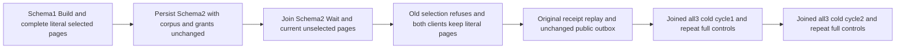

# Selected native text generation after a schema-only change

REQ-FTS-SELECTED-SCHEMA-PUBLIC-001 refines REQ/AC-FTS-002/004/005 and REQ/AC-FTS-INCREMENTAL-004/014: a maintained selection must validate the current canonical resource schema in the same authorized captured query view. A real persisted schema-only resource change cannot reuse a previously built generation even though document content, revisions and administrator grants remain unchanged. Search has no continuation cursor; this contract uses the existing TextIndexSelectionV1 consumer/generation only.

AC-FTS-SELECTED-SCHEMA-PUBLIC-001 maps NativeTextSelectedSchemaPublicTests.SchemaOnlyMutationFencesOriginalSelectionThenBothPublicClientsAndTwoColdOwnersKeepLiteralCurrentPages, one dedicated actual Aspire ClusterFixture RF3 case. A genuine administrator configures a collection, publishes two independently literal bilingual documents and retains its full original quorum receipt. The actual existing protected MaintainTextIndex Build creates generation1. Both SDK and official MCP selected searches return the complete independent pages including scope, revision, original JSON, redaction fields, score and null explanation. No test provider or direct canonical mutation is used.

AC-FTS-SELECTED-SCHEMA-PUBLIC-002: ConfigureResource persists SchemaVersion2 with all other resource fields unchanged. Both clients' SAME original selection must refuse HistoryUnavailable with canonical error envelopes, before partial output. Immediately after EACH refusal, BOTH clients return the same full independent unselected page. First join actual schema2 WaitForIndex and the legitimate unselected current pages, then observe full public OutboxStatus after the real schema commit and require it unchanged after refusals and original successful document-command replay. Replay the full original document receipt through each client and bracket each with current pages plus another strict old-selection refusal. This is a public state/outbox claim, not raw canonical/journal no-effects.

AC-FTS-SELECTED-SCHEMA-PUBLIC-003: close the actual caller owner before each original all-three Kill/BeginRestart/Restart joined cycle. Two genuine same-fixture cold cycles retain node/incarnation and nondecreasing applied/read-generation metadata. Fresh callers repeat exact schema2 WaitForIndex, complete independent current pages, old-selection refusal and full original receipt/outbox checks. No inherited session, one-node reopen or new deadline is called an RF3 cold cycle.

Existing NativeTextSelectedGenerationFlow covers document update/delete and principal Revoked; original public NativeTextMaintenanceRf3Flow covers mutation/Restore. Neither inspected whole flow performs a schema-only ConfigureResource after Build. NativeTextSelectedSourceAdmission invokes fresh NativeTextIncrementalSourceValidation.Authority, which explicitly compares SchemaVersion and ResourceSha256. No product defect or repair is claimed. A fresh incompatible-generation Build/Restore lifecycle is intentionally NOT assumed: its separate native maintenance admission remains an OPEN gate. This case proves old-generation refusal and legitimate current unselected operation; it does not qualify a new maintained generation after schema change.

Canonical slice: IntegrationTests Features/Search Cases, Models, Helpers and Assertions; this Search subdoc owns the new scope. Existing ClusterFixture, SDK, official MCP, native maintenance and joined restart helpers are borrowed unchanged. Source N, compiler, actual UID/census, Linux RF3/runtime, cancellation and adverse cleanup remain OPEN. No new provider, scorer, serializer, persistence, public contract, clock, quota or scheduler is introduced.

The original McpCallerDeadline is linked to the actual TUnit execution cancellation. Its lexical CTS/deadline disposal is observed outside the initiating body ledger, retaining body plus cleanup failures; every nested RunOwned caller closes before restart.

