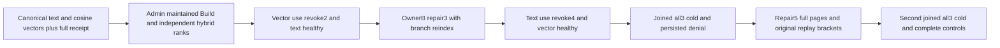

# Maintained text and exact vector composition through current authority

REQ-FTS-VECTOR-FUSION-001 refines canonical Search REQ/AC-SEARCH-001/002/003/004, NativeFullTextProjection REQ/AC-FTS-002/004/005 and GlobalBranchWindows REQ/AC-RANK-004. The same authorized captured SearchRequest combines its actual selected ZoneTree.FullTextSearch generation with the existing exact SIMD vector branch before original reciprocal-rank fusion. This is a same-partition single-window acceptance flow, not distributed/global-snapshot qualification. Native canonical vectors remain unchanged. No provider/scorer/library/API/format change.

AC-FTS-VECTOR-FUSION-001 maps NativeTextVectorFusionR40Tests.MaintainedTextAndExactVectorRanksUseFreshBranchAuthorityAcrossRepairReplayAndTwoColdCycles, one no-argument case. Three original canonical documents a/b/c and cosine vectors [1,0]/[0.8,0.6]/[0,1] use NativeTextClusterScenario's original corpus. Actual administrator Build binds its complete native source and checkpoint. The independent needle hybrid page is a=2/61,b=2/62,c=1/63; plain is b=1/61+1/62,a=1/61,c=1/63. Full generated RankedDocument arrays include reference/revision/JSON/redaction/omitted fields and explicit typed Text/Vector contribution ranks; Explain false preserves full pages with null explanation. Native cosine metric order is independently a>b>c; the public fused score is RRF, not the cosine metric value.

REQ-FTS-VECTOR-FUSION-002 / AC-FTS-VECTOR-FUSION-002 retain a persisted reader's Query/DocumentsRead/VectorSearch and separate protected text/vector field-use grants. Reader retains existing pii.read and native-text.secret.read in every phase, so independent complete original JSON is authorized and unchanged, with Redacted=false and empty omitted fields. This task tests field-use separately from raw-read permission; it makes no raw-read/redaction revocation claim. Epoch2 removes vector-use only: standalone vector also refuses, and selected hybrid PermissionDenied while selected text-only remains literally healthy. Epoch3 restores both and restricts rows to OwnerB: b/c only with recomputed vector ranks1/2 and b text rank1. Epoch4 removes text-use only: standalone selected text also refuses, and hybrid/text refuse while exact vector-only b/c stays literally healthy. Epoch5 restores original unrestricted authority. Every SDK and dispatched official MCP response is separately bracketed by full administrator literal pages and full public outbox. Builder administrator policy, source documents/vectors, schema and generation stay unchanged; no Restore or fallback is inferred from reader changes.

REQ-FTS-VECTOR-FUSION-003 / AC-FTS-VECTOR-FUSION-003 independently read complete admin SDK/MCP partition identity before publication. Bind complete original command mutation receipts and token incarnation/partition/configured persisted copies to that tuple. Retain Build stable result/checkpoint and independently validate its fresh nine-field source metadata. After EACH original SDK or MCP command/maintenance replay, compare full current reader/admin pages and outbox; the reader's current policy never restamps administrator receipts.

REQ-FTS-VECTOR-FUSION-004 / AC-FTS-VECTOR-FUSION-004 join existing RunOwned callers before TWO genuine all-three Kill/BeginRestart/Restart cycles: first while epoch4 denial is persisted, then after epoch5 repair. Reconnect original credentials, recheck all refusal/healthy matrices and original full receipts. Public outbox equality is not a raw canonical/journal inventory or atomic cross-client no-effects claim.

Canonical slice: new IntegrationTests Search Cases/Models/Helpers/Assertions and docs/Features/Search/NativeTextVectorFusionPublic.md. Frontend/product/SDK/provider changes N/A: existing actual APIs only.

After each individual reader result/refusal, the administrator control is one complete independently literal unrestricted hybrid `needle` page with Explain=true through BOTH SDK and official MCP, each followed by the full original outbox. The exhaustive three-term/two-Explain administrator matrix runs once per stage; the complete reader matrix remains unchanged. This avoids repeated identical administrator matrices without changing branch authority, rank, metadata, receipt, lifecycle or deadline criteria.
