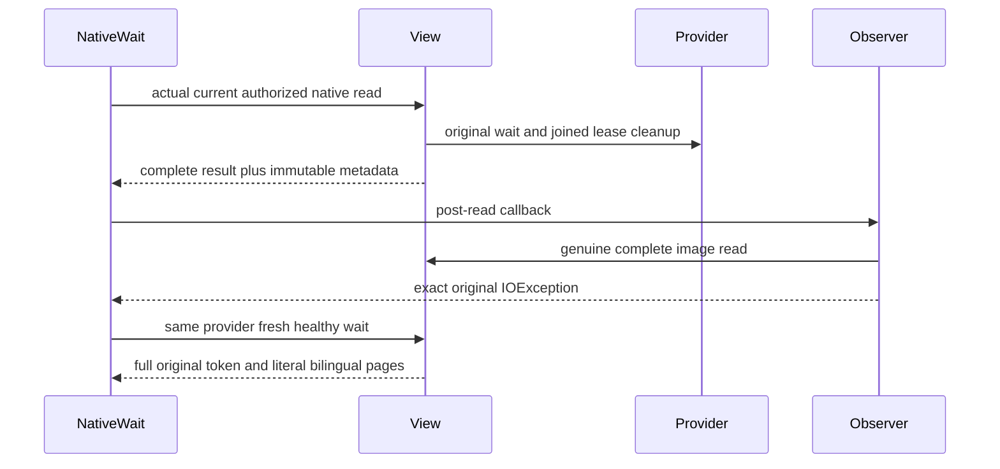

# Native text wait observer failure regression

Source-only supplement to Search REQ-FTS-CUT-PROBE-001/002 and Query read-cut observation. The unchanged real native wait validates persisted principal, Query/DocumentsRead, FieldUse, actual commit token and provider before capture; provider cleanup occurs inside the owning native view and callback publication occurs after read exit. This note adds no product observer, trusted role, serializer, context, routing or transport substitute.

REQ-FTS-OBSERVER-FAIL-001 maps to AC-FTS-OBSERVER-FAIL-001: the genuine post-gate callback first reads the complete original canonical image through the selected NativeTextWaitObservationObserver (actual native Scan with original 4096-row bound and explicit HasMore failure), then throws one exact owned IOException. The awaited native wait must expose that same exception reference; the complete canonical rows and position must remain unchanged. The same original provider and fixture then perform a fresh ordinary healthy wait with the full original receipt token and independent literal schema/policy 1, and return exact Ukrainian and English pages, JSON/revision/reference/score. No successful result is fabricated from the failed wait.

AC-FTS-OBSERVER-FAIL-001 maps to NativeTextWaitThrowingObservationTests.ActualPostReadObserverFailureRetainsIdentityAndCompleteImageThenSameProviderRemainsHealthy. Actual original NativeTextWaitSeed commits its genuine Batch through native log/materializer; NativeTextBilingualAudit owns the same real projection. The optional test observer decorates the existing bounded full-image capture, not the storage/provider/transport. Original FTS41 three cases remain unchanged.

Canonical Search map: observer role tests/KeyLoad.UnitTests/Features/Search/Helpers/NativeTextWaitThrowingObservationObserver.cs; complete operation/cleanup role Helpers/NativeTextWaitThrowingObservationTrial.cs; case role Cases/NativeTextWaitThrowingObservationTests.cs. Core/projection/query owners remain the unchanged original fixtures and coherent FTS41. Backend and public contracts have no additional change; frontend, benchmark and deployment are N/A for this test supplement.

Original token/cancellation and complete fixture/projection disposal are observed with the actual ServerFailureObserver ordered ledger, preserving body and cleanup exceptions and joining original resources. A following successful wait exercises the same provider after the production-owned lease disposal; this is not an independently instrumented disposal-fault proof. Native kernel source coverage is separate from elected leader/RF3, cold/process, real public SDK/official MCP, power-loss and performance qualification. Compiler/analyzer/native TUnit and every runtime gate remain OPEN. Rollback removes only this additive supplement.

